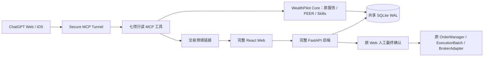

# WealthPilot 4.0

B2 历史成交/收益归因已合入 main：新增只读 `get_trade_history`，复用原 Portfolio/U1/PEER，当前账面收益与历史收益分开。来源、覆盖、成本法及显式迁移见 [B2 实现说明](docs/B2_IMPLEMENTATION.md)；真实补源/生产完整性须以独立验收为准，本轮不调查生产。

私人财富管理与投资决策工作台：**ChatGPT 对话入口 + 七项只读 MCP 工具 + 原 WealthPilot 专业分析 Core + 完整 React Web**。

4.0 第一阶段五大核心场景已完成开发、Mac Mini 生产部署及 ChatGPT Web/iOS 实际验收，用户于 2026-10-16 确认正式收口。原 PEER 四 Agent、13 个内部 Skills、专业 LLM、规则/信号引擎及回答模板均保留；ChatGPT 调用原专业结果，负责交互、解释和最终呈现。

## 五大 ChatGPT 场景

| 场景 | 当前能力与工具 | 状态 / 边界 |
|---|---|---|
| P1 资产负债查询 | `get_wealth_overview`、`get_manual_wealth_items`、`get_investment_details`：总览、手工资产/负债、账户及持仓明细 | DONE，Web/iOS 实测 |
| P2 明确交易指令 | `prepare_trade_confirmation_link`：个人 Pro 中生成预填链接，原 Web 展示、人工确认后走原交易链路 | DONE，MacBook/iPhone 预填已验收；新入口首次真实提交/成交未验收 |
| P3 单标决策 | `analyze_position`：原 PositionDecision、持仓/新建仓路径、规则/信号/研究与 PEER 专业报告 | DONE，Web/iOS 实测 |
| P4 组合评估 | `review_portfolio`：原 PortfolioReview / AssetAllocation、配置快照、目标偏离与集中度 | DONE，Web/iOS 实测 |
| P5 收益分析 | `analyze_performance`：原 PerformanceAnalysis、持仓账面盈亏与贡献结构 | DONE，Web/iOS 实测；不含完整历史收益归因 |

七工具均为生产只读工具。P2 只校验参数和生成 URL，不在 MCP 创建草稿或委托；原 ActionDraft、SymbolStrategy、OrderManager、BrokerAdapter、风控和人工确认全部保留。IB01 含费用总预算入口先显示 ActionDraftCard 简洁参数编辑，点击“加入投资行动”后核对报价/费用，通过后主动进入 ConfirmOrderDialog；打开链接不自动取报价或落库。底层保留原 IBKR Typed Intent / ExecutionBatch / SMART；改价需重新取行情、计算 WhatIf 并重新确认，不走普通美股/Tiger 路径。当前使用个人 Pro，不使用 Business/Edu，不部署独立 Mock ChatGPT 应用。

IBKR 合约、行情和 WhatIf 权限分别验收。挂单资金检查使用新鲜的只读账户快照；Gateway 只读模式拒绝 WhatIf 时保留 DRAFT，费用和最终确认不能标为通过，也不会自动开启实盘。

同一 IB01 链接重新报价或刷新页面后，确认入口会更新未提交的过期批次并撤销旧确认版本；新鲜的相同重试复用当前批次。行情仍须在原 30 秒 TTL 内，金额、费用或报价变化须重新核对，最终下单仍由用户在 Web 主动授权。

IBKR 资金校验使用新鲜的逐币种 CashBalance（兼容 Gateway `$LEDGER-` 前缀），不把账户折算现金、保证金可用资金或购买力视为可支出 USD。账户现金通过原持仓同步按账户/币种持久化；BASE 汇总不重复计入。已成交请求重新打开显示原订单结果，不重新准备同额买单。

## 当前架构与环境



ChatGPT 提供自然语言交互、上下文及回答组织；Core 内的 Planning、Executing、Expressing、Reviewing 继续生成和校验原专业结论，ChatGPT 再组织呈现。Web 保留财富/投资可视化、消费、投研、决策与交易确认等原有功能。业务计算、风控和券商权威状态继续由原服务负责。

**MacBook = Dev，Mac Mini = Prod。** Mini 运行完整 Web、完整 FastAPI、MCP/Tunnel、生产数据库及原有业务服务，使用 macOS 原生环境和 launchd。私人 Web 通过 Tailscale Serve HTTPS / 原生 SSH 转发访问；Web 和后端保留 loopback 监听，不开放无认证公网接口。浏览器代理与各网络的可达性需分别验证。

发布路线：最新 main → 独立分支 → PR / 四项 CI → 经授权合入 main → Mini 拉取确认的完整 SHA → 预检 / 切换 / 验收。各组件独立固定版本，发布文档不会自动部署或改动数据库。代码、配置、数据、备份、日志及凭证分离；离线包仅应急。

版本观察：本次文档整理基于 main `8b648db4cf7c714cd43eef0d4e437f22d061eae6`（含 P3/P4/P5 后的 PR #10 IB01 修复）；2026-10-16 的 Mini 只读核对显示 MCP/Core/Web 启动入口引用同一业务版本。环境与历史资产仍可能固定其他 SHA，不能用全局 current 代替组件版本。详情见 [版本观察表](docs/PROJECT_GOVERNANCE.md#4-版本tag-与发布)。历史最新 SemVer Tag 为 `v3.15.1`；尚未创建 `v4.0.0`，本次收口不自动创建 Tag/Release。前端 package / FastAPI 包版本不是产品版本。

## 已知限制与后续迭代

- 部分数据仍为 PARTIAL：日期未知/过期、研究来源未验证、原则检索不可用或演示 fallback；`synthetic=false` 不证明所有底层证据实时可信，不直接作为实时交易信号。
- P2 新入口首次真实订单提交及成交未验收；历史其他入口的实盘记录不能替代该项。
- P5 仅当前持仓账面盈亏，未覆盖历史已实现交易、TWR/MWR 或决策因果归因。投资持仓、已分类配置快照与完整个人财富分母须区分；默认目标/画像不是已核实个人设定。
- 部分券商 Gateway / 数据源尚未配置或可用，单项同步、常驻恢复及跨网事项有实际证据才标 PASS。
- 历史 PoC02 凭证展示事故保持 FAIL，后续撤销后的权限检查独立记录。以上不阻塞 4.0 功能范围收口，后续优化进入新版本。

U1/U2 与国金原生来源已合入，用户已确认生产启用。原受控 prepare/固定资产视图见 [U1](docs/U1_IMPLEMENTATION.md)，成交同步及只读交易状态见 [U2](docs/U2_IMPLEMENTATION.md)。D1 当前资产质量收尾已合入：复用原发行主体、分类、手工财富及固定视图质量合同，详见 [D1 实现与验收边界](docs/D1_IMPLEMENTATION.md)；本轮不部署或修改生产数据。

开发入口：[AGENTS.md](AGENTS.md)、[当前架构](docs/ARCHITECTURE_CURRENT.md)、[治理与发布](docs/PROJECT_GOVERNANCE.md)、[已有能力索引](docs/CAPABILITY_REGISTRY.md)、[隔离开发/检查](docs/dev_setup.md)。PoC/Batch 报告保留当轮事实，作为历史部署/回滚证据，不再覆盖当前产品基线。

## 项目简介

个人投资者在真实投资过程中，普遍面临一个核心问题：**信息、认知与执行是割裂的。** 持仓分散在多个平台看不清全貌，投研信息很多却难以直接作用于具体持仓，明知投资纪律却在关键时刻难以执行。

WealthPilot 围绕这一问题，构建了一个完整的投资决策闭环：以统一持仓视图作为决策上下文，通过 AI 对话将用户问题转化为结构化的决策过程，并以规则引擎持续约束投资行为。与一般投资问答工具不同，它不是脱离用户资产状态给出泛泛建议，而是把投资问题转化为一个有上下文、有约束、有完整推理链路的辅助决策过程。

## 设计理念

WealthPilot 不是一个"直接给结论"的投资问答工具，而是强调三个核心原则：

- **基于真实持仓**：所有决策建立在用户当前资产状态之上，而不是脱离持仓的泛泛建议
- **过程可解释**：完整展示从意图识别到最终结论的决策链路，而不是黑盒输出
- **受纪律约束**：通过规则引擎在决策链路中前置校验投资纪律

本质上，它是一个 **LLM 负责推理、持仓状态提供上下文、投资规则提供约束** 的决策系统。

## 运行模式

WealthPilot 维护两种明确隔离的本地运行模式：

- **Public Demo**：使用临时 SQLite 数据库和固定 Seed；`PUBLIC_DEMO_MODE=true`、`BROKER_MODE=mock`，默认禁止真实行情、LLM 与券商连接，且交易入口由总闸门拦截。
- **Self-use / Private Full Mode**：使用用户本地数据库与 ignored 环境配置，可按需启用真实 LLM、行情和券商只读能力；任何真实交易能力都必须单独、显式放行。

两种模式不得共用数据库或凭证配置。IBKR 的稳定验收基线保持 Gateway Read-Only API、`IBKR_READ_ONLY_MODE=true` 与 `ENABLE_IBKR_LIVE_TRADING=false` 三重护栏；读取账户、持仓和已有订单不等于授权下单。

## 核心功能

以投资决策为核心，围绕"看清持仓、做出决策、执行纪律"构建完整闭环：

| 模块        | 解决的问题                                               | 状态     |
| --------- | --------------------------------------------------- | ------ |
| 财富总览 | 原投资汇总与手工资产/负债的核心净资产口径、结构展示和刷新一致性；养老金金额级去重边界保留 | 已实现，见 WealthOverview / wealth_service |
| 消费分析 | 本地账单导入、经济事件/分类/重复来源处理及明细分析；数据源有各自覆盖边界 | 已实现，见 Consumption / consumption services |
| 技术形态证据 | canonical TA-Lib 指标、形态事实及证据治理；不等于自动生成交易数值或交易授权 | 部分实现，见 technical_patterns / pattern_data |
| 投资决策      | 针对具体持仓给出有依据的买卖建议，而不是泛泛的市场观点；支持多轮追问、宏观问题分析、多标横向对比    | ✅ v3.0 |
| 投资行动      | 决策 → 分批执行计划 → 盘中触发评估 → 人工确认下单（老虎 / 盈透 IBKR）；规则引擎确定性产出价格与数量，AI 只写解释 | ✅ v3.11 |
| 投资账户总览    | 持仓分散在多个券商看不清全貌；支持老虎 / 富途 / 盈透 / 国金持仓自动同步，统一展示资产分布与盈亏     | ✅ v3.0 |
| 投研观点      | 长期价值判断入库沉淀，短期信号决策时取用即弃；在决策时直接调取对应标的的研究观点，支持美股 / 港股 / A 股 | ✅ v3.12 |
| 资产配置      | 不知道自己的资产结构是否合理；基于五大资产类别给出配置方案，并校验是否符合自己的投资纪律        | ✅ v2.3 |
| 投资纪律      | 明知纪律却在关键时刻难以执行；将个人投资规则写入系统，每次决策时自动前置校验              | ✅ v2.0 |
| 用户画像与投资目标 | 系统需要理解你的风险偏好和目标，才能给出匹配的建议；支持问卷填写和截图解析两种方式           | ✅ v2.1 |

## 技术栈

### 前端

- **React 19** + **Vite 8** + **TypeScript**
- **Tailwind CSS v4**
- **React Router v7**（客户端路由）
- **Zustand v5**（状态管理）
- **Recharts**（资产分布图表）
- **ReactMarkdown** + remark-gfm（AI 对话渲染）
- **Lucide React**（图标）

### 后端

- **Python 3.11**
- **FastAPI** + **uvicorn**（RESTful API + SSE 流式接口）
- **SQLAlchemy 2.0**（ORM，SQLite）
- **Pydantic v2**（数据契约与字段校验）
- **OpenAI ≥ 1.20**（LLM 调用）
- **LangGraph**（保留图/工具层依赖；当前决策主路径为 PEER service）
- **LangChain**（Text Splitter 文档切片）
- **ChromaDB**（向量库，支持知识库 RAG 语义检索）
- **AKShare**（港股 / A 股行情数据）
- **Alpha Vantage API**（美股基本面 / 新闻 / 财报数据）
- **Tiger OpenAPI SDK / Futu OpenD / 盈透 API / 国金 QMT API**（券商持仓同步）
- **ib_async**（IBKR 受合约身份、路由和人工授权护栏约束；包含已验证的 LSE USD 上市身份 / SMART 执行路径）

## 架构说明

### 系统架构图



该图是历史说明；当前 4.0 生产调用边界以 [ARCHITECTURE_CURRENT.md](docs/ARCHITECTURE_CURRENT.md) 为准。

详细分层、PEER / 内部 Skills、数据权威和交易边界统一维护在[当前架构](docs/ARCHITECTURE_CURRENT.md)，服务、接口及测试入口见[能力索引](docs/CAPABILITY_REGISTRY.md)。README 保留产品与上手说明，避免重复维护架构及模型清单；模型和 Provider 配置以代码与任务环境为准。

## 目录结构

```
WealthPilot/
├── frontend/                        # React SPA
│   ├── src/
│   │   ├── pages/
│   │   │   ├── Dashboard.tsx        # 投资账户总览
│   │   │   ├── WealthOverview.tsx   # 财富核心净资产口径
│   │   │   ├── Consumption.tsx      # 消费账单与经济事件分析
│   │   │   ├── Discipline.tsx       # 投资纪律
│   │   │   ├── Research.tsx         # 投研观点
│   │   │   ├── Decision.tsx         # 投资决策（SSE + ExplainPanel）
│   │   │   ├── Action.tsx           # 投资行动（行动清单 + 行动记录）
│   │   │   └── UserProfile.tsx      # 用户画像
│   │   ├── components/
│   │   │   └── layout/              # AppLayout, Sidebar
│   │   ├── lib/
│   │   │   ├── api.ts               # 所有 API 调用封装（含 SSE streamDecisionChat）
│   │   │   └── fmt.ts               # 数字/货币格式化工具
│   │   └── store/
│   │       └── decisionStore.ts     # 决策页面状态管理
│   ├── package.json
│   └── vite.config.ts               # Vite proxy → :8000
│
├── backend/                         # FastAPI 服务层
│   ├── main.py                      # 完整业务入口，路由及原 lifespan
│   ├── api/
│   │   ├── portfolio.py             # 持仓/负债/告警/导入接口
│   │   ├── discipline.py            # 纪律规则/手册/评估接口
│   │   ├── research.py              # 观点/文档/卡片接口
│   │   └── decision.py              # SSE 对话/Explain/会话接口
│   ├── agents/                      # PEER Multi-Agent（v3.0 新增）
│   │   ├── planning_agent.py        # 意图识别 + LLM Skill Selector
│   │   ├── executing_agent.py       # 数据执行层
│   │   ├── expressing_agent.py      # LLM 推理 + SSE 流式输出
│   │   ├── reviewing_agent.py       # 双层质量校验
│   │   ├── contracts.py             # Agent 间数据契约（结构化任务与结果）
│   │   └── adapters.py              # v2/v3 适配层
│   ├── services/
│   │   ├── decision_service.py      # 唯一 PEER 决策入口；无 v2/v3 切换 flag
│   │   ├── decision_service_v3.py   # v3 Multi-Agent 编排
│   │   └── broker_sync/             # 券商持仓同步子系统（v3.0 新增）
│   │       ├── tiger_adapter.py     # 老虎证券适配器
│   │       ├── futu_adapter.py      # 富途证券适配器
│   │       └── sync_service.py      # cron 调度 + 时序写入
│   └── knowledge/                   # 知识索引/检索服务；源文件在根 knowledge_base/
│
├── decision_engine/                 # 投资决策引擎（v2/v3 共用）
│   ├── data_loader.py               # 持仓 + 投研数据加载（LLM 语义匹配）
│   ├── llm_engine.py                # LLM 决策生成（7 档结论 + confidence）
│   ├── rule_engine.py               # 规则前置检查
│   ├── signal_engine.py             # 4 维度信号生成
│   ├── pre_check.py                 # 决策前置校验
│   ├── decision_flow.py             # 决策流程编排
│   └── types.py
│
├── intent_engine/                   # 意图识别引擎
├── app/                             # 核心业务逻辑
│   ├── models.py                    # SQLAlchemy ORM 模型
│   ├── database.py                  # 数据库基础设施
│   ├── analyzer.py                  # 持仓分析引擎
│   └── discipline/                  # 纪律子模块
│
├── skills/                          # 13 个内部 Skill（原子、组合与旁路）
│
├── knowledge_base/                  # 私有知识库（Markdown 真相源）
│
├── pocs/                            # 含当前生产 MCP / worker 与原生部署工具，保留历史目录名
├── docs/                            # 当前治理/架构/执行说明和历史验收文档
│   └── architecture-v3.svg          # v3.0 系统架构图
├── tests/                           # 单元测试（含 18 回归用例）
├── requirements.txt
└── .env.example
```

## MacBook 本地开发快速开始

### 1. 安装依赖

```bash
# Python 依赖
pip install -r requirements.txt

# 前端依赖
cd frontend && npm install
```

### 2. 配置 API Key

```bash
cp .env.example .env
# 编辑 .env，填入：
#   WEALTHPILOT_OPENAI_API_KEY        — GPT-4.1 系列（核心 LLM）
#   TIGER_ID              — 老虎证券持仓同步（可选）
#   TIGER_PRIVATE_KEY_PATH — 老虎证券私钥路径（可选）
#   FUTU_HOST / FUTU_PORT — 富途 OpenD 连接配置（可选）
#   SNOWBALL_ACCOUNT      — 盈透证券持仓同步（可选）
#   IBKR_ACCOUNT / IBKR_PORT — 盈透 IBKR 下单配置（可选）
#   BROKER_MODE           — 下单券商切换（mock / tiger / ibkr）
source .env
```

隔离 Demo 使用 `PUBLIC_DEMO_MODE=true`、`DEMO_ALLOW_MARKET_DATA=false` 和
`BROKER_MODE=mock`，并通过 `WEALTHPILOT_DB_PATH` 指向临时数据库。Demo 必须设置
`DEMO_ACCESS_PASSWORD`；无需知识检索或输出校验 Skill 时，可将
`WP_USE_SKILL_RETRIEVE_PRINCIPLES` 和 `WP_USE_SKILL_OUTPUT_VALIDATOR` 设为 `false`。

v3.14 的 Execution Plan 在隔离 Demo 中使用提交的静态 OHLCV fixture 计算技术因子；
它不会连接实时行情、LLM、券商或交易接口。

### 3. 启动开发应用

```bash
# 终端 1：启动后端
uvicorn backend.main:app --reload --port 8000 --host 127.0.0.1

# 终端 2：启动前端
cd frontend && npm run dev
```

浏览器访问 **http://localhost:5173**。以上为 Dev 命令，不用于替换现有 Mini 启动配置。完整 `backend.main` 的非 Demo lifespan 包含原同步/调度、孤儿扫描、OrderPoller 与触发评估；启动前核对本地数据库、券商模式和授权。生产使用已验收的原 launchd 入口、固定 SHA 与独立运行配置；不复制整份 Dev `.env`。

Mini 已运行完整 Web/Core 与独立 MCP/Tunnel。生产维护沿用现有四个 launchd label、各组件固定 SHA 和代码外配置；不以 Dev 命令覆盖生产包装器，也不为文档收口启停任务或重新迁移数据。

### 4. 运行测试

```bash
python scripts/check_engineering_docs.py
python scripts/m5_e2e_18_cases.py --mode offline
```

全量测试请使用[隔离环境说明](docs/dev_setup.md)，不要让 pytest 隐式读取个人 .env 或数据库。

## 版本历史

- **v4.0 功能范围收口**（2026-10-16）：五大 ChatGPT 场景、七只读 MCP 工具、完整原 Core/Web 与 Mini 生产部署；Tag 尚未创建。

详见 [CHANGELOG.md](CHANGELOG.md)。

**近期主要版本：**

- **v3.15.1**（2026-08-18）：建立 canonical asset classification，分离 Broker security type、vehicle type 与 economic asset class，修复债券 ETF 被误归为权益的问题
- **v3.15.0**（2026-08-18）：Typed Trade Intent、多标的 ExecutionBatch、LSE USD Acc 合约身份校验、IBKR SMART 路由、WhatIf 与人工确认实盘执行闭环
- **v3.14.0**（2026-08-13）：K 线 Provider 解耦与降级链路、隔离 Demo 固定 Seed、Execution Plan 持久化、Self-use Full Mode 复原，以及 IBKR dedicated-loop 只读读取链路验收
- **v3.12**（2026-06-10）：投研观点模块收敛 — 长期价值判断入库沉淀 · 短期信号决策时取用即弃不再写库 · 前端收敛为两 tab
- **v3.11**（2026-06-10）：执行计划引擎 — 决策 → 规则引擎分批计划 → 盘中触发评估 → 人工确认下单 · Step C 对话调整 · Step E 观望主动发起 · 公开演示模式（PUBLIC_DEMO_MODE）
- **v3.10**（2026-06-10）：盈透证券 IBKR 接入 — 美股+港股 LIMIT 单 · 四闸门风控 · permId 收口 · paper/live 真连验证封板
- **v3.9**（2026-06-05）：国金证券 QMT A 股网关 — 主动拉取（pull-mode）同步持仓 · 22:00 定时任务 · 前端接通
- **v3.8**（2026-06-04）：Skills 生产接通 — C0/C1/C2 三个 Skill 双轨+flag 默认开启 · Skill 对账层（reconcile + manifest + phase map）
- **v3.7**（2026-05-19）：知识层清理与契约可观测性 — 删死代码 Skill · 修 _SKILL_BUNDLES_BY_ROUTE 漂移 · 显性化日志
- **v3.6**（2026-05-13）：私有知识库与 RAG 语义检索 — knowledge_base/ Markdown 知识仓库（投研观点 / 投资纪律 / 投资理念 / 配置原则）· Chroma 向量库 + OpenAI Embedding · wp-retrieve-principles Skill · 时效衰减打分 · File-as-Source-of-Truth 架构 · 引用来源标注
- **v3.5**（2026-05-12）：多会话管理与长对话记忆压缩 — ChatGPT 式多会话切换 · 消息持久化 · 短期窗口+中期摘要两层架构 · 投资场景定制摘要 · 全局时区修复
- **v3.4**（2026-05-12）：真实券商下单 — Tiger 老虎证券 LIMIT 单（美股+港股）· Symbol 标准化 · 美股新建仓评估 · paper / market 安全闸门 · 实盘验证通过
- **v3.3**（2026-05-12）：模块层架构收敛 — 资产配置融合到投资决策入口 · 组合级意图路由守门 · 自有资产配置理念注入
- **v3.2**（2026-05-11）：投资行动模块完整实现 — wp-action-planner Skill · BrokerAdapter 协议 · 风控引擎 · 全流程审计 · v2.6 SSE 代码清理 · PEER Agents 成为唯一决策路径
- **v3.1**（2026-05-09）：投资决策 AI 能力升级 — 富途实时行情 · AV 财报/分析师 · 老虎 K 线技术指标 · 资金流向五档信号 · 六段式深度分析框架 · 场景化模板 · 压力测试预计算 · 追问守门双保险
- **v3.0**（2026-05-05）：Multi-Agent 架构 — PEER 四 Agent · 12 个 Skills 协议 · LLM Skill Selector · 宏观分析增强 · 多标横向对比 · 券商持仓直连同步
- **v2.5**（2026-04-28）：投研观点模块 v2 — 三层架构 · 多数据源 · A 股支持 · 跨市场合并优化
- **v2.4**（2026-04-10）：决策对话策略优化 Phase 2 — 多轮持久化 · 智能标的澄清 · 7 档结论
- **v2.3**（2026-04-06）：资产配置模块 V1 — 五大类配置管理 · AI 对话 · 纪律校验
- **v2.0–v2.2**（2026-04-04 起）：全栈重写为 React+FastAPI，四核心模块完整落地，逐步完成用户画像重构与决策 I/O Contract 改造

## License

本项目基于 Apache License 2.0 开源，详见 [LICENSE](LICENSE) 文件。

B3交易体验/产品查询为当前PR候选：原批次恢复、最终确认及U2状态呈现，账户权限缺证据保持UNKNOWN。无Schema迁移，详见[实现与验收合同](docs/B3_IMPLEMENTATION.md)。
