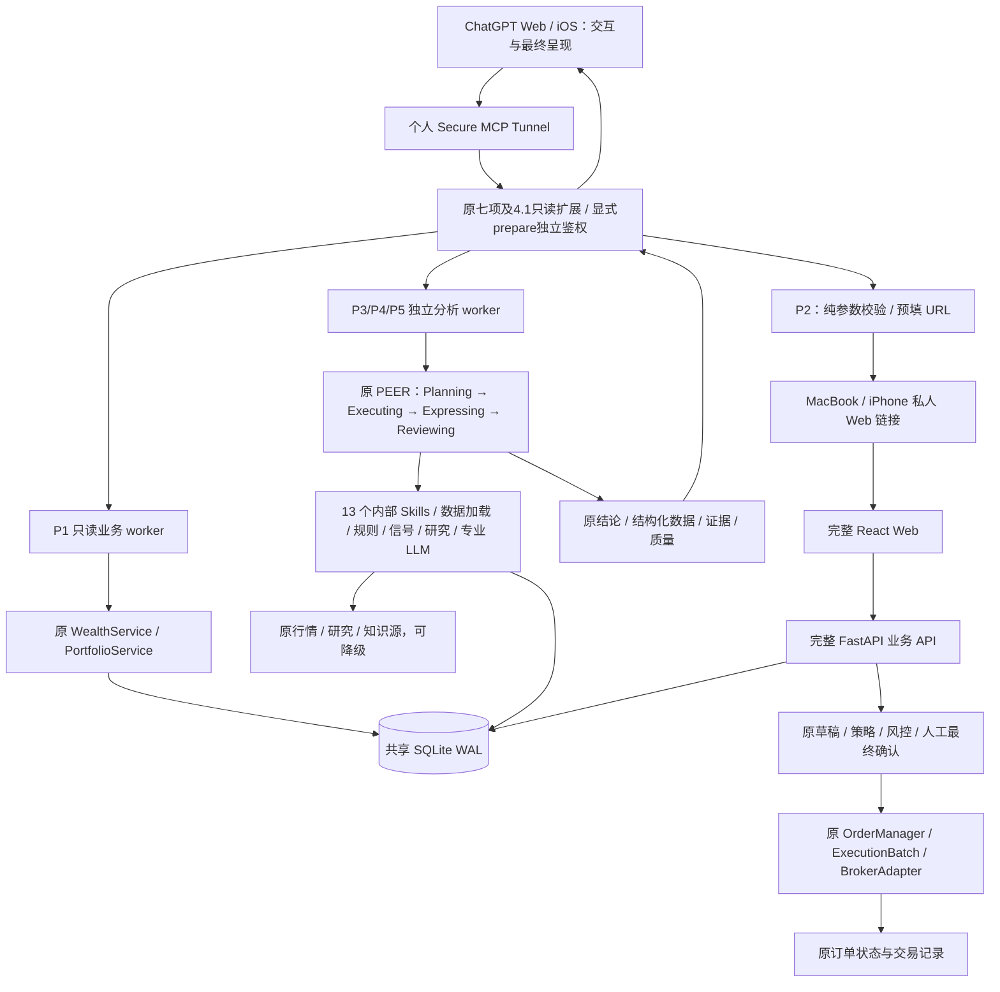

# WealthPilot 当前系统架构

> 2026-10-23：用户报告4.2已部署 `b6b5a17bb589b8e82d1d655880c45f0675cef984`，三标首轮真实投研未通过。本轮仅代码修复，不重新核验或操作生产。以下4.1记录保留为历史证据。

> 2026-10-22：4.1 **RELEASED — 已完成生产交付**。验收生产代码固定`e0df7211f462f07ec0147f40e84f65321d0f6b50`；本次仅文档收口，不变更生产。模块/PR、受控生产Run及持续观察见[4.1结项](releases/v4.1.md)。各批历史开发基线保留在原实现文档，不作为当前发布状态。

本文维护当前架构、模块/数据权威关系；详细开发与发布流程统一见[治理文档](PROJECT_GOVERNANCE.md#8-文档权威与仓库卫生)。实现文档与代码/运行证据冲突时必须报告并修正，未核实项保留 UNKNOWN。任务从 [AGENTS](../AGENTS.md) 进入，复用入口/测试见[能力索引](CAPABILITY_REGISTRY.md)。现有专项设计保留其职责，不新增第二份 ARCHITECTURE.md。

## 1. 产品与组件职责

| 组件 | 当前职责 / 入口 |
|---|---|
| ChatGPT Web / iOS | 个人 Pro 的自然语言交互、相关上下文、工具选择、追问、原专业结果的最终组织与呈现。 |
| Secure MCP Tunnel | 现有个人范围连接，把 ChatGPT 接到 Mini 上的 Streamable HTTP MCP；不是业务计算或交易引擎。 |
| 生产 MCP | `pocs/chatgpt_skills/server.py`；原七项加U2/B2/B3只读扩展，经原worker/业务owner；可选显式prepare独立鉴权，经受保护loopback调原同步（第13节）。原读取工具不获得隐式写权限；目录名pocs保留，不表示试验部署。 |
| WealthPilot Core | 完整 `backend/main.py` / `backend/api/` / `backend/services/`、PEER 四 Agent、13 个内部 Skills、数据源、规则/信号、专业 LLM 与报告模板。 |
| 完整 React Web | `frontend/src/App.tsx` 的 HashRouter，财富、投资账户、消费、投研、决策、投资行动等原页面与可视化；最终人工交易确认。 |
| 数据与知识 | `app/database.py`、`app/models.py`、`app/shared_sqlite.py` 与各业务模型；共享 SQLite WAL。根 `knowledge_base/` Markdown 为知识真相源，Chroma 为可重建索引。 |
| Mac Mini Prod | 原生 ARM Python / Node、launchd、完整 Web/后端、MCP/Tunnel、生产数据库及原业务服务。数据、配置、凭证、日志和备份位于代码外。 |
| MacBook Dev / GitHub | 本地开发与隔离测试 → 短期分支 / PR / 四项 CI → 经授权集成 → Mini 安装确认的完整 SHA，不在生产直接改业务代码。 |

P1–P5 均 DONE：资产负债查询、明确交易预填链接、单标决策、组合评估、当前持仓收益分析。Web/iOS 读取与分析、MacBook/iPhone 交易预填均已实际验收；P2 新入口首次真实券商提交/成交仍未验收。P5 完成的是现有持仓账面盈亏能力，不包含完整历史收益归因。

## 2. 生产调用关系

ChatGPT 消费原专业结论后再次组织、解释和回答。它没有替代 Expressing 或原专业决策引擎。MCP 分析入口执行一次原专业链路，不复制另一套计算或模型分析；多轮相关历史由 ChatGPT 传入。ChatGPT 自身可能重复调用工具，不能把重复请求误称为同一工具内部只执行一次的保证。

## 3. 七个生产工具

本表保留4.0原七项合同；4.1另有只读`get_trade_and_sync_status`、`get_trade_history`、`get_instrument_tradability`，分别见第14节、B2/B3节及[原server](../pocs/chatgpt_skills/server.py)。可选prepare独立鉴权、允许本地同步写入，原七项读取边界不变，不能把新增工具或工具数当成账户权限证据。

| 工具 | 原业务复用与返回 | 访问边界 |
|---|---|---|
| `get_wealth_overview` | WealthService / PortfolioService：资产、负债、净资产、币种、时间与质量；金额为整数最小单位，scale=2 | 只读事务；不调用会写聚合快照的完整 Web summary |
| `get_manual_wealth_items` | 现有手工资产/负债模型，支持类型与条目筛选 | 不返回备注、凭证等不必要字段；金额单位见工具契约 |
| `get_investment_details` | 原投资持仓/账户归属、数量、市值、盈亏、仓位、来源日期 | 账户为不透明引用，不返回原始券商账户敏感字段；存储持仓不冒充实时账户盘点 |
| `prepare_trade_confirmation_link` | 规范化明确订单参数，返回原 Web 预填 URL 与摘要 | 纯计算，不连接券商、不写草稿/持仓/订单；缺必要参数须澄清 |
| `analyze_position` | PositionDecision / position_single；原持仓或新建仓、规则、信号、研究和专业结论 | 只读分析，不能据建议自动下单；不支持/缺数据时澄清或降级 |
| `review_portfolio` | PortfolioReview / AssetAllocation；原配置快照、目标、偏离和组合结论 | 不混用完整财富与投资持仓分母；无行业证据不推断行业归属 |
| `analyze_performance` | PerformanceAnalysis / 原 `_build_performance_data`：当前持仓账面盈亏及贡献 | 不编造历史区间、TWR/MWR、已实现交易收益或决策因果归因 |

代码索引：[`server.py`](../pocs/chatgpt_skills/server.py)、[`worker.py`](../pocs/chatgpt_skills/worker.py)、[`reader.py`](../pocs/chatgpt_skills/reader.py)、[`trade_link.py`](../pocs/chatgpt_skills/trade_link.py)、[`analysis.py`](../pocs/chatgpt_skills/analysis.py)。

测试用 Mock 写工具在 real 配置分支返回后不会注册；生产不开放 `create_trade_draft` / `confirm_trade` 等 Mock 工具。不使用 Business/Edu，也不部署独立 Mock ChatGPT 应用或额外 Tunnel。

## 4. 原 PEER 与内部 Skills 保留

| Agent | 职责 | 代码 |
|---|---|---|
| Planning | 意图、标的、澄清、Skill 选择与 position_single / position_multi / portfolio / general 路由 | `backend/agents/planning_agent.py` |
| Executing | 经 invoke_skill 装配持仓、纪律、知识/研究、行情和信号，沿用原支持范围及 fallback | `backend/agents/executing_agent.py` |
| Expressing | 原 Prompt / 专业 LLM 推理、结构化结论及流式报告；保留新建仓模板和 actionable 规则 | `backend/agents/expressing_agent.py` |
| Reviewing | 原必填/格式硬校验、模型评分与 pass/warn/fallback 策略 | `backend/agents/reviewing_agent.py` |

Web 继续 `decision_service.run_chat_stream` → `decision_service_v3.run_chat_stream_v3`。MCP 的薄适配直接调用后者，收集原 SSE 最终文本及 result callback 的结构化结果，不请求本机 FastAPI。原默认 Web API 行为保留。

`skills/wp-*/SKILL.md` 共 13 个内部 Skill（原子、组合、旁路），由 `backend/skills` 加载；它们与七个对外 MCP 工具不是同一层，也没有全部转换成 ChatGPT Skills。原 `decision_engine/`、AllocationService、研究/技术形态证据和原报告模板均复用。

正常异步L1沿原Worker使用一次性进程，统一600秒研究/660秒IPC（可由同一运行策略调整），最终帧在executor join前flush；父进程有界回收该子进程。Expressing前的合格证据由原Owner内存保留，局部推断失败返回明确facts-only partial，不保留未Review模型文字；同步/其他读取及E1不扩展。详见[可靠性合同](V42_IMPLEMENTATION.md#正常异步-l1-可靠性2026-10-29-开发候选)。

分析 worker 使用 SQLite mode=ro、query_only 和 authorizer，保持进程退出前只读；显式临时分析模式不写 Web 会话或图 checkpoints、不执行交易意图解析。复用既有分析 Python / Provider 配置与知识工作目录，知识索引缺失则降级，不创建第二个 Chroma 数据库。相关实现细节见 [P3/P4/P5 适配记录](WealthPilot_4x_P345_Analysis_Skills.md)。

生成模型配置和 API 适配统一由 [app/llm_config.py](../app/llm_config.py) 维护，原客户端/PEER/Skills 仍为调用入口。正常候选使用 Sol/Luna；显式 legacy profile 才可回滚，Provider 失败不切旧模型。此 owner 仅管理模型请求，不赋予证据资格、可信目标或交易权限。 [观测元数据](../app/llm_observation.py)只沿原 PEER 与隔离进程收集/投影匿名运行字段，经原 SSE/MCP/Explain 传递；不建表、不开放原文日志、不参与资格或交易判断。调用矩阵、API/ARM 兼容及有限 A/B 限制见[升级记录](GPT6_MODEL_UPGRADE.md)，用户报告38c3faf已部署、真实三标仍BLOCKED。仅验收专用进程复用原PEER和[发送前预算](../app/llm_acceptance.py)，不将其并入生产计费/资格owner；原账本可在显式操作员授权和摘要绑定下追加一次LI独立复验，历史claim与累计24次/USD3不变，无snapshot单标入口，不恢复三标循环；范围与固定视图方案见[4.2记录](V42_IMPLEMENTATION.md#最终真实验收阻断定点收口2026-10-23独立-pr-候选)。

## 5. Web 交易、数据库与任务

普通单标 P2：ChatGPT 明确参数 → 只读 URL → `/#/action?...` → 原 ActionDraftCard / ConfirmOrderDialog → ActionDraft / SymbolStrategy / RiskEngine / OrderManager / BrokerAdapter → 原订单状态/记录。打开链接与预览不是最终交易授权，用户必须在 Web 亲自确认；不得将 Mock 成交当实盘成交。

IB01 预算变体已在后续 main 迭代统一到 ActionDraftCard 参数编辑和 ConfirmOrderDialog 最终确认，底层仍复用 Batch。PR #10 起支持的链路为：原可信 LSEETF/USD 合约、SMART 执行身份 → Typed Trade Intent → ExecutionBatch → 原 Web 最终确认，保留资金、行情、WhatIf、幂等和交易开关。该兼容修复的合入或部署本身不证明新入口已经真实成交。普通单标路径和原交易规则保留，见 [P2 记录](WealthPilot_4x_P2_Web_Trade_Link.md)。

完整 FastAPI 后端负责原 REST/SSE 和业务写入。原非 Demo lifespan 包括孤儿订单扫描、OrderPoller、北京时间 22:00 同步和 15 分钟触发评估（`backend/main.py`）；本轮文档没有新增或启停这些任务。代码具备任务不代表每个券商 Gateway、定时成功或全部设备恢复事项已验收；任何后续启动/重启须核对实际任务、券商配置与授权。

Web / 原同步服务受控写同一生产 SQLite WAL；MCP 每请求只读事务读取已提交数据。Web 原财富 summary 的聚合快照写入继续保留；MCP 复用只读计算，不能照搬该写入入口。共享契约校验路径/属主/文件身份/schema/Portfolio/WAL，合法业务更新不再与历史迁移 SHA 比较。历史 migration-reference 与备份摘要只作迁移/恢复证据，不覆盖运行期财富状态。使用 SQLite Backup API 一致性备份和经验证恢复路径，不直接复制活动库；回滚代码前核对共享模式，不盲目换回 0400 固定副本。见 [共享库历史实施与回滚](WealthPilot_4x_Web_Data_Sync_Batch1.md)。

## 6. 生产运行与版本

4.1历史验收生产代码为`e0df7211f462f07ec0147f40e84f65321d0f6b50`（用户确认的2026-10-22验收）；国金Run198/199与asset-view:v1:64一致性、双次LaunchAgent加载证据见[结项记录](releases/v4.1.md)。后续文档提交不代表部署。以下端口/组件说明来自2026-10-16历史观察，未经本轮重测，不据此宣称全部健康状态实时有效。

Mini 当前完整 Web 监听 loopback 8790、后端 18790、MCP 8788；现有 Secure MCP Tunnel 连接 MCP，Tailscale Serve 私人 HTTPS / 原生 SSH 转发连接 Web。四个原 launchd label 分别为 `com.wealthpilot.full-web`、`com.wealthpilot.full-backend`、`com.wealthpilot.readonly-mcp`、`com.wealthpilot.secure-tunnel`。系统级 job 的业务进程使用原运行用户；不把管理员切换校验进程误当成数据库属主进程。

2026-10-16 只读核对：完整 Web/Core/MCP 启动入口引用 `8b648db4cf7c714cd43eef0d4e437f22d061eae6`；四个 job 运行、Web/后端 health 为 HTTP 200。MCP 仍复用旧 SDK 环境和既有分析资产目录，全局 current 仍指向历史 release；这些不是业务版本回退的证明。版本边界和证据限定见治理文档，不因文档提交自动切换任何组件。

GitHub 为主要发布路径：固定完整 SHA、main ancestry 和 exact-commit CI → 原生依赖 → 预检 → 授权切换 → 组件健康 / 原功能 / Web/iOS 实际验收；失败恢复启动入口，保留生产数据、配置、凭证和原备份。离线包只作应急。历史 [PoC03](WealthPilot_4x_Phase1_PoC03_MacMini_Deployment.md) 和 [Batch2](WealthPilot_4x_Web_Data_Sync_Batch2.md) 不能再被解读为“当前只能部署受限 Web”或“Mini 禁止完整后端”。

## 7. 数据质量与验收边界

- P1、P3/P4/P5：ChatGPT Web 和真实 iOS 分别完成调用，不能用同步聊天记录或本地测试代替手机实测。P2：MacBook/iPhone 预填 PASS，新入口首次真实券商提交/成交未验收。
- 来源失败、日期未知、过期、研究来源未验证和原则检索不可用保留 partial/unavailable；查询时间不是估值时间。synthetic=false 表示非合成测试模式，不能证明全部研究、行情或估值实时可信。演示 fallback 不包装为实盘证据。
- 单标权重采用聚合投资持仓；AllocationService 配置快照采用正值且已分类投资持仓，未知分类金额单列；两者都不是完整个人财富，也不额外注入实时现金。配置默认目标和 DataLoader 默认画像不是已验证的个人设定。
- 原P5当前账面盈亏保持独立；B2新增基于真实历史事实/覆盖证据的条件归因。两者均不能证明策略长期有效，缺源不能输出完整历史收益。
- 部分 Gateway / 数据源尚未配置或可用；私人 Web 的代理路径、外部网络、设备重启/退出恢复等按独立证据记录，不从功能收口推导全部 PASS。
- PoC02 凭证展示事故继续保留历史 FAIL；后续撤销权限检查单列，不抹除事故。私钥、Key、账户敏感字段、真实数据库和财务 payload 不进 Git 或公开报告。

上述来源与运行限制不阻塞4.1 RELEASED。真实历史补源、U2自然成交、国金自然双窗口及账户产品证据持续观察；4.2按既有私有PRD独立授权。本次不重构PEER、不复制引擎或新增基础设施。

## 8. 分层依赖与数据权威

依赖方向：ChatGPT / React 展示 → MCP / REST / SSE 适配 → 原业务编排与规则 → 券商/市场/知识适配与持久化。前端可以显示结果和收集人工确认，MCP 可以校验协议参数；两者不另算投资建议、执行资金或券商状态。业务模块跨层复用必须显式传递账户/来源/单位/时间，不从 UI 文案反推事实。

| 业务事实 | 权威来源 / owner | 读取与派生边界 |
|---|---|---|
| 已有投资持仓与账户归属 | [Position / Portfolio](../app/models.py)，由导入或 [broker_sync](../backend/services/broker_sync/position_upsert_service.py) 更新 | [PortfolioService](../backend/services/portfolio_service.py) / [analyzer](../app/analyzer.py) 聚合；本地快照不冒充实时券商账户。同步对账按 broker/account/source 范围，不能仅凭 ticker 跨账户覆盖 |
| 券商实际订单、成交、实时资金 | 原 [IBKR](../backend/services/action/brokers/ibkr.py) / [Tiger](../backend/services/action/brokers/tiger.py) 返回的证据 | OrderManager 对账并持久化；本地状态是观察投影，失败/unknown 不推定无订单。执行资金另走 Batch 的新鲜原币 snapshot / cash ledger，不从财富净资产反推可买金额 |
| IBKR 展示现金 | adapter `get_account_info` 的逐币种 CashBalance，经 [IBKRPortfolioAdapter](../backend/services/broker_sync/snowball/adapter.py) 转 CASH 持仓 | 排除 BASE 折算重复，沿用历史 broker=snowball / source_channel=ibkr，不新建第二套 IBKR 持仓；展示现金与可执行预算含义不同 |
| Tiger 展示现金 | [TigerSyncService](../backend/services/broker_sync/tiger/sync_service.py) 读取逐币种 cash_balance，和持仓同 run 原子持久化为 CASH | U0 已移除 Portfolio/Web/MCP 的读时券商现金旁路与虚拟现金追加；不累计 BASE。缺源保留 last-good，不当成余额 0。零/负原币现金保留；执行预算仍走原交易资金权威 |
| 个人财富及负债 | [WealthService](../backend/services/wealth_service.py) 的手工 WealthItem + 原 Portfolio 投资汇总 | 沿用 included_in_net_worth / already_investment_accounted 去重，养老金仅金额级。不能在财富模块复制持仓/收益权威；WealthSnapshot 是财富汇总快照，不是交易账本 |
| 汇率、币种与分类 | [FXService](../app/fx_service.py)、[canonical classification](../backend/services/instruments/classification.py) | Web 金额字段与 MCP 最小单位契约分开（overview scale=2；details CNY 元/原币字段见契约）。secType=STK 不证明 Equity，未知分类保留 UNKNOWN，禁止前端/MCP 再映射一套分类 |
| 配置/专业分析 | [AllocationService](../backend/services/allocation_service.py)、[原 PEER](../backend/services/decision_service_v3.py)、原 Skills 与模板 | 正值已分类投资持仓配置分母、单标投资权重和完整财富分别解释。ChatGPT 组织原专业结果，不替换其数值/证据 owner |
| 当前收益 / 历史范围 | 原[当前表现](../decision_engine/llm_engine.py)与原Portfolio域[历史事实/归因](../backend/services/portfolio_history) | 当前账面盈亏与B2移动平均/券商原口径分开；execution、费用、独立期初/覆盖和历史FX决定可计算范围。OrderRecord不充当完整历史源，不把财富快照当收益账本 |
| 知识 | 根 [knowledge_base](../knowledge_base) Markdown | Chroma 是可重建索引；不复制另一套个人知识库 |

Web `wealth_service.get_summary` 会记录聚合快照；MCP overview 通过 [readonly reader](../pocs/poc02_wealth_mcp/reader.py) 复用只读计算，details 经 [reader](../pocs/chatgpt_skills/reader.py) 读取存储持仓及质量。所谓“最新状态”仅表示当次读取的已提交业务状态，必须同时看来源同步时间、失败记录与质量；调用时间不能冒充估值时间。

## 9. 交易对象、状态与同步职责

| 对象 / owner | 负责 | 不得承担的替代职责 |
|---|---|---|
| [ActionPlanner](../backend/services/action/action_planner.py) / [ActionDraft](../backend/services/action/models.py) | 分析后的可编辑建议草稿；确认后形成 AllocationIntent / SymbolStrategy | 草稿确认不是券商最终下单确认，不持有券商真实成交权威 |
| [Typed Trade Intent](../backend/services/trade_intent) / [ExecutionBatchService](../backend/services/execution_batch/service.py) | 结构化理解确认、Batch/Leg、可信合约、报价/WhatIf、原币现金/费用/安全垫、版本哈希、顺序及幂等/恢复 | 不替代 OrderManager，不从财富总额推算购买力，不宣称多腿 broker 提交具备数据库原子回滚 |
| [OrderManager](../backend/services/action/order_manager.py) / OrderRecord | 草稿/策略/订单生命周期、原适配器提交；B0 durable claim 与 `apply_broker_observation` 统一订单/累计成交及 Leg/Batch 投影，详见第 11 节 | 不等于持仓同步服务，订单成交数量不得直接合成账户现金和持仓真值 |
| [OrderPoller](../backend/services/action/order_poller.py) | 按订单 owner/券商恢复，包含无 ID 的 SUBMITTED/UNKNOWN；每单提交，缺 ID/NOT_FOUND 不撤销或补单 | 不是完整账户同步；`scan_orphan_orders` 是启动恢复动作，启动完整 backend 不是无副作用只读检查 |
| [SnowballSyncService](../backend/services/broker_sync/snowball/sync_service.py) / [PositionUpsertService](../backend/services/broker_sync/position_upsert_service.py) | IBKR 分支读取真实持仓及现金，存成功 snapshot，再按账户/来源对账写业务 Position | 读券商并不代表只读本地 DB；失败不得先清空业务表；不在 MCP 中直接触发生产同步 |

当前存在两种执行入口，共用原底层订单权威：普通 ActionDraft → SymbolStrategy → OrderManager；Typed Intent / IB01 budget → ExecutionBatch / ExecutionLeg → SymbolStrategy → OrderManager。二者是现有职责分工；本轮不合并或新增交易体系。B3已完成交易交互交付；实际交易资格仍按当前账户/标的证据及原最终人工授权逐次判断，不能只证明Batch对象存在。

**成交与资产同步分权**：B0/U0/U1 原本没有成交后同步消费者，旧[模拟验证](GOVERNANCE_VALIDATION_REPORT.md)保留当时证据。U2 在原观察事务记录进度，原 OrderPoller 在订单事务结束后调用原 SyncExecutor，复用 Run claim/fence/Upsert；只有数量/身份与原币现金/实际费用覆盖核实才报告 SYNCED（第 14 节）。订单 filled 仍不等于资产已同步，未证实必须披露。

生产U2的`get_trade_and_sync_status`只读投影已有订单和同步事实，不刷新券商、不重发；原Mock状态查询不能冒充生产只读合同。已有投资详情读取已发布持仓，不能据此承诺成交后即时更新或主动推送。

## 10. 架构扩展和变更规则

- 新入口先检索[能力索引](CAPABILITY_REGISTRY.md)与代码；复用现有 owner / adapter / 模型。业务规则只留一个权威实现；如必须平行建设，先在现有设计/PR 记录原因、权威归属、迁移/退出和人工批准，不先落代码再补论证。
- 跨模块必须说明输入/输出、读写方向、账户/币种/单位/时间与失败语义；同步不能反向调用 MCP，MCP 不成为定时器或交易引擎。
- 架构/口径/状态权威变化同 PR 更新本文与对应契约；Registry 的具体维护触发条件及无能力变化豁免见[治理规则](PROJECT_GOVERNANCE.md#registry-维护检查)，不在本文重复定义。重要架构决策在原专项设计或 PR 留可追溯记录。
- 代码可验证关系与生产运行事实分开。对未知事件可靠性、源数据完整性或部署状态写待核实，不能凭接口 PASS、历史测试数或 CI 填补生产验收。详细流程见[治理文档](PROJECT_GOVERNANCE.md#9-标准开发流程与风险分级)。

## 11. B0 已合入的代码边界

B0 已合入上述 main 基线，用户已确认正式生产部署；本轮不重复运行生产探测。最终机制与隔离证据入口见 [B0 实现说明](B0_IMPLEMENTATION.md)，显式 Schema 迁移、停止条件和回滚见 [生产 Runbook](B0_PRODUCTION_RUNBOOK.md)。第 8、9 节的职责划分保持不变，以下 B0 规则覆盖其中旧实现细节。

OrderManager 的 `place_order` 在独立短事务提交 durable UNKNOWN 认领、不可变授权和 OrderRecord/ExecutionLeg 关联后，才调用原适配器。`apply_broker_observation` 复用原状态机统一首次回包、轮询、对账、取消和恢复；OrderPoller 按实际券商/owner 每单提交。缺 broker ID 或 NOT_FOUND 不自动撤销、补单。OrderRecord 和原状态机仍是唯一订单权威，没有新增平行交易服务。

观察投影在 I/O 后取得短写事务并刷新全部关联缓存，以最新数据库事实归并；撤单/查询网络异常也走此入口。IBKR 已可能发送后的本地异常保持 UNKNOWN。相同请求重读必须匹配当前 owner、稳定 key 和完整参数；Batch 剩余腿的外部重审结果在版本/linked/账本 CAS 后才能落库，不改变并发已提交的腿。

同步对账以 Portfolio/broker/account/source 为完整 scope；完整物理账户只映射一个 canonical Portfolio，IBKR 持仓继续复用 snowball 通道。旧 owner/key=NULL 不视为新的发送权限或归属证据。LSE 身份沿用 trusted conId/币种/上市行，历史订正必须有 owner 和整行 CAS 证据，不能靠 USD 推断 US。

共享模式启动只验证已迁移结构和原严格契约；不自动 DDL 或创建默认 Portfolio。风险警告统一沿用原 RiskEngine，缺数据显式说明；硬交易门与原 Web 最终人工确认保留。B0本身不承担成交同步消费者；4.1已由U2沿原Poller/Executor接通（第14节），没有新增平行订单权威。原开发文档中的生产待验状态属于当时证据；后续部署以独立发布记录为准，不据此扩大真实交易授权。

## 12. U0 统一同步底座（已合入）

原完整 backend、手动 API、北京时间 22:00 调度和 restricted 入口复用 [SyncExecutor](../backend/services/restricted_sync.py) → 原四券商 `sync_and_persist` → [PositionSnapshotRepository](../backend/services/broker_sync/repository.py) → 原 Upsert。未创建新调度器、任务队列或资产库。完整 backend 通过原 IBKR adapter 的只读 facade 取数，不更改其已授权交易开关；restricted 保留原严格只读进程前提。

原 PositionSnapshotRun 在短事务内认领 Portfolio/broker/account/source，提交 token/300 秒租约后才外部 I/O。跨连接唯一索引限制同 owner 一个 running；发布重新锁库、重读 owner/token/租约，原子写快照、Position 与 success。过期旧 worker 不得覆盖新结果；崩溃 run 仅可在租约过期后由后续请求替换，旧 NULL context 必须人工核实。没有新增 queued/retry_wait 状态或后台持久重试扫描器。

异常空、部分读取失败、重复 canonical symbol/币种、owner 冲突或非零估值未知 FX 都拒绝发布并保留 last-good。Tiger 证券/现金须实际来源账户证据；SDK 3.5.8 合法纯现金用 gross_position_value=0 证明。原币现金与手工/导入/API 余额身份碰撞阻断，成功历史不能自动认领旧现金；已确认的同笔现金只允许显式 CAS 映射，见专项 Runbook。确证空仓须来源独立完成/覆盖证据；Tiger STK/FUND/CASH 与 Futu HK 仅声明支持分区，未覆盖旧持仓保留并标 partial。现金/持仓时间、价格时间与抓取时间分开，无法证明的时间为 NULL；run success 仅表示原子发布成功，不等于实时、全账户质量合格或成交覆盖。

[FXService](../app/fx_service.py) 是唯一汇率权威：latest TTL 300 秒，降级 TTL 15 秒；实际来源日期超过 4 个日历日为 stale，失败可复用带原日期的 last-good 或显式 hardcoded fallback。未知币种不再默认 1:1；非零未知 FX 保留账户 last-good，已确认零余额可存 0 但 FX rate 为 NULL/质量未知。CNH 保留独立币种；原 FrankfurterProvider 对涉及 CNH 的折算使用 Frankfurter v2 / Bank Indonesia 同日 USD 两腿报价，原 FXService 验证日期并记录 `provider_frankfurter_v2_BI_USD_cross`；缺腿/混日不使用另一条交叉路径绕过，其他币种仍用原 v1。U0本身未改变MCP权限；原七项读取工具不隐式刷新，后续U1显式prepare独立鉴权，U2/B2/B3只读扩展见第3节。

U0 只增加 run 的 context_json 和活动 owner 唯一索引；共享 SQLite 严格 digest 仍验证，显式迁移流程见 [U0 实现及发布输入](U0_IMPLEMENTATION.md)。U0 发布及 CNH 修复的生产验收由用户确认；本任务未重新访问生产。U1固定视图见第13节，U2已接通成交触发/覆盖核验（第14节）；不得从视图或Run成功推断成交已覆盖。

## 13. U1 固定资产视图（已交付）

[原 prepare 编排](../backend/services/asset_analysis.py) 复用 U0 SyncExecutor/账户 claim/Last-good。显式 prepare 由受保护 loopback Backend 接收；原 MCP 七工具仍只读，另有可选启用、明确非纯只读的 prepare 工具，不能以原只读权限暗中刷新。任务 ID 与 Portfolio 在原 WealthSnapshot 的 nullable 身份字段和 partial unique 索引约束，payload 保存不可变派生视图；原趋势观察排除分析行。

同一 SQLite Backup 版本上的原 Portfolio/Wealth/reader 结果持久化；原 PEER/Skills 在限时、私有、hash 验证且只读的任务输入上运行，不改 decision_engine 或主 Backend 的全局 engine。Web/MCP 按 snapshot_id 读原 payload，不能查询当前表冒充旧 ID。账户同步、证券/行情、FX 和手工日期分列；缺失/过期则降级并取消精确调仓资格。Issuer 映射只合并已证实直接权益的 CNY 敞口，保留证券/数量/成本，不按币种/同名猜测。

权限、字段必要性、输入期限、状态/恢复和生产迁移边界见 [U1 实现说明](U1_IMPLEMENTATION.md)。U1没有新持仓库、财富算法或订单状态机；后续U2复用该视图合同。U1已生产交付，历史Schema部署步骤仍按原Runbook追溯，本次不执行迁移。

PR #24 修复：原 Run context 在原子发布时记录实际 Position 投影指纹；freshness 复用和冻结副本内均验证，不把最近 success 当当前行完整证明。无旧证据须刷新或降级，不事后认领历史事实。原 PEER 输出前重核同 ID 时效，Web 采用最终质量；最近失败尝试使用原安全错误白名单，与 last-good 质量分列。未新增 Schema。

## 14. U2 成交驱动同步与只读状态（已合入）

[OrderManager](../backend/services/action/order_manager.py) 是成交归并唯一 owner；原 OrderRecord 新增 nullable `fill_sync_json`，在原 pre-send claim 保存基线，在同一观察事务记录累计水位/execId 证据。原 [OrderPoller](../backend/services/action/order_poller.py) 在事务结束后调用 [SyncExecutor](../backend/services/restricted_sync.py) 的账户消费；原 [Repository](../backend/services/broker_sync/repository.py) 在 Run claim 下重读目标，同账户合并、持久退避/崩溃恢复、发布 fence 及覆盖进度一起提交。手动/22:00/分析前同步仍同一入口，发布也重核已跟踪覆盖。

[fill_sync 合同](../app/fill_sync.py) 只核对原交易前快照加已观察成交变化，不写预计持仓/现金，不提供交易状态机或收益计算。缺基线/原始券商持仓现金水位/实际成交时间、净零反向交易、未知实际费用/跨币种费用、现金延迟、execution 矛盾均保守未证实；同步抓取时间不替代源水位，当前 IBKR 原始持仓时间未知时不会宣称覆盖。实际成本继续由原券商同步发布，不能把数量对账当历史成本归因。IBKR 继续映射 snowball，同账户/Portfolio 绑定；Tiger 只消费已配置 Owner，Futu/国金不自动启用。

[原数据上的只读状态投影](../app/trade_status.py) 经 `/api/action/trade-and-sync-status` 和 MCP `get_trade_and_sync_status` 返回交易事实与同步/覆盖两种状态。新工具无 refresh/broker I/O，原七项权限不变，U2/B2/B3补充三个只读工具；可选prepare不是纯读取，须独立鉴权。没有原账号、Token、anchor 或原始 SDK 回包。U1 冻结副本识别待覆盖进度，`FILL_SYNC_PENDING_OR_UNVERIFIED` 阻止未经说明的精确建议，旧视图不改。

原 OrderRecord JSON 中的有界刷新预算与覆盖证明分开：缺基线不会在首次缓存响应后停刷，永久缺证据也不会无限请求。已验证历史证明保留，后续 Run 派生 checkpoint 仅验证当前发布增量，不签认新目标；真实回退/冲突仍降级。细节由 U2 实现说明维护。

仅一列、零索引、零新表，显式 `--stage u2` 原迁移流程，Digest/receipt/停写/启写后不覆盖旧备份约束保留。设计、证据限制、测试及自然成交观察边界见 [U2 实现说明](U2_IMPLEMENTATION.md)。本轮不部署或进行真实交易。

## 15. 国金原生三文件来源（已合入）

原GuojinSyncService/Adapter读取GB18030/TAB的stock.txt、hgt.xls、sgt.xls；沪/深港通同代码以通道限定身份保存，数量/成本不混合，人民币市值/成本/参考盈亏不再二次FX。旧MiniQMT退出，22:00不再拉国金，Tiger/IBKR等原任务不变。

已交付的[国金编排](../backend/services/broker_sync/guojin/daily_sync.py)复用Parallels current-user、Windows原生worker、私有profile/批次证据及原验证器，先候选验证再原子ready，再原SyncExecutor→Repository claim/fence→Snapshot/Upsert发布。按需与11:45/17:30共用同一CLI、flock/mutex及有限超时；LaunchAgent `com.wealthpilot.guojin-native-twice-daily`已加载，双窗口11:45–12:15、17:30–18:00分别保存完成收据，恢复上限15分钟。实际自然运行仍按收据观察，不以加载PASS替代。

金额精确PASS；差额同时≤独立总资产0.5%且≤2000元才WARNING允许，超限或身份/文件/来源失败仍阻断。不平账、不修改原金额。v2观察来源的券商查询/估值时间与完整性UNKNOWN，complete=false：仅更新已证实正持仓，缺失行不清仓、来源现金0不覆盖Last-good，不自动认领历史汇总/截图/导入。真实账户与旧行订正沿私有证据及原CAS规则；失败保留Last-good。运维入口、状态/日志及恢复见[原生同步](GUOJIN_NATIVE_SYNC.md#41生产运维现状2026-10-22)。无新Schema、服务或持仓权威。

## 16. D1 资产质量（已合入）

发行主体仍由原 instruments.issuers 投影，补充有证据的美团/PDD；只聚合市值，账户/通道/证券数量及成本不合并。原 canonical classifier 补充有官方 listing 证据的 Tiger QQQ 例外，未知基金不猜测。无新持仓、现金、分类系统或收益库。

原 U1 capture/public_view 在同一不可变输入上输出 A 战略配置、B 大致金额、C 精确参数及逐项阻断；原 can_propose_rebalance 对应 C。可选 analysis_scope 与原 symbol 限定用途/相关证券，贷款陈旧不阻断无关单标；养老金关联未证实继续人工核对。原 WealthService 仍负责主/副表与去重，编辑时间不再冒充余额有效日期。

来源查询/抓取/发布与持仓/现金/行情有效时间分离：Tiger 服务器资产更新时间仅用于现金，IBKR 本地账户读取时间不再填 source cash_as_of。原 market_hours 增加基于本地交易日历的估值评估，原交易触发判断不变。Web/MCP/PEER 共用质量 owner，输出时重新核同一视图；资格不替代任何 B0 交易门。零 Schema 变更，旧固定 payload 不改，详见 [D1 实现与生产验收边界](D1_IMPLEMENTATION.md)。

## 17. B2 历史成交与归因（已交付）

历史成交新增权威为原 Portfolio 域 [portfolio_history](../backend/services/portfolio_history)，仅存券商 execution/现金流及独立覆盖/来源证据；OrderRecord 仍是原订单权威，Position/Run 仍是持仓/现金权威，Wealth 统计不变。两张事实表不是持仓或余额账本，原均价不能反推历史。原 IBKR Adapter/FXService 只在显式导入阶段读取；原 MCP 新增只读 get_trade_history，Web/PEER 读同一确定性结果，snapshot_id 沿原冻结数据库，旧视图不改。

覆盖权威沿原 evidence_json v2 的来源哈希/范围和独立期初事实，人工标记本身不授予完整资格；来源业务日、纯日期区间及共同计算截止合同见 [B2 定向修复](B2_IMPLEMENTATION.md#7-pr-29-定向修复后的覆盖日期与截止合同)。

系统移动加权成本、券商报表法及当前账面盈亏分开呈现；缺期初/连续覆盖/费用/分红/历史 FX 时相关计算保持未知。未实现全组合 TWR/MWR、Tiger/国金原生历史报表和自动历史采集。Schema 是 2 表/2 显式唯一索引，复用原迁移 --stage b2 与严格 Digest；本轮不部署/补真实数据。合同、Gap、成本/收益条件、权限与生产回滚见 [B2 实现说明](B2_IMPLEMENTATION.md)。

## 18. B3 交易交互与只读产品查询（已交付）

原 ActionDraftCard/ConfirmOrderDialog 消费原link_handoff/ExecutionBatch及U2交易同步投影；最终人工操作仍由原confirm/version/hash/TTL/WhatIf/资金/OrderManager约束。新增只读恢复不取报价、不落库。产品证据归原 [instruments 域](../backend/services/instruments/tradability.py)及原Adapter；MCP薄适配复用U1固定loopback/token读取端点，未配置时只读已有身份。产品查询不调用prepare/sync/WhatIf或订单动作，不改变共享SQLite权限；缺账户权限证据UNKNOWN而非授予YES。详见 [B3](B3_IMPLEMENTATION.md)，没有新订单状态机、现金账本、Schema或服务。

国金最终上线合同：原解析器记录精确PASS/双上限估值WARNING/超限阻断；原生v2来源仅用真实观察动作排序，券商时间和完整性缺证据保留UNKNOWN。原Repository的默认关闭观察行选项仅供国金显式reconcile使用，不清仓/删除未观察到的行，不退役旧汇总；Run.complete=false供原U1质量判定。具体权限与政策以[原国金合同](GUOJIN_NATIVE_SYNC.md#最终上线政策估值-warning-与可观察来源当前合同)为准。

## 4.2 开发扩展：分析证据资格

P1研究内容沿原Owner扩展：独立核验的旧季度进入历史比较分区，不改变当前字段时钟或交易资格；[纯财务研究投影](../backend/services/market_data/financial_research.py)复用原AV窗口/求和、原FXService和已验证技术价格，按完整起止期间/币种/会计及ADS口径生成变化和静态估值。原Output Policy以字段绑定插入数字，研究段落可讨论非执行性价格观察与退出条件，不能补造数字或发出即时下单指令。原ExitPlan的research_plan与执行价量字段分开：用户意图/历史参考仅为假设，日期优先于默认值；L2–L4公式、E1库及PR56运行机制不变。合同与UNKNOWN见[来源说明](V42_US_FINANCIAL_SOURCES.md#p1-专业研究扩展2026-10-29-开发中)。

原 PEER / invoke_skill 仍是唯一专业链路。新增内部证据Skill在原行情/Pattern收集后评估来源时效和冲突，再由原Expressing限制输出粒度。证据来源时钟与抓取时间分开；原行情Registry产生OHLCV，日/周观测与实际订单限价分开。L1方向、L2静态测算、L3精确建议、L4人工交易准备分别门控；4.2不授予L4或任何订单/同步权限。复用入口见[能力索引](CAPABILITY_REGISTRY.md#42-开发单标证据门槛)，开发/验收记录见[4.2记录](V42_IMPLEMENTATION.md)。

4.2的[组合函数](../backend/services/position_analysis.py)连接原证据Skill、issuer、AllocationService和原研究事实投影，不新增资产/贷款/订单Owner。阶段目标复用本地配置真相源模式，[独立配置服务](../backend/services/stage_targets.py)维护候选/确认/期限/停用；仅服务端显式配置的当前有效记录可满足目标门槛，请求布尔或digest不可自证。正式纪律/默认参数保留原owner。候选尚未激活。

[自动退出候选](../backend/services/exit_candidates.py)只选择阶段和账户顺序，资金与分母由原simulate_exit_scenario计算；支持不同去向及其他退出后的被动集中比较。原Expressing单次调用保留引用型专业推论，全部数值仍由程序提供。单标、多标、组合、MCP与Explain最终统一门控；L4关闭，D1 false不可升级，缺单位/费用不猜股数。原AV扩展FCF与字段级时钟，缺源降级。

[Web固定快照适配](../backend/services/snapshot_chat.py)以一次性子进程复用U1 frozen_input和既有MCP只读数据库边界，在同一冻结库执行原PEER；不在共享Web进程改绑数据库，不启动后端lifespan。返回后复核资产、贷款、目标、原证据和单位/费用时效，只保存/返回安全投影；会话沿用原conversation服务。无快照仍走原入口，无新增模型引擎、Schema或依赖。工程与真实业务验收边界见[4.2记录](V42_IMPLEMENTATION.md)。

4.2 首轮真实投研修复沿原 Owner：AV adapter 的三个端点独立分类/缓存，逐端点抓取时间只作抓取时钟；四季度现金流可独立读取，连续零 CapEx 不产生可信 FCF。原研究 Facts 的可选 `financial_observations`（`source_field/value/currency/fiscal_period_end/period_basis/rounding_unit`）只读传递给证据 Owner，与同期间同币种 AV 原始季度观察比较，不以叙事 KPI 或文本猜测替换财报。冲突双方保留，L3 被阻断。

行情入口复用 [symbol](../backend/utils/symbol.py) 的持仓市场投影，优先 stored canonical symbol，保留账户渠道与估值币种；原 Registry/缺失交易日校验不变。专业解释新增 `technical_trend` 定性主题，只由有效技术证据支持；旧解析失败时只恢复同次模型的解释候选，再由原 policy 重核。`explanationDiagnostics` 只含阶段、数量、分类原因；原文和私人资产上下文不进入诊断。旧 Reviewer 的 reasoning/risk 空字段不再作为新合同的缺解释证据，真实候选缺失仍明确失败；所有最终输出门与交易边界不变。详见[修复记录](V42_IMPLEMENTATION.md#首轮真实投研验收修复2026-10-23)。

2026-10-27 L1证据链开发候选仍复用原AV/Research/证据/输出Owner：配置每次解析且不隐式跨账户轮换；财务来源冲突按字段传播，真实盈利/现金流背离保留为风险事实；原事实层仅在服务端独立原文核验 owner 确认后可关联逐季度官方披露；研究卡自报字段不能认证来源，当前无该 owner 接入时保持 UNKNOWN，保留双来源出处，不以公告/抓取时间改写财期。技术L1可引用独立合格周期，原technical_verified保留完整日周含义；Web/Explain重核周期，L3完整门槛不变。新闻抓取与入库时钟分开，既有卡有界优选。无Schema/交易/同步/模型变更，合同与生产待核对项见[实施记录](V42_IMPLEMENTATION.md#l1证据链p0p1修复2026-10-27开发候选)。

正常 MCP 分析的安全阶段诊断沿原 [server/BusinessClient](../pocs/chatgpt_skills/server.py) → [Worker](../pocs/chatgpt_skills/worker.py) → 原 PEER → IPC/Pydantic 返回，复用匿名 analysis_run_id 与原只读事件入口，区分协议错误与业务 ok/partial/unavailable。安全枚举投影和阶段记录不参与业务资格，不输出原文；未观测的模型/Provider 请求数 UNKNOWN。240/270 秒超时与专项预算 owner 不变；字段、离线覆盖及待授权的一次 LI 验证见[4.2记录](V42_IMPLEMENTATION.md#正常-mcp-单标错误诊断2026-10-27待合并候选)。

正常单标长研究在原[MCP server](../pocs/chatgpt_skills/server.py)提供start/get薄适配，优先于同步analyze_position；[进程内登记](../pocs/chatgpt_skills/position_jobs.py)只拥有任务准入/收据/暂存结果，原Worker/PEER仍是研究与证据owner。后台独立BusinessClient与HTTP请求生命周期解耦，get不执行业务/Provider；共享准入锁最多一项分析。boot-scope稳定ID防跨重启重放，结果两小时保留，旧/过期任务UNKNOWN/unavailable，无新数据库/队列/资格/交易权限。原10/11工具不移除，增加start/get后12/13项；120秒官方规则、证据强度、容量/隐私及待授权真实LI使用见[4.2记录](V42_IMPLEMENTATION.md#正常-mcp-长研究异步取回2026-10-27待合并候选)。

## 4.3 开发边界：E1 研究记录

E1-B0/B1/B2/B3均属WealthPilot 4.3内部阶段。B1独立分支新增 [轻量研究域](../backend/services/investment_thesis/service.py) 和显式私人SQLite，保存不可覆盖假设/证据/复核，不复制Position/账户/订单账本，也不修改业务库schema。专业分析仍为原PEER/AnalysisRequest/AnalysisResult；原MCP任务内存不是E1永久档案。

CLI为显式研究写入口；[可选MCP](../pocs/chatgpt_skills/investment_thesis.py)按固定scope查询私人研究库。B3-1经显式E1私人库与写开关启用 [研究预览/确认桥接](../backend/services/investment_thesis/bridge.py)，仅写原E1研究表；E1-I1已完成私人ChatGPT真人保存及重启读回验收。原业务库/资产/交易权限不变，每条研究记录仍须先预览再由用户当次确认。资产/FX/发行人/已核目标继续原owner；加仓敞口函数纯计算，缺证未知、无ETF穿透，不同步或交易。

B3-2沿同一私人E1库显式迁移 [监控事件及待办收据](../backend/services/investment_thesis/monitoring.py)，原Thesis/Review表及不可覆盖触发器不变。监控必须绑定当前Thesis revision和已完成Review的`next_review_at`/`next_review_event`；确定性事件键去重，版本推进、取消、关闭、未来/身份不明事件拒绝触发。扫描只读研究记录并追加监控收据，不运行PEER、Provider、账户刷新或订单。现有backend APScheduler未接线，生产持续任务为OFF；ChatGPT Scheduled task 已通过私人只读工具完成 TEST ONLY 提醒，但不改变 WealthPilot 自建通知 `NOT_WIRED`。B1历史见 [4.3 E1记录](v4.3/E1_B1_IMPLEMENTATION.md)，保存责任见 [B3-1](v4.3/E1_B31_RESEARCH_SAVE.md)，监控边界见 [B3-2](v4.3/E1_B32_REVIEW_MONITORING.md)。

N1不新增schema或scheduler：[自然扫描](../backend/services/investment_thesis/natural_scan.py)只对显式opt-in的US证券复用原SEC directory/Submissions/full-submission读取，首次建水位不回放，后续用CIK/accession/接受时间/原件哈希确定性去重；源失败追加失败收据并隔离，不能解释为无事件。[MCP适配](../pocs/chatgpt_skills/investment_thesis.py)新增第三项E1只读待办投影，使用稳定event key的at-least-once语义，不改变任务或研究记录。生产自动扫描继续OFF；Scheduled task私人连接和用户TEST ONLY提醒已通过。真实SEC验收发现抓取完成时间被误作PIT截止，本修复候选只以SEC acceptance/known clock判断未来信息并保留真实`fetched_at`，尚待合并、部署和水位后自然新accession复验。实现、限制和一次性上线验收见 [N1记录](v4.3/E1_N1_NATURAL_REVIEW.md)。
