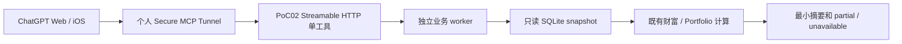

# WealthPilot 当前架构与 4.0 迁移边界

> 2026-10-11。开发事实以 main 的代码/测试为准；v3.15.1 是历史 SemVer Tag。4.0 正在迁移验证，尚未生产上线。

## 当前 3.x 业务系统

| 边界 | 实际入口 / 职责 |
|---|---|
| React Web | `frontend/src/App.tsx` 的 HashRouter；Dashboard、WealthOverview、Consumption、Retirement、Decision、Action 等页面。可视化与人工确认保留。 |
| 完整业务后端 | `backend/main.py`、`backend/api/`；REST/SSE、业务服务和 SQLite。非 Demo lifespan 会初始化券商同步/调度/订单轮询，当前 Prod MCP 不运行此入口。 |
| AI 决策 | `backend/services/decision_service.py` → `decision_service_v3.py` → PEER 四 Agent；`backend/skills` + 根 `skills/wp-*/SKILL.md` 为 13 个内部 Skill。模型解释与硬规则计算边界继续有效。 |
| 财富/投资 | `backend/services/wealth_service.py`、`portfolio_service.py`、`app/analyzer.py`；Wealth 的核心净资产口径与 Portfolio 的投资口径不能混用。公开 Wealth summary 会写 aggregate snapshot。 |
| 消费 | `backend/services/consumption/` 和 `backend/api/consumption.py`；本地账单/Raw Layer、经济事件、分类、重复/退款与页面分析，各数据源覆盖有限。 |
| 技术证据 | `backend/services/technical_patterns/`、`pattern_data/`；canonical 指标、形态事实、来源及证据边界。不把形态事实视作交易授权或保证收益。 |
| 执行与风控 | `backend/services/action/`、`execution_plan/`、Typed Intent / ExecutionBatch；价格/数量由规则产生，人工确认和券商权威校验仍适用。没有迁入当前 MCP。 |
| 数据/知识 | `app/database.py`、`app/models.py`、各服务 models；私有 SQLite；根 `knowledge_base/` Markdown 是真相源，索引可重建。 |

现有 PEER 主路径仍由 WealthPilot 管理对话、模型调用和上下文；LangGraph/工具层依赖存在不等于 PEER 已被替换。PoC 02 耦合私有 `_current_totals` 等计算入口，业务服务后续变动须重新回归。

## 当前已验证的 4.0 入口

代码：`pocs/poc02_wealth_mcp/server.py`、`worker.py`、`reader.py`。唯一工具 `get_wealth_overview(currency=CNY)` 返回资产、负债、净资产、整数分/scale=2、时间和质量状态，不暴露账户/持仓明细或券商凭证。不调用会写快照的完整 summary，不启动完整后端。

PoC 01/02 的 Web/iOS PASS 来自 MacBook 实测；不能复用为 Mac Mini 设备 PASS。PoC 02 凭证展示事故仍 FAIL，用户当时拒绝轮换。新生产 Key 不代表旧 Key 已撤销，也不自动隔离其同组织权限。

## 4.0 目标及未迁移范围

| 场景 | 当前状态 / 后续边界 |
|---|---|
| A 财富与投资查询 | 财富只读摘要已 PoC 验证；其他查询逐项封装后再验收。 |
| B 投资组合分析/调仓建议 | 3.x 业务和 PEER 能力继续可用；对外 Skills/MCP 尚未迁移。 |
| C 独立 Web | 现有 React 保留；当前 Mini 包只部署 MCP，不部署完整 Web 后端。 |
| D 对话、授权、执行 | 目标保留后端风控/用户授权/券商执行边界；本轮不对外开放任何交易工具。 |
| E 复盘/策略优化 | 后续规划，现有历史记录是数据基础，不等于完整复盘已实现。 |

ChatGPT 对话、通用推理和用户偏好记忆是目标；没有在本轮迁移 PEER / SkillsLoader、引入 Mem0/A2A、投资分析工具或交易能力。具体迁移影响见 Phase 0 报告。

## Dev、GitHub 与 Prod

MacBook Dev 通过短期分支、PR 和四项 CI 发布 main Commit。Mac Mini Prod 仅拉取确认的完整 SHA，安装固定哈希原生 ARM 依赖，用现有 launchd 管理两个非 root jobs。代码、数据/备份、配置/凭证、日志分离，默认 synthetic；真实访问门槛与设备验收不能跳过。

当前 `install-github` 复用 Stage 1 安装器：从公共 GitHub 拉取、验证 main ancestry 和 exact-commit CI，暂存哈希依赖及临时包，安装完成清理暂存，不切换 `current` 或启动服务。版本切换和健康/真实查询单独验收；旧 release 保留供回滚。离线包为应急备份，不是长期主要发布方式。

Stage 2 原生运行、SSH/网络、电源/FileVault、数据一致性、独立生产 Key、Web/iOS、MacBook 关闭、退出/重启及恢复均未完成。本轮发布代码不等于 4.0 正式生产上线。执行入口：[Mac Mini Stage 2](WealthPilot_4x_Phase1_PoC03_MacMini_Deployment.md)；发布规则：[PROJECT_GOVERNANCE](PROJECT_GOVERNANCE.md)。
