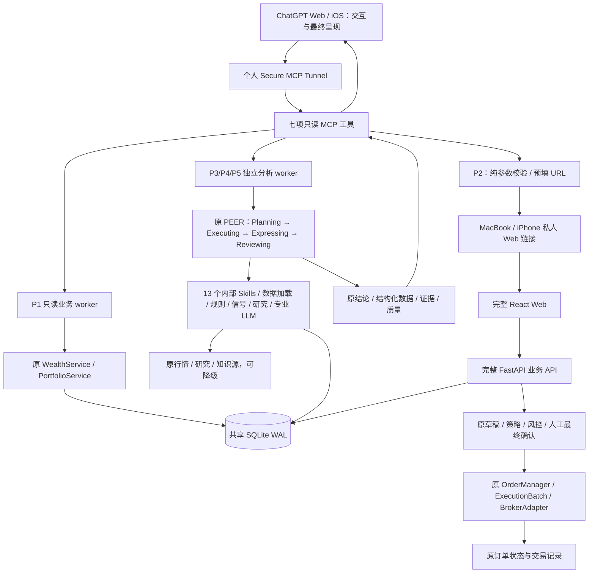

# WealthPilot 4.0 当前生产架构

> 2026-10-16：用户确认五大核心场景正式收口。本文描述已落地产品；版本观察见 [PROJECT_GOVERNANCE](PROJECT_GOVERNANCE.md#4-版本tag-与发布)。代码、CI、组件部署和运行验收分别记录，main 最新提交不自动代表 Mini 已部署。

## 1. 产品与组件职责

| 组件 | 当前职责 / 入口 |
|---|---|
| ChatGPT Web / iOS | 个人 Pro 的自然语言交互、相关上下文、工具选择、追问、原专业结果的最终组织与呈现。 |
| Secure MCP Tunnel | 现有个人范围连接，把 ChatGPT 接到 Mini 上的 Streamable HTTP MCP；不是业务计算或交易引擎。 |
| 生产 MCP | `pocs/chatgpt_skills/server.py`；real 配置只注册七项只读工具。独立 worker 调原服务，不通过本机 HTTP 绕行。目录名 pocs 保留，不代表当前仍只有试验能力。 |
| WealthPilot Core | 完整 `backend/main.py` / `backend/api/` / `backend/services/`、PEER 四 Agent、13 个内部 Skills、数据源、规则/信号、专业 LLM 与报告模板。 |
| 完整 React Web | `frontend/src/App.tsx` 的 HashRouter，财富、投资账户、消费、投研、决策、投资行动等原页面与可视化；最终人工交易确认。 |
| 数据与知识 | `app/database.py`、`app/models.py`、`app/shared_sqlite.py` 与各业务模型；共享 SQLite WAL。根 `knowledge_base/` Markdown 为知识真相源，Chroma 为可重建索引。 |
| Mac Mini Prod | 原生 ARM Python / Node、launchd、完整 Web/后端、MCP/Tunnel、生产数据库及原业务服务。数据、配置、凭证、日志和备份位于代码外。 |
| MacBook Dev / GitHub | 本地开发与隔离测试 → 短期分支 / PR / 四项 CI → 经授权集成 → Mini 安装确认的完整 SHA，不在生产直接改业务代码。 |

P1–P5 均 DONE：资产负债查询、明确交易预填链接、单标决策、组合评估、当前持仓收益分析。Web/iOS 读取与分析、MacBook/iPhone 交易预填均已实际验收；P2 新入口首次真实券商提交/成交仍未验收。P5 完成的是现有持仓账面盈亏能力，不包含完整历史收益归因。

## 2. 生产调用关系

ChatGPT 消费原专业结论后再次组织、解释和回答。它没有替代 Expressing 或原专业决策引擎。MCP 分析入口执行一次原专业链路，不复制另一套计算或模型分析；多轮相关历史由 ChatGPT 传入。ChatGPT 自身可能重复调用工具，不能把重复请求误称为同一工具内部只执行一次的保证。

## 3. 七个生产工具

| 工具 | 原业务复用与返回 | 访问边界 |
|---|---|---|
| `get_wealth_overview` | WealthService / PortfolioService：资产、负债、净资产、币种、时间与质量；金额为整数最小单位，scale=2 | 只读事务；不调用会写聚合快照的完整 Web summary |
| `get_manual_wealth_items` | 现有手工资产/负债模型，支持类型与条目筛选 | 不返回备注、凭证等不必要字段；金额单位见工具契约 |
| `get_investment_details` | 原投资持仓/账户归属、数量、市值、盈亏、仓位、来源日期 | 账户为不透明引用，不返回原始券商账户敏感字段；存储持仓不冒充实时账户盘点 |
| `prepare_trade_confirmation_link` | 规范化明确订单参数，返回原 Web 预填 URL 与摘要 | 纯计算，不连接券商、不写草稿/持仓/订单；缺必要参数须澄清 |
| `analyze_position` | PositionDecision / position_single；原持仓或新建仓、规则、信号、研究和专业结论 | 只读分析，不能据建议自动下单；不支持/缺数据时澄清或降级 |
| `review_portfolio` | PortfolioReview / AssetAllocation；原配置快照、目标、偏离和组合结论 | 不混用完整财富与投资持仓分母；无行业证据不推断行业归属 |
| `analyze_performance` | PerformanceAnalysis / 原 `_build_performance_data`：当前持仓账面盈亏及贡献 | 不编造历史区间、TWR/MWR、已实现交易收益或决策因果归因 |

代码索引：[`server.py`](../pocs/chatgpt_skills/server.py)、[`worker.py`](../pocs/chatgpt_skills/worker.py)、[`reader.py`](../pocs/chatgpt_skills/reader.py)、[`trade_link.py`](../pocs/chatgpt_skills/trade_link.py)、[`analysis.py`](../pocs/chatgpt_skills/analysis.py)。

测试用 Mock 写工具在 real 配置分支返回后不会注册；生产不开放 `create_trade_draft` / `confirm_trade` 等 Mock 工具。不使用 Business/Edu，也不部署独立 Mock ChatGPT 应用或额外 Tunnel。

## 4. 原 PEER 与内部 Skills 保留

| Agent | 职责 | 代码 |
|---|---|---|
| Planning | 意图、标的、澄清、Skill 选择与 position_single / position_multi / portfolio / general 路由 | `backend/agents/planning_agent.py` |
| Executing | 经 invoke_skill 装配持仓、纪律、知识/研究、行情和信号，沿用原支持范围及 fallback | `backend/agents/executing_agent.py` |
| Expressing | 原 Prompt / 专业 LLM 推理、结构化结论及流式报告；保留新建仓模板和 actionable 规则 | `backend/agents/expressing_agent.py` |
| Reviewing | 原必填/格式硬校验、模型评分与 pass/warn/fallback 策略 | `backend/agents/reviewing_agent.py` |

Web 继续 `decision_service.run_chat_stream` → `decision_service_v3.run_chat_stream_v3`。MCP 的薄适配直接调用后者，收集原 SSE 最终文本及 result callback 的结构化结果，不请求本机 FastAPI。原默认 Web API 行为保留。

`skills/wp-*/SKILL.md` 共 13 个内部 Skill（原子、组合、旁路），由 `backend/skills` 加载；它们与七个对外 MCP 工具不是同一层，也没有全部转换成 ChatGPT Skills。原 `decision_engine/`、AllocationService、研究/技术形态证据和原报告模板均复用。

分析 worker 使用 SQLite mode=ro、query_only 和 authorizer，保持进程退出前只读；显式临时分析模式不写 Web 会话或图 checkpoints、不执行交易意图解析。复用既有分析 Python / Provider 配置与知识工作目录，知识索引缺失则降级，不创建第二个 Chroma 数据库。相关实现细节见 [P3/P4/P5 适配记录](WealthPilot_4x_P345_Analysis_Skills.md)。

## 5. Web 交易、数据库与任务

P2：ChatGPT 明确参数 → 只读 URL → `/#/action?...` → 原 ActionDraftCard / ConfirmOrderDialog → ActionDraft / SymbolStrategy / RiskEngine / OrderManager / BrokerAdapter → 原订单状态/记录。打开链接与预览不是最终交易授权，用户必须在 Web 亲自确认；不得将 Mock 成交当实盘成交。

main 的 PR #10 已支持 IB01 预算链接变体：原可信 LSEETF/USD 合约、SMART 执行身份 → Typed Trade Intent → ExecutionBatch → 原 Web 最终确认，保留资金、行情、WhatIf、幂等和交易开关。该兼容修复的合入或部署本身不证明新入口已经真实成交。普通单标路径和原交易规则保留，见 [P2 记录](WealthPilot_4x_P2_Web_Trade_Link.md)。

完整 FastAPI 后端负责原 REST/SSE 和业务写入。原非 Demo lifespan 包括孤儿订单扫描、OrderPoller、北京时间 22:00 同步和 15 分钟触发评估（`backend/main.py`）；本轮文档没有新增或启停这些任务。代码具备任务不代表每个券商 Gateway、定时成功或全部设备恢复事项已验收；任何后续启动/重启须核对实际任务、券商配置与授权。

Web / 原同步服务受控写同一生产 SQLite WAL；MCP 每请求只读事务读取已提交数据。Web 原财富 summary 的聚合快照写入继续保留；MCP 复用只读计算，不能照搬该写入入口。共享契约校验路径/属主/文件身份/schema/Portfolio/WAL，合法业务更新不再与历史迁移 SHA 比较。历史 migration-reference 与备份摘要只作迁移/恢复证据，不覆盖运行期财富状态。使用 SQLite Backup API 一致性备份和经验证恢复路径，不直接复制活动库；回滚代码前核对共享模式，不盲目换回 0400 固定副本。见 [共享库历史实施与回滚](WealthPilot_4x_Web_Data_Sync_Batch1.md)。

## 6. 生产运行与版本

Mini 当前完整 Web 监听 loopback 8790、后端 18790、MCP 8788；现有 Secure MCP Tunnel 连接 MCP，Tailscale Serve 私人 HTTPS / 原生 SSH 转发连接 Web。四个原 launchd label 分别为 `com.wealthpilot.full-web`、`com.wealthpilot.full-backend`、`com.wealthpilot.readonly-mcp`、`com.wealthpilot.secure-tunnel`。系统级 job 的业务进程使用原运行用户；不把管理员切换校验进程误当成数据库属主进程。

2026-10-16 只读核对：完整 Web/Core/MCP 启动入口引用 `8b648db4cf7c714cd43eef0d4e437f22d061eae6`；四个 job 运行、Web/后端 health 为 HTTP 200。MCP 仍复用旧 SDK 环境和既有分析资产目录，全局 current 仍指向历史 release；这些不是业务版本回退的证明。版本边界和证据限定见治理文档，不因文档提交自动切换任何组件。

GitHub 为主要发布路径：固定完整 SHA、main ancestry 和 exact-commit CI → 原生依赖 → 预检 → 授权切换 → 组件健康 / 原功能 / Web/iOS 实际验收；失败恢复启动入口，保留生产数据、配置、凭证和原备份。离线包只作应急。历史 [PoC03](WealthPilot_4x_Phase1_PoC03_MacMini_Deployment.md) 和 [Batch2](WealthPilot_4x_Web_Data_Sync_Batch2.md) 不能再被解读为“当前只能部署受限 Web”或“Mini 禁止完整后端”。

## 7. 数据质量与验收边界

- P1、P3/P4/P5：ChatGPT Web 和真实 iOS 分别完成调用，不能用同步聊天记录或本地测试代替手机实测。P2：MacBook/iPhone 预填 PASS，新入口首次真实券商提交/成交未验收。
- 来源失败、日期未知、过期、研究来源未验证和原则检索不可用保留 partial/unavailable；查询时间不是估值时间。synthetic=false 表示非合成测试模式，不能证明全部研究、行情或估值实时可信。演示 fallback 不包装为实盘证据。
- 单标权重采用聚合投资持仓；AllocationService 配置快照采用正值且已分类投资持仓，未知分类金额单列；两者都不是完整个人财富，也不额外注入实时现金。配置默认目标和 DataLoader 默认画像不是已验证的个人设定。
- P5 只解释当前持仓账面盈亏与原贡献排名，不能据此证明历史策略长期有效。
- 部分 Gateway / 数据源尚未配置或可用；私人 Web 的代理路径、外部网络、设备重启/退出恢复等按独立证据记录，不从功能收口推导全部 PASS。
- PoC02 凭证展示事故继续保留历史 FAIL；后续撤销权限检查单列，不抹除事故。私钥、Key、账户敏感字段、真实数据库和财务 payload 不进 Git 或公开报告。

这些限制不阻塞用户确认的 4.0 功能范围收口。后续复盘、历史归因、数据源优化或其他能力进入新迭代，不为文档收口重构 PEER、复制业务引擎或新增基础设施。
