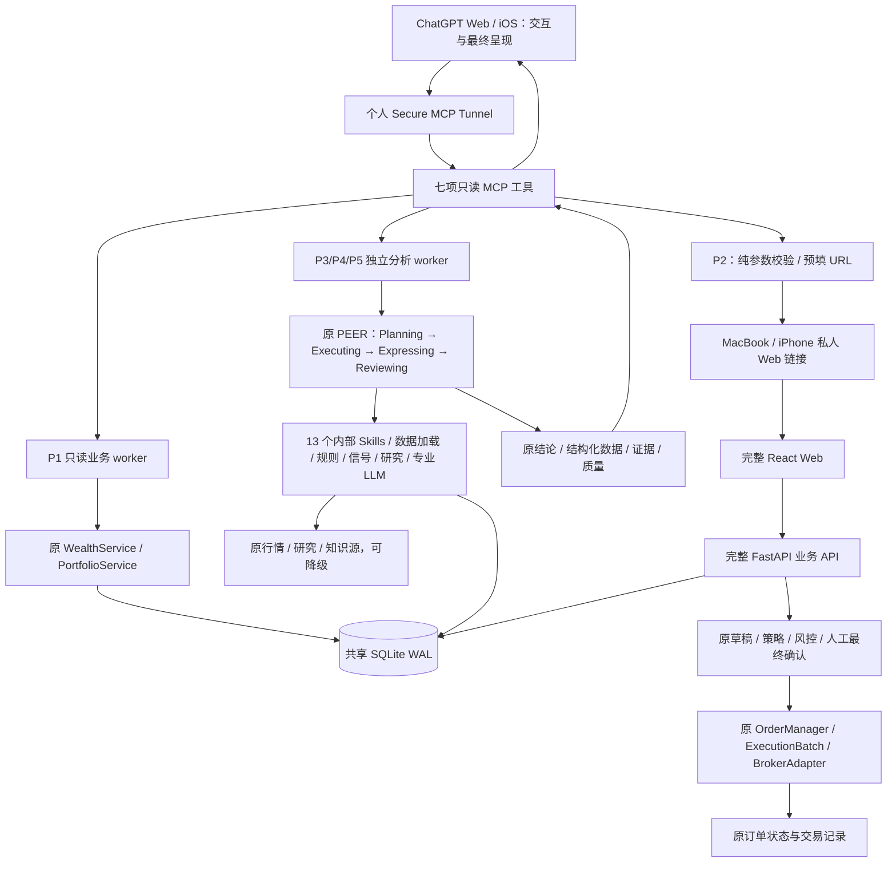

# WealthPilot 当前系统架构

> 2026-10-18：本次核对基线为已合入 B0 的 `12d9357f1543156db379a94ace8eb359c107c30e`；U0 为本 PR 开发候选，未部署。用户已确认 B0 正式生产部署，本轮仅核对已有发布记录，未访问生产。2026-10-16 的功能/部署记录保留为历史观察，本轮未访问生产。版本观察见 [PROJECT_GOVERNANCE](PROJECT_GOVERNANCE.md#4-版本tag-与发布)。代码、CI、组件部署和运行验收分别记录，main 最新提交不自动代表 Mini 已部署。

本文维护当前架构、模块/数据权威关系；详细开发与发布流程统一见[治理文档](PROJECT_GOVERNANCE.md#8-文档权威与仓库卫生)。实现文档与代码/运行证据冲突时必须报告并修正，未核实项保留 UNKNOWN。任务从 [AGENTS](../AGENTS.md) 进入，复用入口/测试见[能力索引](CAPABILITY_REGISTRY.md)。现有专项设计保留其职责，不新增第二份 ARCHITECTURE.md。

## 1. 产品与组件职责

| 组件 | 当前职责 / 入口 |
|---|---|
| ChatGPT Web / iOS | 个人 Pro 的自然语言交互、相关上下文、工具选择、追问、原专业结果的最终组织与呈现。 |
| Secure MCP Tunnel | 现有个人范围连接，把 ChatGPT 接到 Mini 上的 Streamable HTTP MCP；不是业务计算或交易引擎。 |
| 生产 MCP | `pocs/chatgpt_skills/server.py`；real 配置只注册七项只读工具。独立 worker 调原服务，不通过本机 HTTP 绕行。目录名 pocs 保留，不代表当前仍只有试验能力。 |
| WealthPilot Core | 完整 `backend/main.py` / `backend/api/` / `backend/services/`、PEER 四 Agent、13 个内部 Skills、数据源、规则/信号、专业 LLM 与报告模板。 |
| 完整 React Web | `frontend/src/App.tsx` 的 HashRouter，财富、投资账户、消费、投研、决策、投资行动等原页面与可视化；最终人工交易确认。 |
| 数据与知识 | `app/database.py`、`app/models.py`、`app/shared_sqlite.py` 与各业务模型；共享 SQLite WAL。根 `knowledge_base/` Markdown 为知识真相源，Chroma 为可重建索引。 |
| Mac Mini Prod | 原生 ARM Python / Node、launchd、完整 Web/后端、MCP/Tunnel、生产数据库及原业务服务。数据、配置、凭证、日志和备份位于代码外。 |
| MacBook Dev / GitHub | 本地开发与隔离测试 → 短期分支 / PR / 四项 CI → 经授权集成 → Mini 安装确认的完整 SHA，不在生产直接改业务代码。 |

P1–P5 均 DONE：资产负债查询、明确交易预填链接、单标决策、组合评估、当前持仓收益分析。Web/iOS 读取与分析、MacBook/iPhone 交易预填均已实际验收；P2 新入口首次真实券商提交/成交仍未验收。P5 完成的是现有持仓账面盈亏能力，不包含完整历史收益归因。

## 2. 生产调用关系

ChatGPT 消费原专业结论后再次组织、解释和回答。它没有替代 Expressing 或原专业决策引擎。MCP 分析入口执行一次原专业链路，不复制另一套计算或模型分析；多轮相关历史由 ChatGPT 传入。ChatGPT 自身可能重复调用工具，不能把重复请求误称为同一工具内部只执行一次的保证。

## 3. 七个生产工具

| 工具 | 原业务复用与返回 | 访问边界 |
|---|---|---|
| `get_wealth_overview` | WealthService / PortfolioService：资产、负债、净资产、币种、时间与质量；金额为整数最小单位，scale=2 | 只读事务；不调用会写聚合快照的完整 Web summary |
| `get_manual_wealth_items` | 现有手工资产/负债模型，支持类型与条目筛选 | 不返回备注、凭证等不必要字段；金额单位见工具契约 |
| `get_investment_details` | 原投资持仓/账户归属、数量、市值、盈亏、仓位、来源日期 | 账户为不透明引用，不返回原始券商账户敏感字段；存储持仓不冒充实时账户盘点 |
| `prepare_trade_confirmation_link` | 规范化明确订单参数，返回原 Web 预填 URL 与摘要 | 纯计算，不连接券商、不写草稿/持仓/订单；缺必要参数须澄清 |
| `analyze_position` | PositionDecision / position_single；原持仓或新建仓、规则、信号、研究和专业结论 | 只读分析，不能据建议自动下单；不支持/缺数据时澄清或降级 |
| `review_portfolio` | PortfolioReview / AssetAllocation；原配置快照、目标、偏离和组合结论 | 不混用完整财富与投资持仓分母；无行业证据不推断行业归属 |
| `analyze_performance` | PerformanceAnalysis / 原 `_build_performance_data`：当前持仓账面盈亏及贡献 | 不编造历史区间、TWR/MWR、已实现交易收益或决策因果归因 |

代码索引：[`server.py`](../pocs/chatgpt_skills/server.py)、[`worker.py`](../pocs/chatgpt_skills/worker.py)、[`reader.py`](../pocs/chatgpt_skills/reader.py)、[`trade_link.py`](../pocs/chatgpt_skills/trade_link.py)、[`analysis.py`](../pocs/chatgpt_skills/analysis.py)。

测试用 Mock 写工具在 real 配置分支返回后不会注册；生产不开放 `create_trade_draft` / `confirm_trade` 等 Mock 工具。不使用 Business/Edu，也不部署独立 Mock ChatGPT 应用或额外 Tunnel。

## 4. 原 PEER 与内部 Skills 保留

| Agent | 职责 | 代码 |
|---|---|---|
| Planning | 意图、标的、澄清、Skill 选择与 position_single / position_multi / portfolio / general 路由 | `backend/agents/planning_agent.py` |
| Executing | 经 invoke_skill 装配持仓、纪律、知识/研究、行情和信号，沿用原支持范围及 fallback | `backend/agents/executing_agent.py` |
| Expressing | 原 Prompt / 专业 LLM 推理、结构化结论及流式报告；保留新建仓模板和 actionable 规则 | `backend/agents/expressing_agent.py` |
| Reviewing | 原必填/格式硬校验、模型评分与 pass/warn/fallback 策略 | `backend/agents/reviewing_agent.py` |

Web 继续 `decision_service.run_chat_stream` → `decision_service_v3.run_chat_stream_v3`。MCP 的薄适配直接调用后者，收集原 SSE 最终文本及 result callback 的结构化结果，不请求本机 FastAPI。原默认 Web API 行为保留。

`skills/wp-*/SKILL.md` 共 13 个内部 Skill（原子、组合、旁路），由 `backend/skills` 加载；它们与七个对外 MCP 工具不是同一层，也没有全部转换成 ChatGPT Skills。原 `decision_engine/`、AllocationService、研究/技术形态证据和原报告模板均复用。

分析 worker 使用 SQLite mode=ro、query_only 和 authorizer，保持进程退出前只读；显式临时分析模式不写 Web 会话或图 checkpoints、不执行交易意图解析。复用既有分析 Python / Provider 配置与知识工作目录，知识索引缺失则降级，不创建第二个 Chroma 数据库。相关实现细节见 [P3/P4/P5 适配记录](WealthPilot_4x_P345_Analysis_Skills.md)。

## 5. Web 交易、数据库与任务

普通单标 P2：ChatGPT 明确参数 → 只读 URL → `/#/action?...` → 原 ActionDraftCard / ConfirmOrderDialog → ActionDraft / SymbolStrategy / RiskEngine / OrderManager / BrokerAdapter → 原订单状态/记录。打开链接与预览不是最终交易授权，用户必须在 Web 亲自确认；不得将 Mock 成交当实盘成交。

IB01 预算变体已在后续 main 迭代统一到 ActionDraftCard 参数编辑和 ConfirmOrderDialog 最终确认，底层仍复用 Batch。PR #10 起支持的链路为：原可信 LSEETF/USD 合约、SMART 执行身份 → Typed Trade Intent → ExecutionBatch → 原 Web 最终确认，保留资金、行情、WhatIf、幂等和交易开关。该兼容修复的合入或部署本身不证明新入口已经真实成交。普通单标路径和原交易规则保留，见 [P2 记录](WealthPilot_4x_P2_Web_Trade_Link.md)。

完整 FastAPI 后端负责原 REST/SSE 和业务写入。原非 Demo lifespan 包括孤儿订单扫描、OrderPoller、北京时间 22:00 同步和 15 分钟触发评估（`backend/main.py`）；本轮文档没有新增或启停这些任务。代码具备任务不代表每个券商 Gateway、定时成功或全部设备恢复事项已验收；任何后续启动/重启须核对实际任务、券商配置与授权。

Web / 原同步服务受控写同一生产 SQLite WAL；MCP 每请求只读事务读取已提交数据。Web 原财富 summary 的聚合快照写入继续保留；MCP 复用只读计算，不能照搬该写入入口。共享契约校验路径/属主/文件身份/schema/Portfolio/WAL，合法业务更新不再与历史迁移 SHA 比较。历史 migration-reference 与备份摘要只作迁移/恢复证据，不覆盖运行期财富状态。使用 SQLite Backup API 一致性备份和经验证恢复路径，不直接复制活动库；回滚代码前核对共享模式，不盲目换回 0400 固定副本。见 [共享库历史实施与回滚](WealthPilot_4x_Web_Data_Sync_Batch1.md)。

## 6. 生产运行与版本

本节是 2026-10-16 观察快照，非本轮实时生产复核；最新状态待授权后的组件检查。

Mini 当前完整 Web 监听 loopback 8790、后端 18790、MCP 8788；现有 Secure MCP Tunnel 连接 MCP，Tailscale Serve 私人 HTTPS / 原生 SSH 转发连接 Web。四个原 launchd label 分别为 `com.wealthpilot.full-web`、`com.wealthpilot.full-backend`、`com.wealthpilot.readonly-mcp`、`com.wealthpilot.secure-tunnel`。系统级 job 的业务进程使用原运行用户；不把管理员切换校验进程误当成数据库属主进程。

2026-10-16 只读核对：完整 Web/Core/MCP 启动入口引用 `8b648db4cf7c714cd43eef0d4e437f22d061eae6`；四个 job 运行、Web/后端 health 为 HTTP 200。MCP 仍复用旧 SDK 环境和既有分析资产目录，全局 current 仍指向历史 release；这些不是业务版本回退的证明。版本边界和证据限定见治理文档，不因文档提交自动切换任何组件。

GitHub 为主要发布路径：固定完整 SHA、main ancestry 和 exact-commit CI → 原生依赖 → 预检 → 授权切换 → 组件健康 / 原功能 / Web/iOS 实际验收；失败恢复启动入口，保留生产数据、配置、凭证和原备份。离线包只作应急。历史 [PoC03](WealthPilot_4x_Phase1_PoC03_MacMini_Deployment.md) 和 [Batch2](WealthPilot_4x_Web_Data_Sync_Batch2.md) 不能再被解读为“当前只能部署受限 Web”或“Mini 禁止完整后端”。

## 7. 数据质量与验收边界

- P1、P3/P4/P5：ChatGPT Web 和真实 iOS 分别完成调用，不能用同步聊天记录或本地测试代替手机实测。P2：MacBook/iPhone 预填 PASS，新入口首次真实券商提交/成交未验收。
- 来源失败、日期未知、过期、研究来源未验证和原则检索不可用保留 partial/unavailable；查询时间不是估值时间。synthetic=false 表示非合成测试模式，不能证明全部研究、行情或估值实时可信。演示 fallback 不包装为实盘证据。
- 单标权重采用聚合投资持仓；AllocationService 配置快照采用正值且已分类投资持仓，未知分类金额单列；两者都不是完整个人财富，也不额外注入实时现金。配置默认目标和 DataLoader 默认画像不是已验证的个人设定。
- P5 只解释当前持仓账面盈亏与原贡献排名，不能据此证明历史策略长期有效。
- 部分 Gateway / 数据源尚未配置或可用；私人 Web 的代理路径、外部网络、设备重启/退出恢复等按独立证据记录，不从功能收口推导全部 PASS。
- PoC02 凭证展示事故继续保留历史 FAIL；后续撤销权限检查单列，不抹除事故。私钥、Key、账户敏感字段、真实数据库和财务 payload 不进 Git 或公开报告。

这些限制不阻塞用户确认的 4.0 功能范围收口。后续复盘、历史归因、数据源优化或其他能力进入新迭代，不为文档收口重构 PEER、复制业务引擎或新增基础设施。

## 8. 分层依赖与数据权威

依赖方向：ChatGPT / React 展示 → MCP / REST / SSE 适配 → 原业务编排与规则 → 券商/市场/知识适配与持久化。前端可以显示结果和收集人工确认，MCP 可以校验协议参数；两者不另算投资建议、执行资金或券商状态。业务模块跨层复用必须显式传递账户/来源/单位/时间，不从 UI 文案反推事实。

| 业务事实 | 权威来源 / owner | 读取与派生边界 |
|---|---|---|
| 已有投资持仓与账户归属 | [Position / Portfolio](../app/models.py)，由导入或 [broker_sync](../backend/services/broker_sync/position_upsert_service.py) 更新 | [PortfolioService](../backend/services/portfolio_service.py) / [analyzer](../app/analyzer.py) 聚合；本地快照不冒充实时券商账户。同步对账按 broker/account/source 范围，不能仅凭 ticker 跨账户覆盖 |
| 券商实际订单、成交、实时资金 | 原 [IBKR](../backend/services/action/brokers/ibkr.py) / [Tiger](../backend/services/action/brokers/tiger.py) 返回的证据 | OrderManager 对账并持久化；本地状态是观察投影，失败/unknown 不推定无订单。执行资金另走 Batch 的新鲜原币 snapshot / cash ledger，不从财富净资产反推可买金额 |
| IBKR 展示现金 | adapter `get_account_info` 的逐币种 CashBalance，经 [IBKRPortfolioAdapter](../backend/services/broker_sync/snowball/adapter.py) 转 CASH 持仓 | 排除 BASE 折算重复，沿用历史 broker=snowball / source_channel=ibkr，不新建第二套 IBKR 持仓；展示现金与可执行预算含义不同 |
| Tiger 展示现金 | [TigerSyncService](../backend/services/broker_sync/tiger/sync_service.py) 读取逐币种 cash_balance，和持仓同 run 原子持久化为 CASH | U0 候选已移除 Portfolio/Web/MCP 的读时券商现金旁路与虚拟现金追加；不累计 BASE。缺源保留 last-good，不当成余额 0。零/负原币现金保留；执行预算仍走原交易资金权威 |
| 个人财富及负债 | [WealthService](../backend/services/wealth_service.py) 的手工 WealthItem + 原 Portfolio 投资汇总 | 沿用 included_in_net_worth / already_investment_accounted 去重，养老金仅金额级。不能在财富模块复制持仓/收益权威；WealthSnapshot 是财富汇总快照，不是交易账本 |
| 汇率、币种与分类 | [FXService](../app/fx_service.py)、[canonical classification](../backend/services/instruments/classification.py) | Web 金额字段与 MCP 最小单位契约分开（overview scale=2；details CNY 元/原币字段见契约）。secType=STK 不证明 Equity，未知分类保留 UNKNOWN，禁止前端/MCP 再映射一套分类 |
| 配置/专业分析 | [AllocationService](../backend/services/allocation_service.py)、[原 PEER](../backend/services/decision_service_v3.py)、原 Skills 与模板 | 正值已分类投资持仓配置分母、单标投资权重和完整财富分别解释。ChatGPT 组织原专业结果，不替换其数值/证据 owner |
| 当前收益 / 历史范围 | 原 [performance calculation](../decision_engine/llm_engine.py) 与 OrderRecord | 当前持仓账面盈亏不等于期间收益或历史成交归因；不得把消费流水或财富快照当收益账本 |
| 知识 | 根 [knowledge_base](../knowledge_base) Markdown | Chroma 是可重建索引；不复制另一套个人知识库 |

Web `wealth_service.get_summary` 会记录聚合快照；MCP overview 通过 [readonly reader](../pocs/poc02_wealth_mcp/reader.py) 复用只读计算，details 经 [reader](../pocs/chatgpt_skills/reader.py) 读取存储持仓及质量。所谓“最新状态”仅表示当次读取的已提交业务状态，必须同时看来源同步时间、失败记录与质量；调用时间不能冒充估值时间。

## 9. 交易对象、状态与同步职责

| 对象 / owner | 负责 | 不得承担的替代职责 |
|---|---|---|
| [ActionPlanner](../backend/services/action/action_planner.py) / [ActionDraft](../backend/services/action/models.py) | 分析后的可编辑建议草稿；确认后形成 AllocationIntent / SymbolStrategy | 草稿确认不是券商最终下单确认，不持有券商真实成交权威 |
| [Typed Trade Intent](../backend/services/trade_intent) / [ExecutionBatchService](../backend/services/execution_batch/service.py) | 结构化理解确认、Batch/Leg、可信合约、报价/WhatIf、原币现金/费用/安全垫、版本哈希、顺序及幂等/恢复 | 不替代 OrderManager，不从财富总额推算购买力，不宣称多腿 broker 提交具备数据库原子回滚 |
| [OrderManager](../backend/services/action/order_manager.py) / OrderRecord | 草稿/策略/订单生命周期、原适配器提交；B0 durable claim 与 `apply_broker_observation` 统一订单/累计成交及 Leg/Batch 投影，详见第 11 节 | 不等于持仓同步服务，订单成交数量不得直接合成账户现金和持仓真值 |
| [OrderPoller](../backend/services/action/order_poller.py) | 按订单 owner/券商恢复，包含无 ID 的 SUBMITTED/UNKNOWN；每单提交，缺 ID/NOT_FOUND 不撤销或补单 | 不是完整账户同步；`scan_orphan_orders` 是启动恢复动作，启动完整 backend 不是无副作用只读检查 |
| [SnowballSyncService](../backend/services/broker_sync/snowball/sync_service.py) / [PositionUpsertService](../backend/services/broker_sync/position_upsert_service.py) | IBKR 分支读取真实持仓及现金，存成功 snapshot，再按账户/来源对账写业务 Position | 读券商并不代表只读本地 DB；失败不得先清空业务表；不在 MCP 中直接触发生产同步 |

当前存在两种执行入口，共用原底层订单权威：普通 ActionDraft → SymbolStrategy → OrderManager；Typed Intent / IB01 budget → ExecutionBatch / ExecutionLeg → SymbolStrategy → OrderManager。二者是现有职责分工；本轮不合并或新增交易体系。实际 UI 的简洁编辑及最终确认体验仍需完整验收，不能只证明 Batch 对象存在。

**成交后同步缺口（本轮静态核实）**：OrderPoller → OrderManager 更新订单/累计成交和 Batch linkage；这条调用链未调用 SnowballSyncService / PositionUpsertService。`backend/main.py` 的定时同步与 `/api/broker-sync/trigger` 是独立入口。因此不把“订单 filled”直接写为“持仓及现金已同步”。未发现可直接复用的持久化成交后同步事件闭环；未来最小触发/重试方案仍需设计验证，详见[模拟验证](GOVERNANCE_VALIDATION_REPORT.md)。

生产 real MCP 的七工具没有订单状态查询或主动推送；Mock `get_trade_order_status` 会持久化状态，不能直接复制为生产只读工具。要让 ChatGPT 读订单结果，需另行评审现有 OrderRecord 的只读最小投影及权限；复用已存在的投资详情工具可以查询已同步持仓，不能承诺成交后即时更新。

## 10. 架构扩展和变更规则

- 新入口先检索[能力索引](CAPABILITY_REGISTRY.md)与代码；复用现有 owner / adapter / 模型。业务规则只留一个权威实现；如必须平行建设，先在现有设计/PR 记录原因、权威归属、迁移/退出和人工批准，不先落代码再补论证。
- 跨模块必须说明输入/输出、读写方向、账户/币种/单位/时间与失败语义；同步不能反向调用 MCP，MCP 不成为定时器或交易引擎。
- 架构/口径/状态权威变化同 PR 更新本文与对应契约；Registry 的具体维护触发条件及无能力变化豁免见[治理规则](PROJECT_GOVERNANCE.md#registry-维护检查)，不在本文重复定义。重要架构决策在原专项设计或 PR 留可追溯记录。
- 代码可验证关系与生产运行事实分开。对未知事件可靠性、源数据完整性或部署状态写待核实，不能凭接口 PASS、历史测试数或 CI 填补生产验收。详细流程见[治理文档](PROJECT_GOVERNANCE.md#9-标准开发流程与风险分级)。

## 11. B0 已合入的代码边界

B0 已合入上述 main 基线，用户已确认正式生产部署；本轮不重复运行生产探测。最终机制与隔离证据入口见 [B0 实现说明](B0_IMPLEMENTATION.md)，显式 Schema 迁移、停止条件和回滚见 [生产 Runbook](B0_PRODUCTION_RUNBOOK.md)。第 8、9 节的职责划分保持不变，以下 B0 规则覆盖其中旧实现细节。

OrderManager 的 `place_order` 在独立短事务提交 durable UNKNOWN 认领、不可变授权和 OrderRecord/ExecutionLeg 关联后，才调用原适配器。`apply_broker_observation` 复用原状态机统一首次回包、轮询、对账、取消和恢复；OrderPoller 按实际券商/owner 每单提交。缺 broker ID 或 NOT_FOUND 不自动撤销、补单。OrderRecord 和原状态机仍是唯一订单权威，没有新增平行交易服务。

观察投影在 I/O 后取得短写事务并刷新全部关联缓存，以最新数据库事实归并；撤单/查询网络异常也走此入口。IBKR 已可能发送后的本地异常保持 UNKNOWN。相同请求重读必须匹配当前 owner、稳定 key 和完整参数；Batch 剩余腿的外部重审结果在版本/linked/账本 CAS 后才能落库，不改变并发已提交的腿。

同步对账以 Portfolio/broker/account/source 为完整 scope；完整物理账户只映射一个 canonical Portfolio，IBKR 持仓继续复用 snowball 通道。旧 owner/key=NULL 不视为新的发送权限或归属证据。LSE 身份沿用 trusted conId/币种/上市行，历史订正必须有 owner 和整行 CAS 证据，不能靠 USD 推断 US。

共享模式启动只验证已迁移结构和原严格契约；不自动 DDL 或创建默认 Portfolio。风险警告统一沿用原 RiskEngine，缺数据显式说明；硬交易门与原 Web 最终人工确认保留。B0 没有接通成交后同步消费者或新增 MCP 工具，第 9 节的后续能力缺口保持有效。原开发文档中的生产待验状态属于当时证据；后续部署以独立发布记录为准，不据此扩大真实交易授权。

## 12. U0 统一同步底座（本 PR 候选）

原完整 backend、手动 API、北京时间 22:00 调度和 restricted 入口复用 [SyncExecutor](../backend/services/restricted_sync.py) → 原四券商 `sync_and_persist` → [PositionSnapshotRepository](../backend/services/broker_sync/repository.py) → 原 Upsert。未创建新调度器、任务队列或资产库。完整 backend 通过原 IBKR adapter 的只读 facade 取数，不更改其已授权交易开关；restricted 保留原严格只读进程前提。

原 PositionSnapshotRun 在短事务内认领 Portfolio/broker/account/source，提交 token/300 秒租约后才外部 I/O。跨连接唯一索引限制同 owner 一个 running；发布重新锁库、重读 owner/token/租约，原子写快照、Position 与 success。过期旧 worker 不得覆盖新结果；崩溃 run 仅可在租约过期后由后续请求替换，旧 NULL context 必须人工核实。没有新增 queued/retry_wait 状态或后台持久重试扫描器。

异常空、部分读取失败、重复 canonical symbol/币种、owner 冲突或非零估值未知 FX 都拒绝发布并保留 last-good。Tiger 证券/现金须实际来源账户证据；SDK 3.5.8 合法纯现金用 gross_position_value=0 证明。原币现金与手工/导入/API 余额身份碰撞阻断，成功历史不能自动认领旧现金；已确认的同笔现金只允许显式 CAS 映射，见专项 Runbook。确证空仓须来源独立完成/覆盖证据；Tiger STK/FUND/CASH 与 Futu HK 仅声明支持分区，未覆盖旧持仓保留并标 partial。现金/持仓时间、价格时间与抓取时间分开，无法证明的时间为 NULL；run success 仅表示原子发布成功，不等于实时、全账户质量合格或成交覆盖。

[FXService](../app/fx_service.py) 是唯一汇率权威：latest TTL 300 秒，降级 TTL 15 秒；实际来源日期超过 4 个日历日为 stale，失败可复用带原日期的 last-good 或显式 hardcoded fallback。未知币种不再默认 1:1；非零未知 FX 保留账户 last-good，已确认零余额可存 0 但 FX rate 为 NULL/质量未知。MCP 仍为原七项只读工具，不执行刷新。

U0 只增加 run 的 context_json 和活动 owner 唯一索引；共享 SQLite 严格 digest 仍验证，显式迁移流程见 [U0 实现及发布输入](U0_IMPLEMENTATION.md)。同分析 snapshot_id/WealthSnapshot payload、分析前准备、成交触发/水位覆盖和公司经济归属映射均未实施；U1/U2 必须扩展本 owner/执行器，不能复制同步体系。
