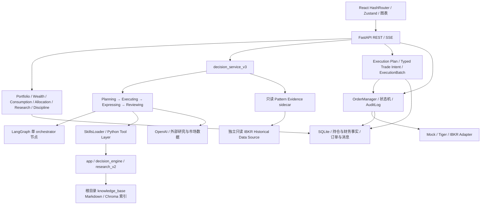

# WealthPilot 3.x 现状审计

审计日期：2026-10-11（Asia/Shanghai）  
审计基线：`main` / `4da23b1868f3e6dae85a15383405aad3b15da5e3`  
目的：为 4.0 的 ChatGPT 对话入口、专业能力开放、独立 Web 和 Mac Mini 常驻部署提供迁移依据。

## 1. 审计结论与证据规则

当前可复用的资产远超过旧文档所描述的 v3.15.1：投资业务底座之外，main 已包含财富总览、消费分析和技术形态证据。4.0 可以围绕这些服务增加外部调用与授权边界，不需要重写资产、规则、行情或订单系统。

但当前系统仍是面向单个本地使用者的应用，不是已经具备认证、远程工具协议与全天候运维能力的服务。尤其不能把现有 REST 路由或 13 份 SKILL.md 原样开放给 ChatGPT，再以模型的确认提示替代后端授权。

主要发现：

1. **基线已证实**：本地 main、缓存 origin/main、远端 main 和 `wealthpilot-personal-finance-v1.0` 的剥离 Tag 提交一致；main 比 v3.15.1 多 139 个提交。没有开放 PR，但有六个非 main 祖先的本地短期分支。
2. **专业服务已实现**：Portfolio、Allocation、Wealth、Consumption、Pattern Evidence、Execution Plan、OrderManager 和受限 ExecutionBatch 都有实际代码、入口与测试。
3. **AI 与业务没有完全解耦**：PEER 是同进程 Python 编排；数据加载、研究解析、画像、解释和交易语义提取均有直接 OpenAI 调用。内部 Skills 也不是完整、统一的可调用能力目录。
4. **交易 D 场景只能有限复用**：旧单标策略与执行计划是一条轨道，多标 ExecutionBatch 是另一条受冻结 Case 1 限制的轨道；已有确认和券商护栏，但没有可靠的远程用户身份与逐次授权证明。
5. **运行与恢复仍有缺口**：启动会扫描并改写孤儿订单状态；调度器和轮询器随 Web 进程启动；部分决策数据只在内存；仓库未发现完整常驻部署、自动备份和恢复演练体系。
6. **质量门有范围盲区**：默认 pytest、M5、前端和当前提交远端 CI 均通过，但消费等目录没有被默认 pytest 收集；补充运行揭示了测试事务、环境前提和旧模块收集污染问题。

本文标记：

- **【事实】**：当前代码、Git、静态解析或本次测试直接支持。
- **【推断】**：由事实推导的迁移影响或风险，未进行相应生产实验。
- **【待验证】**：必须通过目标设备、接入账号或授权环境验证。
- “已实现可用”表示存在实际入口和实现，并有相称证据；不代表本次再次连接真实服务验收。
- 历史验收报告只证明当时记录的结果，不能替代本次真实账户或部署验证。

本次未读取生产数据库内容、`.env`、私钥或 Keychain；未调用真实券商、同步真实持仓或提交/撤销订单。唯一新增的 Git 可见文件是这两份报告，测试另生成仓库外日志/脚本及被忽略的前端构建产物；没有业务代码修改、分支创建、提交、合并、推送或 Tag 操作。

## 2. 版本与仓库基线

### 2.1 版本身份

| 对象 | 本次核实结果 | 解读 |
| --- | --- | --- |
| HEAD / 本地 main / origin/main / 远端 main | `4da23b1868f3e6dae85a15383405aad3b15da5e3` | 当前真实开发基线，提交日期 2026-09-15 |
| `v3.15.1^{}` | `5492b1dbead99677e0e84d8a177a78e6e7157036` | 旧 SemVer 稳定参考，main 已超前 139 个提交 |
| `wealthpilot-pattern-evidence-v1.0^{}` | `f3c47080c4a6a875f5e74db4c4d6873ac04b3843` | 技术形态模块验收参考；比 v3.15.1 多 45 个提交，距 main 94 个提交 |
| `wealthpilot-personal-finance-v1.0^{}` | 与 HEAD 一致 | 当前 main 上的个人财务模块参考；不能自动改称“v3.16”或“v4.0” |
| FastAPI / 前端 package 版本字段 | `1.0.0` / `0.0.0` | 元数据未与产品版本统一，[入口][s-main]、[package][s-package] |
| README / AGENTS / 治理文档 | 仍写 v3.15.1 | 不能据此忽略后续 main；README 还保留 feature flag、LangGraph 全流程等旧描述 |

【事实】执行了 `git ls-remote` 核实远端 main 与上述 Tags，没有 fetch、移动引用或改分支。起始工作区干净；当前审计继续留在 main，按本次约束覆盖默认创建短期分支的惯例。

### 2.2 未合并工作

`git rev-list --left-right --count main...<branch>` 与 `git cherry main <branch>` 的结果如下。“独有提交”是历史关系和 patch 比较，不证明该能力尚未在 main 以其他实现完成。

| 本地分支 | main 独有 / 分支独有提交 | 分支主要内容 |
| --- | ---: | --- |
| `codex/hide-futu-sync-ui` | 139 / 1 | BrokerSyncTab 与 Portfolio correction 测试；当前 main 也已隐藏 Futu UI，不能直接按分支名判断缺功能 |
| `codex/ibkr-pattern-data-contract-probe` | 139 / 1 | IBKR Pattern 数据契约探针文档 |
| `codex/talib-consolidation-prd-revision` | 139 / 2 | TA-Lib 审计与候选 PRD |
| `codex/technical-pattern-evidence-readiness-audit` | 139 / 1 | Pattern readiness 审计文档 |
| `codex/tovest-pattern-core-migration-audit` | 139 / 1 | Tovest core 迁移审计文档 |
| `codex/tovest-pattern-reuse-audit` | 159 / 1 | Tovest reuse 审计文档；另有一个干净 worktree |
| `feat/v3.14-kline-provider` | 207 / 0 | 已在 main 历史中，仍保留本地引用 |
| `master` | 294 / 0 | 本地旧分支，已在 main 历史中；与 origin/master 不是同一 tip |

六个短期分支共有 7 个 patch 独有提交；未审计其未来合并必要性，不删除、不带入 4.0 基线。远端 head 查询本次只返回 main/master；GitHub 开放 PR 查询为 0。仓库外另一个 worktree 未改动。

【事实】当前提交 GitHub `Quality Gates` Run `34956711729` 的 Backend tests、Frontend checks、Offline M5 三个 Job 均 success。Ruleset `Protect main with Quality Gates` 当前 active，仍包含 required linear history。main 历史同时包含 `20bf93a` 和 `49f9523` 两个消费/财富集成 merge 提交；**历史事实与当前规则分别成立**，此次不推断当时如何放行。

## 3. 实际架构与调用关系

### 3.1 当前结构

【事实】当前挂载 17 组业务/Demo router，另有 `/api/health`。[路由注册][s-routes]。前端实际入口包括 Dashboard、Wealth、Consumption、Retirement、Profile、Discipline、Research、Decision、Action；首页仍是 Dashboard。数据管理、设置为 Placeholder，养老规划是稳定壳页。[前端路由][s-app]、[导航][s-sidebar]。

【事实】主要层次：

| 层 | 当前职责与边界 | 证据 |
| --- | --- | --- |
| `frontend/src` | 独立 SPA；图表、表格、编辑、SSE 消费、确认交易；API 封装集中在 api.ts，另有 allocation/broker sync client | [API client][s-api-client] |
| `backend/api` | HTTP 参数校验、状态码、Session 生命周期；部分风控、券商单例和协议逻辑也在路由中 | [Action 路由][s-action-api]、[Batch 路由][s-batch-api] |
| `backend/services` | 领域服务、数据源适配、执行计划、订单、消费分析与 Pattern | 后文模块证据 |
| `app` | ORM/SQLite、资产计算、导入、汇率、完整纪律引擎、配置计算；仍是活跃底层 | [数据库][s-db]、[分析器][s-analyzer] |
| `decision_engine` | 持仓与研究装配、前置规则、信号和各类 LLM prompt/result 处理 | [数据加载][s-data-loader]、[LLM][s-llm] |
| `intent_engine` / `backend/graph` | 意图识别、上下文继承和路由；仍有旧引擎/占位子任务实现 | [旧 orchestrator][s-old-orchestrator]、[Graph][s-graph] |
| `skills` | 项目内部元数据、Python 调用分派、prompt 注入、校验；没有对外 MCP Server | [Loader][s-loader]、[Tool registry][s-tools] |
| `research_v2` / `knowledge_base` | 研究 facts/narrative/judgment 与私有知识文件、检索；不是 ChatGPT Memory | [研究 processor][s-research-processor]、[知识配置][s-kb-config] |

### 3.2 决策实际路径

1. `/api/decision/chat` → `decision_service.run_chat_stream` → `run_chat_stream_v3`，没有 v2/v3 主路径 feature flag。[API][s-decision-api]、[委托][s-delegate]。
2. 读取会话历史、恢复进程内上下文、聚合持仓；并行执行 Planning 与 Typed Trade Intent 解析。[编排][s-decision-v3]。
3. Planning 使用 LangGraph 路由。Graph 只有 orchestrator 一个实际节点，路由后结束；不是四个 Agent 都在 StateGraph 中运行。[Graph 构建][s-graph-build]。
4. Executing 按 route 进入固定单标/组合/general 管道，调用若干 Skills 和市场数据服务；**没有按 selected_skills 任意执行清单**。Planner 增补有明确“未实际生效”的日志，reconcile 只观察不阻断。[Executing][s-executing]、[Planner][s-planning]。
5. 可选 Pattern sidecar 注入结构化证据，30 秒总等待边界；失败允许决策继续。实际数据、算法、校准与 AI 文案权威分离。[sidecar][s-pattern-sidecar]、[运行 provider][s-pattern-provider]。
6. Expressing 中一部分路径真实流式调用模型，组合/general 等路径先获得完整结果再分块发送；SSE 流式展示不等于所有模型请求都是 token streaming。[Expressing][s-expressing]。
7. Reviewing 先硬校验，仅失败时调用 LLM 评分。`retry` 当前只发 warning，不重新执行 Agent。完整自动 retry/fallback 循环仍是预留设计。[Reviewer][s-reviewing]、[编排处理][s-review-handling]。
8. 写会话、简要 DecisionHistory 和内存 Explain store。多标比较有专门分支，不能假定所有分支都使用完全相同的 review/persistence 流程。[写入][s-write-stores]。

### 3.3 旧架构与重复边界

- **活跃复用，不宜直接废弃**：`app`、`decision_engine`、LangGraph orchestrator、意图识别、研究 v1/v2 读取。模块注释写 v2 不意味着运行时已过时。
- **候选遗留**：`intent_engine.orchestrator` 对 Portfolio/Allocation/Performance 仍生成 stub flow，完整旧 `intent_engine.engine` 不在主 API 决策路径；`DecisionLog` 表注释明确 UI 尚未实现。逐模块查引用后才能删除。[旧 orchestrator][s-old-orchestrator]、[DecisionLog][s-decision-log]。
- **多处客户端与 Prompt**：`intent_engine._llm_client`、`decision_engine.llm_engine`、`app.ai_advisor`、画像、ActionPlanner、研究 processor、Reviewer 分别构建客户端/调用；超时、模型选择与异常降级不是一个统一边界。
- **两个行情契约是当前事实**：Execution Plan 使用 KlineProvider/factors；Pattern 使用带合约身份、交易日历、收盘 session、数据哈希的 CanonicalPatternSeries 与 TA-Lib。不能因都有 OHLCV 就认定可直接合并。[Kline][s-kline]、[Pattern 数据][s-pattern-data]。
- **纪律有三种范围**：主动纪律审计调用三引擎完整规则；决策前置检查为简化仓位规则；下单 RiskEngine 为三个 warning 检查。不能把完整纪律页面的能力等同于每笔订单都已执行完整 11 条纪律。[完整纪律入口][s-discipline]、[简化 Tool][s-discipline-tool]、[订单风险][s-risk]。
- **C1/C2 双轨仍存在**：output-validator、principles 可走 Skill 或直连，其条件是环境值不等于字符串 `0`；README 的 `false` 关闭示例与这个判断不一致。这些是能力级兼容 flag，不是已经删除的 v2/v3 双主路径 flag。
- **文档路径漂移**：知识配置和写入指向根目录 `knowledge_base`，不是 AGENTS 所示 `backend/knowledge_base`；README 的 Tasks、Graph、feature flag 和版本描述需后续治理，但本次不修改原文。

## 4. 功能资产盘点

| 模块 | 完成度 | 实际入口、依赖、限制与测试证据 |
| --- | --- | --- |
| 财富总览 | **已实现可用，v0.1 边界** | `/wealth`；`/api/wealth/summary, items, import/preview`；复用 Portfolio、手工资产/负债、养老金、汇率和快照。个人养老金是登记金额去重，`holding_link_verified=false`；不是 holding 身份映射。Wealth 单测在默认 pytest 中，两个财富浏览器测试本次通过。[Wealth][s-wealth] |
| 财富导入与归因 | **部分实现** | PDF 文本/文件名规则提候选金额并人工保存；截图没有实际 OCR/视觉金额提取。月度 investment_return 是累积浮盈亏的快照差，other_adjustment 是残差；不是现金流校正后的投资绩效。汇总 GET 会记录聚合快照。[候选提取][s-wealth-preview]、[汇总][s-wealth-summary] |
| 消费分析 | **已实现可用，导入与覆盖有限** | `/consumption`；Analytics、明细、CSV、分类修订、备注、候选确认/拒绝 API。已有招行信用卡 PDF/邮件、招行借记卡 PDF、建行信用卡邮件适配；导入主要经本地脚本，没有消费上传 HTTP 入口。Raw → EconomicEvent → projection/interpretation → Analytics，包含退款、去重、用户规则、来源覆盖、未分类与未换汇状态。[API][s-consumption-api]、[导入][s-consumption-import]、[Analytics][s-consumption-analytics] |
| 投资账户总览 | **已实现可用** | `/dashboard`；Portfolio summary/positions/liabilities/alerts、导入导出；canonical economic classification、平台分布、汇率、持仓聚合。部分现金来自查询时 Tiger 调用；失败 fallback 的完整性不能被当作实时账户权威。[Portfolio][s-portfolio]、[分类][s-classification] |
| 券商数据接入 | **已实现，按源有边界** | Tiger/Futu/Snowball/Guojin 同步服务与快照、归属字段和 stale 清理。Futu 从 UI 隐藏，后端与定时任务仍在。BROKER_MODE 包含 ibkr 时 SnowballSyncService 实际读取共享 IBKR adapter，但存储 broker 仍用 snowball。Guojin 是远端 VM HTTP QMT 网关，港股通仍有汇总行。[同步入口][s-sync-api]、[IBKR 同步][s-snowball-sync]、[QMT][s-qmt] |
| 资产配置 | **已实现可用** | `/api/allocation` 的 snapshot/deviation/增量与初始方案/纪律校验；Web 与对话复用计算器。当前五大资产类别和目标规则属于后端业务权威。[配置服务][s-allocation] |
| 纪律与投资理念 | **已实现可用，调用范围不同** | `/discipline`、philosophy/knowledge API；规则、手册、三引擎审计、知识文件/RAG。需要复用明确的模式和规则版本，不能只复用文字 Prompt。[纪律服务][s-discipline] |
| 用户画像与目标 | **已实现可用** | `/profile`；问卷、图片提取、AI summary/style、冲突与风险有效期；画像金融事实和目标落库，依赖 GPT-4.1/mini。不是已与 ChatGPT 用户偏好同步。[画像][s-profile] |
| 投研观点 | **已实现，保留两代数据边界** | `/research`；文本/URL/PDF、外部 AV/AKShare、卡片判断和正式观点；v1 ResearchDocument/Card/Viewpoint 与 ViewpointCardV2 共存，知识写入/索引另有边界。旧解析入口仍在路由，不能全部当死代码。[研究服务][s-research]、[processor][s-research-processor] |
| 技术指标与形态 | **已实现可用，精确范围受限** | 6 个形态家族：突破、跌破、矩形、上升三角形、双顶、双底；运行 registry 放行 9 个 Pattern×经济类别 scope：Equity 6 个，Fixed Income 仅突破/上升三角形/双顶。其余 fail closed。现时只读 IBKR 日线证据进入决策和展示，不能改变订单权威；TA-Lib 是 Pattern 指标权威。[registry][s-pattern-registry]、[UI][s-pattern-ui] |
| 投资决策 | **已实现可用，AI 编排部分契约化** | 五种意图、澄清、多轮、多标比较、研究/原则引用、SSE、硬校验。Offline M5 18/18；不证明真实模型输出质量稳定或全部 Skill 契约已落实。[PEER][s-decision-v3] |
| 收益分析 | **部分实现** | PerformanceAnalysis 对话实际调用 LLM，使用当前持仓盈亏/权重 payload；独立收益分析页面隐藏并指向 Placeholder。未发现完整 TWR/MWR、基准/现金流/交易归因服务。不要按五意图支持推断已有绩效账本。[LLM Performance][s-performance]、[导航][s-sidebar] |
| 执行计划 | **已实现可用** | generate/persist-draft/confirm/update-tranches/adjust；因子 → 规则价格与数量 → AI rationale → validator；计划确认拆成策略，15 分钟触发评估只 arm 批次，不自动下单。US/HK、券商/AV/隔离 Demo Seed 边界；本次相关 98 单测通过。[规则引擎][s-plan-rule]、[确认服务][s-plan-confirm]、[触发器][s-trigger] |
| ActionPlanner 草稿 | **业务已实现；Skill 协议不可调用** | `/api/action/drafts/generate` 直接调用 `plan_actions`，LLM 从对话积极推算 quantity/limit_price，保留 value_sources/missing_fields，并入库待确认。不能套用“所有数字都由规则引擎生成”。Skill YAML 本次静态与实际 Loader 均验证失败。[API][s-action-generate]、[planner][s-action-planner]、[Skill][s-action-skill] |
| Typed Trade Intent | **已实现，提取范围有限** | 对话解析输出字段来源/缺失/歧义、用户确认理解结果；持久化在 assistant message metadata，确认本身不创建交易实体。[parser][s-intent-parser]、[确认][s-intent-confirm] |
| ExecutionBatch | **部分实现，Case 1 专用可用** | 冻结 IBKR、USD cash、ALL_AVAILABLE_CASH、LSE USD Acc、BUY LIMIT 及指定 legs variants；现金权威、费用预留、安全垫、SMART 合约路由、WhatIf、确认版本/哈希、逐腿提交、对账/停止/重试。不能推断支持通用“卖 A 买 B”或任意组合调仓。[约束][s-batch-case]、[提交][s-batch-submit] |
| 交易授权与执行 | **本地流程已实现；远程授权未实现** | ConfirmOrderDialog、BatchCard、服务端二次风险与明确文字确认；Mock/Tiger/IBKR LIMIT，订单状态/部分成交/撤单/轮询/审计。缺少经认证 actor、账户权限和一次性授权证据。[Action API][s-action-submit]、[Batch API][s-batch-api] |
| 历史决策与复盘 | **历史部分实现；复盘仅保留基础** | Conversation/Message、DecisionHistory、订单/计划/批次/审计、Pattern metadata；Explain 完整结果仍在内存。没有完整“决策→实际执行→未来价格/收益→误差归因→策略版本更新”服务/页面。DecisionLog 表不等于已实现复盘。[模型][s-history-model]、[写入][s-write-stores] |
| 养老规划、Tasks、系统设置 | **仅壳/接口设计** | Retirement 明确建设中；Tasks create/status 返回 501；数据管理/设置 Placeholder。不能当成远程持久任务框架。[养老壳][s-retirement]、[Tasks][s-tasks] |

消费分析本次 275 passed、1 failed 的原因见第 8 节；其他表格中的“测试存在”不意味着每个第三方数据源均经真实连接复验。

### 4.1 测试资产与覆盖缺口

这里的覆盖指具体测试对象，不是行覆盖率；本次没有生成 coverage 百分比。

| 业务范围 | 当前测试资产 | 能证明什么 / 主要缺口 |
| --- | --- | --- |
| 财富 | [test_wealth_service.py][s-wealth-tests]、两个 Wealth 浏览器 spec | 隔离资产汇总、去重/归因边界与 UI 刷新；无真实财务数据验收 |
| 消费 | [消费测试目录][s-consumption-tests]、consumption-ui.spec.ts | 事件、适配、分类、持久化、分析与展示；目录不在默认 pytest；本次一项 fixture 失败 |
| 组合、分类与同步 | [test_analyzer.py][s-analyzer-tests]、[test_asset_classification.py][s-classification-tests]、test_portfolio_sync_corrections.py、[同步测试目录][s-sync-tests] | 汇总/分类/同步 scope 与 persistence；真实连接测试默认排除，完整 Portfolio API 的实时现金仍需单独验证 |
| 技术形态 | [technical_patterns 测试目录][s-pattern-tests]、Pattern Data adapter/immutable dataset tests、pattern-evidence.spec.ts | 检测、golden parity、calibration、治理/范围、决策集成与展示；数量较多，但不能替代真实交易收益验证 |
| 决策、知识与内部协议 | Agents tests、tests/knowledge、tests/skills、manifest/reconcile tests、Offline M5 | 冻结环境回归、数据契约、RAG 与编排；真实模型评分/远程 ChatGPT 不在验证范围 |
| 执行计划 | [执行计划测试目录][s-plan-tests] | 因子、provider、规则、状态机、trigger 和 validator；目录不在默认 pytest |
| 理解确认与 Batch | [test_trade_intent_persistence.py][s-intent-tests]、[test_execution_batch_service.py][s-batch-tests]、calculator/presentation tests | 语义结构、确认与 Case 1 业务边界；不证明任意调仓或并发/崩溃 exactly-once |
| 单标交易与券商 | [Action 测试目录][s-action-tests]、broker tiger/credential tests | 风控、状态、下单/撤单/IBKR assembly 与 mock 行为；broker 子目录须显式收集，实盘未运行 |
| 画像、独立配置 API、完整研究 API、长期记忆 | 现有决策用例/其他测试有间接调用；未找到按这些服务命名的独立完整测试套件 | 不能据间接回归认定上传、模型解析、更新、鉴权或所有失败分支有系统性测试 |
| 远程认证、常驻运维与 E 复盘闭环 | 未发现对应完整系统验收套件 | 属于新增接入/运行能力或未实现范围，需后续 Gate |

## 5. AI 能力、协议与耦合审计

### 5.1 当前模型调用

| 能力 | 当前实现 | 迁移属性 |
| --- | --- | --- |
| 意图识别/路由与通用问答 | `intent_engine`、Graph、Expressing、`llm_engine`，Chat Completions，GPT-4.1 与 mini | 通用对话能力候选迁出；当前路由又承担业务范围控制，需要保留服务端校验 |
| 专业决策解释 | 单标 GPT-4.1、组合 `_call_generic_llm` GPT-4.1；规则/持仓/研究/RAG 进入 payload | Prompt 中包含专业知识，但模型推理可由 ChatGPT 承担；数据、规则和证据输出不能迁出 |
| 标题与摘要 | GPT-4.1-mini，daemon thread | 通用会话功能，可在新入口替代后逐步退役 |
| 交易语义提取 / 草稿 | Typed parser 与 ActionPlanner 使用 GPT-4.1-mini | 语言提取可替代；字段来源、缺失、确认、数值权威和支持范围必须留在后端 |
| 研究与画像解析 | 研究 processor/ai_advisor 使用 mini；画像 GPT-4.1/mini；银行/券商截图 `gpt-4o` | 专有工作流中包含通用提取能力，不因迁出聊天而自动消失 |
| Reviewer / 知识 embedding | GPT-4.1-mini；`text-embedding-3-small` | 硬校验与知识权威保留；评分/向量化是否继续后端运行需评估 |

模型字符串来自源码，并非本次推荐型号或对未来可用性的承诺。[共享 client][s-models]、[LLM][s-llm]、[图片解析][s-vision]、[Embedding][s-embedding]。

【事实】存在多个同步客户端、`asyncio.to_thread`、真实 streaming 和完整结果分块发送。数据 Loader 也包含 LLM 语义匹配与研究/知识装配，不是可以无副作用地直接对外暴露的纯持仓查询函数。

【事实】“数据只存本地”和“不将持仓数据传到云端”不能混用：`_call_generic_llm` 将含持仓、盈亏、画像的 JSON payload 发送到 OpenAI；截图解析发送图像；Embedding 发送文本。**落盘本地是真的，模型输入完全不出本地不符合当前实现。** 本次未调用这些真实 Provider。4.0 的数据最小化与用户同意必须以实际传输边界为准。[payload][s-llm-payload]、[调用][s-llm-call]。

### 5.2 Skills / Tools / MCP

- 【事实】磁盘有 13 份 `skills/*/SKILL.md`；按 Loader 同样的 YAML 解析，本次仅 12 份合法，实际 `SkillsLoader().list_skill_names()` 返回 12，缺 `wp-action-planner`。
- 【事实】该文件 description 的非引用文本包含 `trigger: `，导致 `yaml.ScannerError`；Loader 返回 None 后跳过。即使修正 YAML，function_call 分派要求 tool_name，而该文件只列 entry_point；需要另行解决调用契约，不能只修格式就认定已接通。[Skill][s-action-skill]、[分派][s-loader-dispatch]。
- 【事实】`TOOL_SCHEMAS` 为 16 项、`TOOL_EXECUTORS` 为 17 项，Execution Plan 有 executor 但不在同一 schema 清单中。13 个 Skill、16 个 schema、17 个 executor 是三种不同计数。[registry][s-tools]。
- 【事实】`wp-reasoning` 的直接 llm_dispatch 只放行 `general_chat`，专业 reason/review/allocation/performance 仍调用具体函数；不具备文档所描绘的统一参数化 Skill 调用完整度。[dispatch 白名单][s-loader-dispatch]。
- 【事实】盈米 MCP 是**向外消费的 Client**；仓库运行入口没有 WealthPilot 的 MCP Server、tools/list/tools/call、用户 OAuth 或外部 tool schema 服务。[MCP Client][s-mcp-client]。
- 【推断】内部 Skill 的入口定义和 Python/Pydantic 结果是未来封装线索，不能视为 ChatGPT 已可加载执行的产品接口。应先明确“计算/查询服务、业务编排、语言说明、写操作”四种边界。

### 5.3 记忆与上下文

- 【事实】SQLite Conversation/Message 保存内容、摘要、metadata；读取摘要 + 最近窗口；超过 20 条未摘要消息时，后台压缩旧消息并保留最新 10 条，mini 生成摘要。[窗口][s-history-window]、[压缩][s-summary]。
- 【事实】`intent_engine.context_manager` 仍有进程内 session/inheritance；启动或切换会话由历史重建，不是跨进程 A2A 或集中 session store。
- 【事实】DecisionHistory 保存有限字段，回答最多 500 字；`memory_service.get_decision_history` 存在，但主链路未见调用该查询服务，不能按其“Long-term Memory”注释认定已形成跨会话偏好检索。[History][s-history-model]、[Memory query][s-memory]。
- 【事实】完整 Explain 的 `_DECISION_STORE` / `_ALLOC_EXPLAIN_STORE` 是进程内 dict；消息持久化不等于完整决策证据在重启后可恢复。[write stores][s-write-stores]。
- 【事实】根目录 Markdown 是原则/研究知识来源，Chroma 是索引；索引目录、配置和部分缓存采用相对路径。业务知识和 UserProfile 不能自动由 ChatGPT 的偏好记忆取代。[配置][s-kb-config]。
- 【待验证】ChatGPT 记忆如何影响工具调用、能否被可靠读取/导出/对账、与本地金融目标的冲突处理，当前仓库均无实现。迁移初评不承诺这些能力。

## 6. 数据、交易与安全边界

### 6.1 数据模型与存储

静态 ORM 定义共 40 张表（不是生产 DB 实际表数量）：`app/models.py` 15、Action 7、Execution Plan 2、Consumption 14、Broker sync 2。LangGraph checkpoints 和 Chroma 另外存储。[主模型][s-main-models]、[交易模型][s-order-models]、[消费模型][s-consumption-models]、[同步模型][s-sync-models]。

- 【事实】默认业务 DB `data/wealthpilot.db`，可由 `WEALTHPILOT_DB_PATH` 隔离。SQLite + SQLAlchemy NullPool；Base 注册及 create_all、幂等 ALTER 和部分 UPDATE 在 init_db 中执行；并非已有完整版本化迁移/回滚体系。[DB][s-db]。
- 【事实】Graph checkpoint 硬编码到项目 `data/checkpoints.db`，不遵从 `WEALTHPILOT_DB_PATH`。M5 对 sqlite.connect 专门替换为内存；普通业务 DB 环境隔离不自动隔离所有数据存储。[checkpoint][s-graph-build]、[M5 isolation][s-m5-isolation]。
- 【事实】业务持仓/财富部分使用 Float，订单/同步/消费多使用 Numeric/Decimal；不是全域一致的金额模型。现有 canonical asset classification 是可复用的唯一经济资产分类入口，未知 ETF 暴露应继续 UNKNOWN，不重新以 STK 当 Equity。[分类][s-classification]。
- 【事实】多数 API 使用全局默认 portfolio；消费账户、Batch、订单等也未与经认证用户绑定。支持 portfolio_id 参数不等于多用户授权隔离。
- 【事实】财富 cashflow 直接读取当前活跃 EconomicEvent.base_amount 的收入/消费；消费图表使用净额 projection + interpretation/eligibility。两者不是同一统计查询，退款/排除/覆盖口径需另外对账。[现金流][s-wealth-cashflow]、[消费 Analytics][s-consumption-analytics]。

### 6.2 IBKR 连接与交易机制

【事实】IBKRBrokerAdapter 使用 `ib_async`，独立 daemon thread/event loop，通过 `run_coroutine_threadsafe` 对外提供同步方法；连接按需建立并检查账户类型/managedAccounts，默认 host 回环、port 4002、clientId 1。[Adapter][s-ibkr]、[连接][s-ibkr-connect]。

已有护栏和状态能力：

- read-only 本地闸门、live enable、账户前缀与市场/限价/数量验证；Gateway Read-Only 是外部配置，本次未验证。
- 旧 US/HK LIMIT 下单之外，受信任 LSE USD Acc Batch 通过已验证 conId/上市身份与 SMART 路由；不能把 LSE 例外扩大成全市场通用能力。
- WhatIf 使用独立 whatIf order 构建/调用路径，不调用 placeOrder；费用/报价/现金完整性检查属于业务权威。
- orderRef、本地 OrderRecord、permId 优先、orderId 兼容、broker acknowledgement 等待、部分成交、撤单请求和 not_found 重试；unknown 明确保留不确定状态。
- ExecutionBatch 按确认版本/哈希、前序腿状态、外部 BUY 冲突、当前现金、LIVE 报价、市场开放和 WhatIf 再校验，逐腿提交与 broker authority reconciliation。[Batch][s-batch-submit]。

【事实】订单 Poller 每几秒同步，并回写计划/策略/Batch 状态；启动的 `scan_orphan_orders` 会先将无 broker_id 的 submitted 标 unknown，再将同类 unknown 标 cancelled，随后 commit。它没有先证明券商未收到订单。[孤儿扫描][s-orphan]。

【推断】“提交已到券商、DB 尚未持久化”时发生进程崩溃，是必须验证的恢复窗口。OrderManager 在 broker 调用前创建/flush 订单，但最终 commit 由 API/service 后续执行；Batch 幂等主要为查询已存在记录，OrderRecord 目前没有该组合的唯一约束。单进程顺序测试通过，不等于并发/重启 exactly-once 已证实。[下单][s-order-submit]、[OrderRecord][s-order-models]。

【事实】Pattern 历史行情另有独立只读 loop/source，运行默认 `IBKR_PATTERN_CLIENT_ID=41`，请求后 shutdown；交易/同步共用 Action singleton。并发 Pattern 请求、重启/重连和 clientId 冲突未在本次真实 Gateway 验证。[Pattern source][s-pattern-source]、[Provider][s-pattern-provider]。

### 6.3 认证、授权、风险与凭证

- 【事实】Private Full Mode 未挂载统一身份认证 middleware/dependency；接口没有经认证 actor 与账户 scope。Demo 密码门只在 Demo 生效，允许 header/cookie/query password；CORS 本地 allowlist 不是认证。[middleware][s-demo-middleware]、[main][s-main]。
- 【事实】旧下单路由后二次检查 RiskEngine，风险 warning 需精确文字确认；Batch submit 需要 `live_order_acknowledged`、`confirmation_text` 与 `confirmation_version`。它们是请求字段，不能证明远程请求来自用户本人。[下单路由][s-action-submit]、[Batch 路由][s-batch-api]。
- 【事实】旧 RiskEngine 总资产 <=0 时直接跳过并返回通过；纪律数据不可得时也可能仅执行剩余检查。Batch 则有独立现金/合约/费用保护，不应把两条链路的检查覆盖率混为一谈。[RiskEngine][s-risk]。
- 【事实】AuditLog 为应用层 append-only，user_id 可空；Action API 记录 IP/User-Agent，Batch audit 未建立认证 actor 链。未发现不可篡改存储/链式签名/独立日志权限；不能称为防篡改审计。[审计模型][s-audit-model]。
- 【事实】Tiger 交易有 KeyringCredentialProvider/InMemory；Tiger 同步、Portfolio 虚拟现金与行情也读取环境变量和私钥路径，凭证并非全经 Keychain。IBKR 使用 Gateway 登录会话；Guojin 使用网关 secret。[凭证][s-credentials]、[Portfolio][s-portfolio]。
- 【推断】现有日志/源码样例有账户标识与原始响应边界，不能直接面向远程用户开放。报告不复述这些值；尚未逐行审计全部日志脱敏，也未访问真实凭证。

### 6.4 外部数据源与降级路径

| 来源 | 实际使用位置 / 配置方式 | 边界与本次验证 |
| --- | --- | --- |
| IBKR Gateway / TWS | Action adapter、Snowball 模式同步、独立 Pattern source；连接参数/会话来自本地运行配置 | 交易与只读源分别有 clientId/loop；未连接真实 Gateway |
| Tiger | 同步/虚拟现金/历史 Kline/真实订单 adapter；环境配置、私钥路径及交易 CredentialProvider | 配置不统一；未访问凭证或真实账户 |
| Futu OpenD | [quote service][s-futu-market] 等读本机 11111；同步服务另有入口 | 获取失败返回 None；UI 隐藏不等于后端移除，未验证真实 OpenD |
| Alpha Vantage | [基本面 service][s-av-market] 多 key 轮换；[研究 adapter][s-av-research] 新闻/基本面/财报；Execution Plan Kline fallback | 两处配置/Mock 路径不同；限流、错误返回缺失/错误，AV_DEV_MOCK 不代表所有行情入口都必然无网络；本次另用网络 guard |
| AKShare | research_v2/adapters/akshare_adapter.py，研究 ingest | 有 fixture 路径；真实网络/源稳定性未验收 |
| 盈米 MCP | 外部 URL/Key 配置的 [MCP Client][s-mcp-client]，基金数据/研究 Tool | 向外消费，不能反推具备 WealthPilot 对外服务 |
| Guojin / QMT | [远端 VM 网关][s-qmt]，HTTP secret 与 positions | 依赖仓库外运行服务；无真实网络调用 |
| Frankfurter FX | [app/fx_service.py][s-fx]，直接/交叉汇率 + 内存缓存 | 失败使用硬编码 USD/HKD fallback，并记录 `rate_date=fallback`；未知币种 fallback 默认 1.0，**不是已验证汇率**；本次出现合成 FX fallback warning |
| OpenAI | 语言模型、视觉与 Embedding | 外部模型接收实际业务输入；本次均为 Mock/静态结果，未消耗真实模型调用 |
| 本地文件/人工登记 | 券商文件、消费 PDF/EML、财富手工项、知识 Markdown | 对外接入需保持来源/修订与用户确认，不能把文件来源当成实时券商权威 |

【推断】optional 源应继续允许分析 graceful degrade，但实际交易需要对必要权威数据 fail closed。4.0 不能把所有失败统一转换成 0 或把 FX fallback 当作实时可执行汇率。市场数据真实目录是 `backend/services/market_data`，旧 AGENTS 的 `backend/market_data` 结构已经漂移。

## 7. 运行环境、Mac Mini 与恢复

| 项目 | 已证实事实 | 迁移影响 / 待验证 |
| --- | --- | --- |
| 当前宿主与 Python | 宿主 `uname -m=arm64`；指定 wealthpilot Python 为 Darwin x86_64 / 3.11.13 | 当前测试是 Intel Python 在 ARM 宿主上的环境结果；**不是 ARM 原生 Mac Mini 验收** |
| 依赖 | 实测 ib_async 2.1.0、TA-Lib 0.6.8、Chroma 1.5.9、OpenAI 2.29.0、FastAPI 0.135.3、SQLAlchemy 2.0.48 | requirements 多为开放下限或未固定；原生 ARM wheel、TA-Lib/Chroma 与券商 SDK 需重新安装验证 |
| 依赖完整性 | 源码直接使用 keyring；Fund E 使用 pandas.read_excel，需可用 Excel engine；requirements 未显式列 keyring/Excel engine | 当前环境已安装不代表干净 Mac Mini 可复现全部入口 |
| 启动 | uvicorn + Vite 开发启动；主程序加载项目 .env；静态 frontend/dist 托管只在 Demo 分支 | Private production Web 需正式静态托管和配置，不能靠 dev server 自动视为常驻方案 |
| 调度 | lifespan 启动 22:00 Asia/Shanghai 四券商同步、15 分钟触发扫描、OrderPoller | 随应用进程重复创建；多 worker 可能重复调度/clientId 冲突，需单实例或独立 worker 验证 |
| 调度持久性 | APScheduler 默认内存配置；`_last_scan_time` 在进程内，缺少重启前水位时不触发相同补扫条件 | 停机错过任务、睡眠/唤醒、网络恢复和交易时段需恢复 PoC，不能按 misfire_grace_time 推断重启补偿完备 |
| shutdown / reconnect | IBKR adapter 有 shutdown；main shutdown 明确停止 poller/scheduler/Mock，未见相应关闭真实 adapter 单例调用 | daemon loop 清理、Gateway 重启、客户端抢占与重连有实现片段，缺整机运行证据 |
| 远程访问与身份 | 仓库未找到部署级 TLS/reverse proxy、OAuth/RBAC、launchd plist、生产 supervisor 配置 | 不证明用户机器/路由器上不存在配置；本次未审计仓库外设施 |
| 备份 | 消费导入/重放脚本 `_backup_database` 使用 SQLite backup API，源 mode=ro | 这是操作前本地备份，未发现统一定时、加密、异地、保留周期、完整恢复演练；需覆盖业务 DB/checkpoint/知识源/配置 |
| 健康与恢复 | `/api/health` 只返回 ok；startup 会 create/migrate DB 并改写孤儿状态 | 不是行情新鲜度/Gateway/磁盘/调度/DB 可写 readiness；恢复后不能未经对账直接开启交易 |

【事实】仓库搜索范围覆盖 app、backend、scripts、requirements、CI 和现有启动文档，未发现上述完整运维体系。没有检查系统 Keychain、LaunchAgents、目标 Mac Mini、睡眠设置、公网域名或真实 Gateway 状态。[lifespan][s-main]、[backup][s-backup]、[requirements][s-requirements]。

## 8. 本次验证与质量边界

### 8.1 运行方式

测试使用 `/Users/songbin/opt/anaconda3/envs/wealthpilot/bin/python`；显式环境白名单，不继承本地密钥/代理；默认禁用 dotenv、临时 SQLite、Demo + Mock、关闭真实交易与外部行情。补充 pytest 加了 outbound socket guard，并将 checkpoint 连接转到内存；M5 使用自身白名单、冻结 Provider、内存 checkpoint 与公网 guard。

浏览器使用新建独立 Vite 端口与临时 fixture backend，主测试 Vite 的 API proxy 指向未使用端口，避免接触现有生产 API；真实 Wealth/Portfolio 服务用临时 SQLite，其他页面为静态/拦截 fixture。构建产物为生成文件，不修改业务源码。未开展 Live M5、真实 broker integration 或个人财务数据验收。

### 8.2 结果

| 检查 | 本次结果 | 证明范围 |
| --- | --- | --- |
| 默认 `python -m pytest` 收集范围 | **896 passed, 7 skipped**，137.10s | 当前 pytest.ini 默认质量门；不是仓库所有 test 文件 |
| Offline M5 | **18/18，public_network_attempts=0** | 冻结外部结果下真实 FastAPI/SSE + PEER 路径；不证明实时模型质量或真实 broker 可用 |
| 前端 lint / build | **通过** | 生成 bundle 约 1,199.21 kB（gzip 335.19 kB）；已有 >500 kB 非阻断提示 |
| Playwright 全部现有 spec | **22 passed**，38.5s | 导航、消费 UI、Pattern 展示、Futu 隐藏、财富刷新与临时 DB 一致性；不是实盘 UI 验收 |
| Broker sync 目录补充测试 | **45 passed, 2 integration deselected** | Mock/静态数据；有一条 FX fallback warning，未请求真实行情 |
| Execution Plan 目录 | **98 passed** | 模型、规则、数据 provider、触发与 validator |
| Consumption 目录 | **275 passed, 1 failed** | 失败为下述 fixture/事务问题；不宣称该目录全绿 |
| 额外混合模块组 | **166 passed, 10 failed** | 初次环境与 fixture 前提不匹配；已做下述定向复验，计数不能相加 |
| 环境 / 凭证 / Loader 定向复验 | **6 / 20 / 11 passed** | 测试合成 dotenv、非 Demo 凭证 mock、初始化临时 DB；未读取真实配置或凭证 |
| Graph 两个旧测试文件 | **3 passed, 8 failed** | 5 项缺 checkpoint configurable.thread_id；1 项仍断言 13 schemas 而实际 16；2 项被全局模块 mock 污染 |
| 大范围补充一次收集 | **34 collection errors** | Graph 旧测试的导入阶段模块替换使后续 package 失效；改为进程隔离后能运行各业务目录 |
| 远端当前提交 CI | 三个 Gate Job **success** | 与 `.github/workflows/ci.yml` 范围一致；不包含补充目录和浏览器测试 |
| Skill 静态解析 + Loader | **13 文件 / 12 discovered** | ActionPlanner 协议失败；业务直接调用路径仍实现 |

初次额外混合组的 10 失败包括：3 项要求读取测试生成的 dotenv 却被审计的禁用环境挡住；6 项 Keyring/工厂测试期望非 Demo 行为却被 Demo 短路；1 项 Loader Tool 测试未先初始化临时 positions 表。后续仅在相关测试的合成配置中调整前提，不读取真实 `.env` 或 Keychain；环境测试 6 passed、凭证测试 20 passed、Loader 测试 11 passed，分别耗时 0.05s / 1.63s / 1.88s。这些不能当作新增业务回归；复验包含原已通过项，不与前述计数相加。

消费失败用例：[test_analytics_service.py:77][s-consumption-test]。第一次请求前 `_event` / `_account` 只 flush，API 的 finally 关闭 monkeypatched 同一 Session，导致未提交数据 rollback。仓库外合成诊断得到：第一次请求前 Account/Event 数为 1/1；请求后为 0/0；随后 commit September event 后为 0/1，默认账户集合为空，窗口回落 `date.today()`，本次得到 2026-10。原期望 2026-09，因此当月份变化时暴露问题。**这是当前 main 的测试事务缺陷，不能凭该失败断定生产最新月份算法错误。** 未改测试或业务代码。

【事实】pytest.ini 只列 `tests`、Action tests、Pattern Data tests、Agents；消费、broker_sync、execution_plan、core、graph、skills 等测试目录被遗漏或需显式运行。CI 直接使用默认 pytest，因此“全量 pytest”名称的覆盖范围小于完整仓库。[pytest 配置][s-pytest]、[CI][s-ci]。此次没有代码候选分支，所有发现是现状问题；没有将历史债务描述成新分支回归。

### 8.3 证据保存与限制

完整本次日志、JUnit、浏览器 JSON 和诊断脚本位于仓库外：

`/var/folders/3z/jxp28jq906xc9qb5f3qr26g00000gn/T/wealthpilot-phase0-32yfyol1/`

主日志：pytest.log、m5.log、browser.log；补充日志：consumption.log、broker.log、plan.log、misc.log、graph.log、envcheck.log、credentialcheck.log、loadercheck.log。M5 Markdown 报告在 `/tmp/wealthpilot-m5/m5_e2e_report.md`。这些是本机临时证据，不是永久归档；本报告保存了必要的结果和复现前提，不包含真实财务记录或凭证。

## 9. 需要影响 4.0 方案选择的事项

| 优先级 | 判断 | 事实与迁移含义 |
| --- | --- | --- |
| P0 | 远程身份/交易授权需要新增边界 | 本地确认字段不能证明 actor；公开所有 REST mutation 会扩大账户执行权限。先验证读取/草稿/人工确认/实际执行分权 |
| P0 | 重启和提交不确定窗口必须 PoC | 启动扫描能写 cancelled；本地事务与 broker 接收不是一个事务；不能用自动重试代替 broker authority 对账 |
| P0 | ChatGPT 接入不是现有 Skill 原样搬运 | 12 discovered、调用目录不一致、无 MCP Server；需要明确 DTO、错误/新鲜度、scope、输出最小化 |
| P1 | 私有记忆与金融事实应分开 | ChatGPT 可承担会话偏好，但账户、风险目标、规则、确认与执行记录仍应有后端真相源 |
| P1 | 场景 A 查询语义应标准化 | Wealth GET 有写快照副作用；Portfolio GET 可能调用 Tiger；数据“缺失/过期/失败/为零”需要区分 |
| P1 | 常驻化先验证单实例和 ARM 环境 | 当前不是原生 ARM 依赖验收；多 worker、Gateway、定时水位、Keychain、QMT VM 都有独立依赖 |
| P1 | 复盘不能从聊天摘要还原全部证据 | 当前 Explain 内存、History 截断；4.0 应保留可关联的事实和版本基础，E 场景后续实现 |
| P1 | 收益口径与消费/财富口径需澄清 | 当前浮盈亏差、现金流原额与消费净额不同；不能在 MCP 输出中包装成完整绩效归因 |
| P2 | 测试与文档治理收敛 | 当前 CI 通过与补充目录问题可以同时成立；补齐采集/隔离与版本事实，防止后续 migration Gate 漏报 |

迁移动作、A/B/C/D/E 对照和 PoC 问题详见 [WealthPilot_4x_Migration_Impact_Assessment.md](/Users/songbin/Documents/GitHub/WealthPilot/docs/WealthPilot_4x_Migration_Impact_Assessment.md)。这些是模块级初评，不构成实施 PRD，也没有在此次审计中改变任何架构。

## 10. 当前代码证据索引

链接行号均对应本报告记录的 HEAD；后续代码变化时应以该提交复核。文件名和行号作为事实定位，历史文档只作为辅助证据。

[s-main]: /Users/songbin/Documents/GitHub/WealthPilot/backend/main.py:32
[s-routes]: /Users/songbin/Documents/GitHub/WealthPilot/backend/main.py:184
[s-package]: /Users/songbin/Documents/GitHub/WealthPilot/frontend/package.json:4
[s-app]: /Users/songbin/Documents/GitHub/WealthPilot/frontend/src/App.tsx:25
[s-sidebar]: /Users/songbin/Documents/GitHub/WealthPilot/frontend/src/components/layout/Sidebar.tsx:24
[s-api-client]: /Users/songbin/Documents/GitHub/WealthPilot/frontend/src/lib/api.ts:1
[s-action-api]: /Users/songbin/Documents/GitHub/WealthPilot/backend/api/action.py:62
[s-batch-api]: /Users/songbin/Documents/GitHub/WealthPilot/backend/api/execution_batch.py:259
[s-db]: /Users/songbin/Documents/GitHub/WealthPilot/app/database.py:16
[s-analyzer]: /Users/songbin/Documents/GitHub/WealthPilot/app/analyzer.py:59
[s-data-loader]: /Users/songbin/Documents/GitHub/WealthPilot/decision_engine/data_loader.py:1
[s-llm]: /Users/songbin/Documents/GitHub/WealthPilot/decision_engine/llm_engine.py:114
[s-old-orchestrator]: /Users/songbin/Documents/GitHub/WealthPilot/intent_engine/orchestrator.py:38
[s-graph]: /Users/songbin/Documents/GitHub/WealthPilot/backend/graph/decision_graph.py:133
[s-loader]: /Users/songbin/Documents/GitHub/WealthPilot/backend/skills/loader.py:65
[s-loader-dispatch]: /Users/songbin/Documents/GitHub/WealthPilot/backend/skills/loader.py:175
[s-tools]: /Users/songbin/Documents/GitHub/WealthPilot/backend/graph/tools.py:1155
[s-research-processor]: /Users/songbin/Documents/GitHub/WealthPilot/research_v2/processor.py:72
[s-kb-config]: /Users/songbin/Documents/GitHub/WealthPilot/backend/config/knowledge.yaml:1
[s-decision-api]: /Users/songbin/Documents/GitHub/WealthPilot/backend/api/decision.py:38
[s-delegate]: /Users/songbin/Documents/GitHub/WealthPilot/backend/services/decision_service.py:615
[s-decision-v3]: /Users/songbin/Documents/GitHub/WealthPilot/backend/services/decision_service_v3.py:96
[s-graph-build]: /Users/songbin/Documents/GitHub/WealthPilot/backend/graph/decision_graph.py:387
[s-executing]: /Users/songbin/Documents/GitHub/WealthPilot/backend/agents/executing_agent.py:71
[s-planning]: /Users/songbin/Documents/GitHub/WealthPilot/backend/agents/planning_agent.py:311
[s-pattern-sidecar]: /Users/songbin/Documents/GitHub/WealthPilot/backend/services/decision_service_v3.py:62
[s-pattern-provider]: /Users/songbin/Documents/GitHub/WealthPilot/backend/services/technical_patterns/runtime_provider.py:41
[s-expressing]: /Users/songbin/Documents/GitHub/WealthPilot/backend/agents/expressing_agent.py:317
[s-reviewing]: /Users/songbin/Documents/GitHub/WealthPilot/backend/agents/reviewing_agent.py:95
[s-review-handling]: /Users/songbin/Documents/GitHub/WealthPilot/backend/services/decision_service_v3.py:368
[s-write-stores]: /Users/songbin/Documents/GitHub/WealthPilot/backend/services/decision_service_v3.py:734
[s-decision-log]: /Users/songbin/Documents/GitHub/WealthPilot/app/models.py:222
[s-kline]: /Users/songbin/Documents/GitHub/WealthPilot/backend/services/execution_plan/kline_provider.py:301
[s-pattern-data]: /Users/songbin/Documents/GitHub/WealthPilot/backend/services/pattern_data/contracts.py:1
[s-discipline]: /Users/songbin/Documents/GitHub/WealthPilot/backend/services/discipline_service.py:1
[s-discipline-tool]: /Users/songbin/Documents/GitHub/WealthPilot/backend/graph/tools.py:136
[s-risk]: /Users/songbin/Documents/GitHub/WealthPilot/backend/services/action/risk_engine.py:53
[s-wealth]: /Users/songbin/Documents/GitHub/WealthPilot/backend/services/wealth_service.py:247
[s-wealth-preview]: /Users/songbin/Documents/GitHub/WealthPilot/backend/services/wealth_service.py:506
[s-wealth-summary]: /Users/songbin/Documents/GitHub/WealthPilot/backend/services/wealth_service.py:437
[s-consumption-api]: /Users/songbin/Documents/GitHub/WealthPilot/backend/api/consumption.py:86
[s-consumption-import]: /Users/songbin/Documents/GitHub/WealthPilot/backend/services/consumption/import_runner.py:1
[s-consumption-analytics]: /Users/songbin/Documents/GitHub/WealthPilot/backend/services/consumption/analytics.py:49
[s-portfolio]: /Users/songbin/Documents/GitHub/WealthPilot/backend/services/portfolio_service.py:41
[s-classification]: /Users/songbin/Documents/GitHub/WealthPilot/backend/services/instruments/classification.py:216
[s-sync-api]: /Users/songbin/Documents/GitHub/WealthPilot/backend/api/broker_sync.py:101
[s-snowball-sync]: /Users/songbin/Documents/GitHub/WealthPilot/backend/services/broker_sync/snowball/sync_service.py:35
[s-qmt]: /Users/songbin/Documents/GitHub/WealthPilot/backend/services/broker_sync/guojin/sync_service.py:1
[s-allocation]: /Users/songbin/Documents/GitHub/WealthPilot/backend/services/allocation_service.py:33
[s-profile]: /Users/songbin/Documents/GitHub/WealthPilot/backend/services/profile_service.py:187
[s-research]: /Users/songbin/Documents/GitHub/WealthPilot/backend/services/research_service.py:267
[s-pattern-registry]: /Users/songbin/Documents/GitHub/WealthPilot/backend/services/technical_patterns/calibration/runtime_registry.py:316
[s-pattern-ui]: /Users/songbin/Documents/GitHub/WealthPilot/frontend/src/components/PatternEvidenceSection.tsx:1
[s-performance]: /Users/songbin/Documents/GitHub/WealthPilot/decision_engine/llm_engine.py:524
[s-plan-rule]: /Users/songbin/Documents/GitHub/WealthPilot/backend/services/execution_plan/rule_engine.py:68
[s-plan-confirm]: /Users/songbin/Documents/GitHub/WealthPilot/backend/services/execution_plan/confirm_service.py:29
[s-trigger]: /Users/songbin/Documents/GitHub/WealthPilot/backend/services/execution_plan/trigger_evaluator.py:30
[s-action-generate]: /Users/songbin/Documents/GitHub/WealthPilot/backend/api/action.py:141
[s-action-planner]: /Users/songbin/Documents/GitHub/WealthPilot/backend/services/action/action_planner.py:97
[s-action-skill]: /Users/songbin/Documents/GitHub/WealthPilot/skills/wp-action-planner/SKILL.md:3
[s-intent-parser]: /Users/songbin/Documents/GitHub/WealthPilot/backend/services/trade_intent/parser.py:165
[s-intent-confirm]: /Users/songbin/Documents/GitHub/WealthPilot/backend/services/trade_intent/persistence.py:39
[s-batch-case]: /Users/songbin/Documents/GitHub/WealthPilot/backend/services/execution_batch/service.py:207
[s-batch-submit]: /Users/songbin/Documents/GitHub/WealthPilot/backend/services/execution_batch/service.py:892
[s-action-submit]: /Users/songbin/Documents/GitHub/WealthPilot/backend/api/action.py:720
[s-history-model]: /Users/songbin/Documents/GitHub/WealthPilot/app/models.py:387
[s-retirement]: /Users/songbin/Documents/GitHub/WealthPilot/frontend/src/pages/Retirement.tsx:5
[s-tasks]: /Users/songbin/Documents/GitHub/WealthPilot/backend/api/tasks.py:22
[s-models]: /Users/songbin/Documents/GitHub/WealthPilot/intent_engine/_llm_client.py:16
[s-vision]: /Users/songbin/Documents/GitHub/WealthPilot/app/bank_screenshot.py:148
[s-embedding]: /Users/songbin/Documents/GitHub/WealthPilot/backend/knowledge/store.py:106
[s-llm-payload]: /Users/songbin/Documents/GitHub/WealthPilot/decision_engine/llm_engine.py:1639
[s-llm-call]: /Users/songbin/Documents/GitHub/WealthPilot/decision_engine/llm_engine.py:1834
[s-mcp-client]: /Users/songbin/Documents/GitHub/WealthPilot/backend/mcp_client/yingmi_client.py:34
[s-history-window]: /Users/songbin/Documents/GitHub/WealthPilot/backend/services/decision_service.py:50
[s-summary]: /Users/songbin/Documents/GitHub/WealthPilot/backend/services/decision_service.py:190
[s-memory]: /Users/songbin/Documents/GitHub/WealthPilot/backend/services/memory_service.py:14
[s-main-models]: /Users/songbin/Documents/GitHub/WealthPilot/app/models.py:44
[s-order-models]: /Users/songbin/Documents/GitHub/WealthPilot/backend/services/action/models.py:180
[s-consumption-models]: /Users/songbin/Documents/GitHub/WealthPilot/backend/services/consumption/models.py:40
[s-sync-models]: /Users/songbin/Documents/GitHub/WealthPilot/backend/services/broker_sync/models.py:20
[s-m5-isolation]: /Users/songbin/Documents/GitHub/WealthPilot/scripts/m5_e2e_18_cases.py:242
[s-wealth-cashflow]: /Users/songbin/Documents/GitHub/WealthPilot/backend/services/wealth_service.py:375
[s-ibkr]: /Users/songbin/Documents/GitHub/WealthPilot/backend/services/action/brokers/ibkr.py:168
[s-ibkr-connect]: /Users/songbin/Documents/GitHub/WealthPilot/backend/services/action/brokers/ibkr.py:204
[s-orphan]: /Users/songbin/Documents/GitHub/WealthPilot/backend/services/action/order_poller.py:116
[s-order-submit]: /Users/songbin/Documents/GitHub/WealthPilot/backend/services/action/order_manager.py:491
[s-pattern-source]: /Users/songbin/Documents/GitHub/WealthPilot/backend/services/pattern_data/ibkr_source.py:54
[s-demo-middleware]: /Users/songbin/Documents/GitHub/WealthPilot/backend/core/demo_middleware.py:33
[s-audit-model]: /Users/songbin/Documents/GitHub/WealthPilot/backend/services/action/models.py:239
[s-credentials]: /Users/songbin/Documents/GitHub/WealthPilot/backend/services/action/brokers/credentials.py:80
[s-backup]: /Users/songbin/Documents/GitHub/WealthPilot/backend/scripts/import_consumption_statements.py:152
[s-requirements]: /Users/songbin/Documents/GitHub/WealthPilot/requirements.txt:1
[s-consumption-test]: /Users/songbin/Documents/GitHub/WealthPilot/backend/services/consumption/tests/test_analytics_service.py:77
[s-pytest]: /Users/songbin/Documents/GitHub/WealthPilot/pytest.ini:2
[s-ci]: /Users/songbin/Documents/GitHub/WealthPilot/.github/workflows/ci.yml:26
[s-wealth-tests]: /Users/songbin/Documents/GitHub/WealthPilot/tests/test_wealth_service.py:1
[s-consumption-tests]: /Users/songbin/Documents/GitHub/WealthPilot/backend/services/consumption/tests
[s-analyzer-tests]: /Users/songbin/Documents/GitHub/WealthPilot/tests/test_analyzer.py:1
[s-classification-tests]: /Users/songbin/Documents/GitHub/WealthPilot/tests/test_asset_classification.py:1
[s-sync-tests]: /Users/songbin/Documents/GitHub/WealthPilot/backend/services/broker_sync/tests
[s-pattern-tests]: /Users/songbin/Documents/GitHub/WealthPilot/tests/technical_patterns
[s-plan-tests]: /Users/songbin/Documents/GitHub/WealthPilot/backend/services/execution_plan/tests
[s-intent-tests]: /Users/songbin/Documents/GitHub/WealthPilot/tests/test_trade_intent_persistence.py:1
[s-batch-tests]: /Users/songbin/Documents/GitHub/WealthPilot/tests/test_execution_batch_service.py:1
[s-action-tests]: /Users/songbin/Documents/GitHub/WealthPilot/backend/services/action/tests
[s-futu-market]: /Users/songbin/Documents/GitHub/WealthPilot/backend/services/market_data/futu_quote_service.py:32
[s-av-market]: /Users/songbin/Documents/GitHub/WealthPilot/backend/services/market_data/av_fundamentals_service.py:24
[s-av-research]: /Users/songbin/Documents/GitHub/WealthPilot/research_v2/adapters/alpha_vantage.py:1
[s-fx]: /Users/songbin/Documents/GitHub/WealthPilot/app/fx_service.py:90
