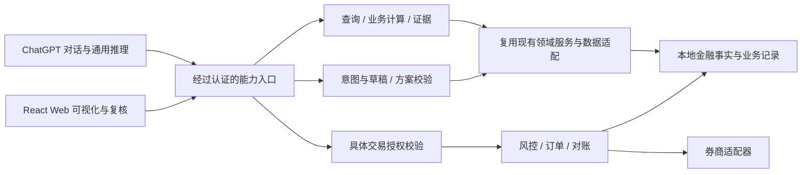

# WealthPilot 4.x 迁移影响初评

评估日期：2026-10-11（Asia/Shanghai）  
代码基线：`main` / `4da23b1868f3e6dae85a15383405aad3b15da5e3`  
配套证据：[WealthPilot_3x_Current_State_Audit.md](/Users/songbin/Documents/GitHub/WealthPilot/docs/WealthPilot_3x_Current_State_Audit.md)。

## 1. 方案判断

**建议以现有领域服务为核心，增加面向 ChatGPT 的受控能力入口，同时保留 React Web。** 财富、消费、组合、研究、规则、行情、计划和券商适配已有可复用实现；主要迁移成本在服务契约、身份与交易授权、持久化和常驻运行，而非财富管理功能重写。

本报告中的代码现状为【事实】，迁移动作为【建议】，由代码推导的影响为【推断】，尚无目标设备或平台实验支持的结论为【待验证】。建议不表示已实现，也不构成详细 PRD、接口设计或上线授权。

关键边界：

- ChatGPT 可承担对话、通用推理、表达偏好与一般解释；其记忆如何用于工具调用仍需实际账号 PoC。
- 后端继续掌握账户事实、资产分类、数据质量、计算规则、金融约束、授权校验、计划与订单状态；模型不能自行改变这些权威。
- React 继续提供图表、明细、纠错、导入和具体方案复核。是否通过 Web 完成最终交易确认，需要与对话授权方案一起验证。
- ChatGPT 入口不意味着立刻取消所有后端模型调用。研究提取、画像、截图识别、Embedding 和交易语义解析仍是实际依赖；逐项确定替代路径后才能下线。
- E 场景先保留关联和版本数据基础，完整绩效归因、复盘和策略优化留待后续版本。

【事实】main 已超过 v3.15.1 139 个提交，当前 `wealthpilot-personal-finance-v1.0` Tag 指向 HEAD。不能以旧稳定文档删减本次复用范围，也不能把六个本地未合并短期分支自动纳入迁移；分支详情见现状报告第 2 节。

## 2. A/B/C/D/E 场景影响

### A. 财富与投资数据查询

【事实】Portfolio 提供持仓、分类、负债、汇率与账户汇总；Wealth 将投资账户与手工资产/负债组合；Consumption 有明细、分类修订、退款、去重、来源覆盖和分析结果。主要查询能力已经存在。[Portfolio][portfolio]、[Wealth][wealth]、[Consumption][consumption]。

【建议】封装这些服务的业务输出，不开放原始数据库、任意文件读取或通用内部 `call_tool`。工具结果应区分已知金额、未知金额、查询失败与数据过期，并标明统计窗口、币种、分类、来源覆盖和成功同步时间；查询用户自己的数据也需要身份与账户范围校验。

【事实】Wealth summary GET 会写快照；Portfolio GET 可读取 Tiger 实时资产、失败回退。不能按 HTTP GET 直接声明工具为无副作用查询。[快照写入][wealth-summary]、[现金读取][portfolio]。消费主分析使用净额 projection，而财富现金流直接读取活跃 EconomicEvent 原额，两者还需统一解释或明确展示口径。[财富现金流][wealth-cashflow]。

【推断】A 是最适合先验证外部工具契约的场景，但其前提是纯查询语义与质量元数据清晰。当前收益与养老金去重结果应保留已有边界，不包装成完整绩效归因或已验证的持仓映射。消费账单导入仍以本地脚本为主；ChatGPT 文件导入不是既有能力。

### B. 投资组合分析与调仓建议

【事实】可复用 canonical economic asset classification、配置偏离/目标计算、纪律检查、持仓信号、研究/原则检索、技术形态证据和执行计划规则。现有 PEER 是同进程固定路由编排，数据准备与模型解释混合。[分类][classification]、[配置][allocation]、[Executing][executing]。

【建议】优先将“给出当前业务事实/计算结果”和“对结果作自然语言解释”分离。ChatGPT 可结合用户问题解释结构化结果；后端继续计算仓位、目标、价格/数量规则，并校验缺失信息、分类 UNKNOWN、证据引用和适用范围。

【事实】不同纪律入口的覆盖不同；旧 Order RiskEngine 仅三条 warning，总资产不可用时会跳过。Pattern 当前仅放行 9 个形态×资产类别 scope，且不能改变交易权威。[风险引擎][risk]、[Pattern registry][pattern-registry]。迁移不能把“有纪律工具”认定为所有阶段均实施完整纪律，也不能把形态证据升级为自动交易信号。

【推断】通用 Planning/Expressing、Education 和会话压缩是替换候选；专业计算、数据获取、硬校验和证据范围不能随 PEER 一起废弃。现有 `decision_engine` 有专业 Prompt、装配与计算混合，拆分应在后续任务通过契约复用完成，本次不修改该稳定底层。

【待验证】外部 ChatGPT 在缺失行情、证据冲突、多标比较、用户偏好与纪律冲突时能否达到当前可接受结果。现有 Offline M5 18/18 是回归基础，不证明 ChatGPT 接入后的实时回答质量；需另外验证工具组合与拒绝越权行为。

### C. 独立 Web 可视化

【事实】React 已有投资 Dashboard、Wealth、Consumption、Research、Profile、Discipline、Decision 和 Action 页面；养老、系统设置等仍为壳或占位。私有完整模式没有现成的生产静态托管分支，当前 CORS 也不是身份认证。[路由][web]、[启动][main]。

【建议】保留业务页面与 API 客户端，按实际完成度延续。Web 和 ChatGPT 使用同一领域事实与同一授权边界，防止出现一条入口有风险校验、另一条绕过的情况。对话页是否保留兼容入口，应依据迁移验收决定，而非先删页面。

【推断】需要改造生产静态托管、身份会话、远程网络配置、错误/数据新鲜度展示和涉及交易的授权续期。22 项现有 Playwright 本次通过，可以作为保留页面的回归基础；它们使用隔离 fixture，未证明远程身份、实盘或目标 Mac Mini 的可用性。

### D. 对话发起、用户授权、实际交易执行

【事实】当前有三种不同阶段：Typed Trade Intent 的理解确认；计划/策略或 Batch 的方案确认；最终实际下单。确认理解只写消息 metadata，不能视为下单授权。ExecutionBatch 仅支持冻结的 IBKR/USD/ALL_AVAILABLE_CASH/LSE USD Acc/BUY LIMIT Case 1 范围；不是通用组合调仓。[意图确认][intent-confirm]、[Batch 限制][batch-case]。

【建议】保留 OrderManager、状态机、风控、WhatIf、合约与现金权威、逐腿提交、撤单、轮询和对账。面向外部入口应分别控制查询、生成草稿、确认方案、实际提交和撤单权限；授权必须由后端验证认证主体、账户、具体方案版本/哈希、有效期及是否已消费。

【事实】当前明确文字、布尔值和版本字段均来自请求；Private Full Mode 没有统一认证 actor。AuditLog 的 user_id 可空；IP/User-Agent 不等于用户本人。[Action 提交][action-submit]、[Batch API][batch-api]、[AuditLog][audit]。因此现有确认流程可以复用其业务检查，不能直接继承为可靠远程授权。

【推断】“用户在 ChatGPT 说确认”与“该请求确实具备一次具体交易权限”之间需要新的证明链。平台确认 UI、MCP annotation 和后端风控各有职责，任何一项都不能代替其他项。最终确认放 Web 还是对话，需要 PoC 后决定；不预设平台允许或足以覆盖真实交易操作。

【事实】启动 orphan scan 可将无 broker_id 的 unknown 标为 cancelled；broker 接受与 DB commit 存在独立边界；当前幂等查询未配对应 OrderRecord 唯一约束。[启动扫描][orphan]、[提交][order-submit]、[模型][order-model]。

【建议】把重启恢复和不确定提交作为 D 场景的前置 Gate。未证实券商状态时应先对账，不能依赖模型重试或只凭本地状态重新下单。先以 Mock 故障注入验证；Paper/Live 验收需单独授权，本次不执行。

### E. 投资决策复盘与策略迭代

【事实】已有 Conversation/Message、部分 DecisionHistory、计划、Batch、订单、审计和 Pattern metadata，可建立后续复盘关联；DecisionHistory 回答截断至 500 字，完整 Explain 在进程内，重启后并不保留全部证据。[历史模型][history]、[Explain store][stores]。

【建议】4.0 保留可关联的决策、事实时间与数据来源、规则/策略版本、方案确认版本、授权及实际订单/成交记录。模型、Prompt 或算法版本与证据结果应能定位到具体决策，避免以后只能用聊天摘要猜测当时依据。具体字段和保留周期在后续设计中确定。

【事实】Wealth 的快照盈亏差、PerformanceAnalysis 的持仓盈亏解释、Pattern 的校准实验都不是完整交易绩效复盘。未发现决策与实际收益误差归因、策略版本优化闭环。[Performance][performance]、[Wealth][wealth-summary]。

【推断】E 的首要依赖是 D 的真实成交/撤单/对账和 B 的可复核证据；先补数据基础即可，不应借 4.0 迁移提前引入策略自动更新或自动交易。

## 3. 模块级处置矩阵

“保留”指继续使用业务实现；“封装”指增加外部契约；“改造”指现有边界不足；“废弃候选”必须先查引用并完成替代验收；“后续迭代”不作为当前已实现资产。

| 模块 | 初评处置 | 场景 | 需要维持或改变的边界 | 当前依据 |
| --- | --- | --- | --- | --- |
| Portfolio / canonical classification | 保留 + 封装 | A/B/C | 分类 UNKNOWN、币种、归属、缓存/实时区别；查询不能静默将缺失转零 | [分类][classification]、[Portfolio][portfolio] |
| Wealth 手工资产/负债与汇总 | 保留 + 改造查询语义 | A/C | GET 快照副作用；养老金去重证据、现金流/归因口径 | [Wealth][wealth-summary] |
| Consumption 事件/解释/修订/分析 | 保留 + 封装 | A/C | 保留净额、去重、未换汇、来源覆盖；导入入口另评估 | [Analytics][consumption] |
| Allocation 计算、纪律和信号 | 保留 + 封装 | B/D | 规则版本与覆盖范围继续由后端决定 | [配置][allocation]、[风险][risk] |
| Tiger/Futu/IBKR/QMT 数据接入 | 保留 + 改造部署/状态契约 | A/B/C | optional 降级；Snowball/IBKR 命名耦合；QMT VM 外部依赖 | [同步][sync]、[IBKR 同步][ibkr-sync]、[QMT][qmt] |
| Research v1/v2 / 原则知识库 | 保留 + 封装 | B/E | 事实/观点/用户原则分开；Markdown 真相源，索引可重建 | [研究][research]、[知识配置][knowledge] |
| Pattern Data / TA-Lib / calibration registry | 保留 + 封装只读证据 | B/E | 合约/日历/收盘/调整契约；9 scope；不与普通 Kline 无条件合并 | [Pattern provider][pattern-provider]、[registry][pattern-registry] |
| Execution Plan Kline/factor/rule/validator | 保留 + 封装 | B/D | 规则数值、数据源 gate、Draft/Confirm 不等于下单 | [Kline][kline]、[规则][plan-rule] |
| Typed Trade Intent | 保留契约 + 评估解析替代 | D | ChatGPT 可以提取语言，但后端仍验证来源/缺失/范围，理解确认不授予交易权限 | [parser][intent-parser]、[confirm][intent-confirm] |
| ActionPlanner | 保留草稿能力 + 改造 | B/D | 有 LLM 数值推算；与确定性执行计划不同；内部 Skill 不可调用 | [planner][action-planner]、[Skill][action-skill] |
| ExecutionBatch | 保留 + 封装受限范围 | D/E | 当前 Case 1；通用多标卖买是后续能力，不能靠泛化 schema 宣称完成 | [Case][batch-case]、[提交][batch-submit] |
| OrderManager / BrokerAdapter / 状态机 | 保留 + 恢复改造 | D/E | DB/broker 不确定窗口、幂等/并发、unknown 对账、shutdown | [OrderManager][order-submit]、[IBKR][ibkr] |
| 风控、用户确认、审计 | 保留规则 + 改造身份/授权 | D/E | request 字段升级为可验证权限，保留所有业务再校验 | [Action][action-submit]、[Audit][audit] |
| React Web / API clients | 保留 + 改造运行入口 | A/B/C/D | 生产托管、认证、同一业务契约；占位页不算迁移成果 | [App][web]、[main][main] |
| PEER / LangGraph routing / SSE | 渐进替代候选 | B | 通用路由/解释转 ChatGPT；未完成等价验收前保持现有主路径 | [主链路][peer]、[Executing][executing] |
| SkillsLoader / Tool registry | 改造外部契约；内部按引用保留 | A/B/D | 13 文件≠12 loaded≠16 schemas≠17 executors；不是现成 MCP Server | [Loader][loader]、[registry][tools] |
| 后端 LLM 客户端与专业 Prompt | 逐调用点评估 | B/D | 研究/画像/视觉/Embedding 实际存在；不能整体删除或双重推理长期叠加 | [LLM][llm]、[processor][processor] |
| Conversation 摘要 / 内存 session | 对话入口替代候选；业务记录保留 | B/E | ChatGPT 偏好记忆不能替代画像、纪律或确认依据；历史证据持久化 | [History][history]、[stores][stores] |
| 旧 intent_engine 全引擎/stub flow、未使用 helper | 废弃候选 | B | 先引用核验；`app` 与 `decision_engine` 整体仍活跃，不能按目录版本删除 | [旧 orchestrator][legacy] |
| APScheduler / Poller / 数据库存储 | 保留能力 + 常驻改造 | A/D/E | 单实例所有权、持久水位、健康检测、恢复与备份 | [lifespan][main]、[DB][database] |
| 完整绩效复盘 / 策略持续优化 | 后续迭代；4.0 留基础 | E | 完整快照、版本、执行关联与收益口径，当前无闭环 | [History][history]、[Performance][performance] |
| Retirement / Tasks / 设置占位 | 后续迭代 | C | 501 接口和壳页不当作已存在异步平台或业务能力 | [Tasks][tasks]、[Retirement][retirement] |

## 4. ChatGPT / Skills / MCP 的接入影响

### 4.1 应验证的服务边界

以下为【建议】的逻辑边界图，不是当前已部署架构，也不限定 SDK、进程划分或接口名称：

【事实】现有盈米 MCP 只是向外调用 Client；现有 Skills 是项目内部文件与 Python 分派；缺少 WealthPilot 对外 MCP Server。[MCP Client][mcp-client]、[Loader][loader]。

【建议】以实际服务和结果模型为封装线索，给专业能力提供有限、明确的输入输出、错误和权限边界。内部完整 `data_loader.load()` 含模型/研究/网络装配，不能当作简单持仓查询原样外放。输出摘要和聚合数据应按场景最小化，凭证、账户敏感标识和原始账单不进入工具返回。[Loader 装配][data-loader]。

【待验证】在本用户实际 ChatGPT 账号/工作区中，Skills 如何安装、触发并使用已认证的 MCP，是否可以达到预期私有使用方式。现有 SKILL.md 的 type/entry_point/tool_name 是 WealthPilot Loader 契约，不代表与 ChatGPT 安装协议兼容；也不能假设 ChatGPT 用户记忆有可供 MCP 任意读写的稳定接口。

### 4.2 平台文档支持与未知项

以下为 2026-10-11 查阅的官方文档事实，不是本项目验收结果：

- MCP 服务使用 Streamable HTTP 接入，工具结果可提供结构化内容。`readOnlyHint` 应对应真实无写入能力；权限与业务校验仍需服务端实施。现有 Wealth GET 的快照写入应先处理或如实标注，不能仅给工具加“只读”名称。[OpenAI MCP server 文档](https://developers.openai.com/plugins/build/mcp-server)
- 私有数据与写操作需要服务端认证/授权；OAuth 2.1 及受保护资源发现、Token 校验是接入边界。工具返回和模型文本不能成为凭证通道，客户端或平台认证也不能替代账户业务权限。[OpenAI authentication 文档](https://developers.openai.com/plugins/build/auth)
- Secure MCP Tunnel 是私有网络接入的候选，需要相应 Platform tunnel 权限、ChatGPT 工作区接入资格以及持续运行的本地客户端；是否对本用户可用须 PoC。面向公开发布的插件仍有稳定公共 HTTPS 等要求，不能将“存在隧道文档”视为已获准公开发布。[OpenAI secure MCP tunnel 文档](https://developers.openai.com/api/docs/guides/secure-mcp-tunnels)、[MCP server 文档](https://developers.openai.com/plugins/build/mcp-server)

【待验证】选择公网 HTTPS、私网加隧道或其他受控远程方式；账号权限、工具审批体验、交易类工具的平台要求、连接可靠性和成本。**本报告不承诺 ChatGPT 平台接受真实交易执行工具，也不把平台确认当作后端交易授权。** 网络方案应由这些实验决定，而不是先把当前无认证 API 暴露公网。

### 4.3 通用 AI 与专业能力的归属

| 能力 | 建议归属 | 不能丢失的约束 |
| --- | --- | --- |
| 普通问答、语言意图、通用解释、表达偏好 | ChatGPT 优先 | 外部语言结果进入业务仍需校验；无可靠记忆接口假设 |
| 用户风险目标、配置纪律、账户权限 | 后端真相源；ChatGPT 可读取/建议修改 | 修改需明确确认与版本，不能由聊天记忆静默覆盖 |
| 分类、配置偏离、技术因子、计划数值 | 后端专业服务 | 算法/规则范围、来源与缺失状态 |
| 投研提取、画像总结、视觉识别 | 逐项 PoC 决定 | 当前后端 AI 功能实际存在，不提前宣称零 LLM |
| 原则/研究知识检索与 Embedding | 现有本地知识系统优先保留 | Markdown 真相源、索引可重建；文本外传边界如实告知 |
| 硬格式与业务校验、风控、授权、提交、对账 | 后端 | 模型输出与平台 UI 均不能替代 |
| 未来复盘中的语言总结/策略假设 | ChatGPT 或专用分析后续评估 | 假设与历史事实分开，策略修改不能自动变成交易 |

【事实】当前后端已将持仓/盈亏/画像 JSON、部分图片和知识文本发送 OpenAI；“本地落盘”不意味着输入不出本地。[模型 payload][llm-payload]、[发送][llm-call]。4.0 用 ChatGPT 接收同类业务信息会改变传输与权限路径，但不是首次引入云模型。应评估实际数据流，不依据旧隐私口号推断。

## 5. Mac Mini 与 7×24 运行影响

| 重点 | 当前证据 | 初评 |
| --- | --- | --- |
| 原生 ARM 可复现性 | 当前宿主 ARM，指定 Python 是 x86_64；依赖未完整固定，Keyring/Excel engine 未显式列全 | 【建议】目标机干净原生环境验收 TA-Lib、Chroma、券商 SDK、Keychain 和全部实际导入入口；现有测试结果不能替代 |
| IBKR Gateway 生命周期 | Adapter 独立 loop/thread，按需连接；Pattern 独立只读 clientId；真实 adapter shutdown 未在 main 显式调用 | 【待验证】Gateway 登录/认证续期、夜间维护、断线重连、clientId 并发、无人登录时服务行为；不能承诺永不人工介入 |
| 服务与调度所有权 | 每个 lifespan 启动 cron、trigger 和 poller；APScheduler 内存，水位进程内 | 【建议】先验证单实例常驻，再决定任务拆分；多 worker 不能直接作为扩容方法 |
| 睡眠/重启恢复 | 仓库无完整 launchd/生产 supervisor；startup 可能改订单状态 | 【待验证】macOS 睡眠/唤醒、自动启动、网络恢复和停机补扫；未对账不能恢复交易权限 |
| 数据源拓扑 | Futu optional；Tiger 凭证有多条配置路径；QMT 依赖远端 VM 网关 | 【建议】Mac Mini 保留外部适配边界，明确故障/过期状态；不能认为换 Mac 就消除 Windows/网关依赖 |
| 私有 Web 与远程身份 | 没有完整生产托管、TLS/认证配置 | 【建议】接入方案与统一身份 PoC 后再部署；仓库外已有设施仍需核实 |
| 数据备份 | 有消费导入前 SQLite backup，缺完整常驻备份/演练证据 | 【建议】覆盖业务 DB、知识文件、必要 checkpoint、配置版本；Keychain/密钥单独规划受控恢复，不能把凭证放 Git/普通报告 |
| 健康与故障检测 | health 只回 ok；无完整 Gateway/任务/数据新鲜度 readiness | 【建议】运行是否存活与业务是否可用分别验收；故障状态要影响读取可信度与下单权限 |

依据：[启动/调度][main]、[IBKR][ibkr]、[数据库][database]、[备份脚本][backup]、[requirements][requirements]。本次未检查目标 Mac Mini、系统 LaunchAgents、Keychain、域名或真实 Gateway；以上缺少仓库证据不代表用户机器上一定没有配置。

## 6. 关键技术 PoC 与决策 Gate

以下是后续实验问题与验收方向，不是本次开发计划或实际实验结果。默认合成数据、隔离 DB、Mock、禁止真实下单；涉及 Paper/Live、真实凭证或个人数据的实验需另行明确授权。

| 优先级 / PoC | 要解决的问题 | 最小验证方式 | 决策所需证据 |
| --- | --- | --- | --- |
| P0-1 ChatGPT 私有接入与身份 | 本账号可用何种 MCP/Skills/远程方式？认证如何绑定用户？ | 最小合成查询工具，验证实际账号资格、HTTPS/隧道、OAuth、过期/无权限请求 | 可重复调用、服务端拒绝越权；确定网络/平台边界，仍不等于获准真实交易 |
| P0-2 交易授权与重放 | 对话确认能否绑定账户、具体版本与一次执行？ | Mock 下过期、改价/改量、变更版本、重复点击、并发请求、错误账户 | 被篡改或过期授权拒绝；重复请求不增加真实执行次数；操作有可定位 actor |
| P0-3 IBKR 不确定窗口恢复 | broker 接受后、本地 commit 前崩溃怎么恢复？ | 先 Mock 故障注入到各边界；构造无 broker_id、permId/orderRef 与重启扫描 | 未证实状态保持不确定；对账能找回原单，不误取消、不重复提交；明确纸面/真实验证余项 |
| P1-4 查询纯度与数据质量 | GET/外部查询会否写状态或将错误当零？ | 隔离库调用前后对照；模拟未同步、来源故障、FX 未知、退款/排除与手工资产 | 查询权限和实际副作用一致；质量/时间/口径可复核；A 输出不误称实时完整 |
| P1-5 ChatGPT 替代通用 PEER | 工具组合和解释是否满足五意图及多标决策边界？ | 使用现有 M5 场景及新增外部契约样本；真实模型实验另统计质量/延迟/成本 | 数值/引用可追溯；缺失/冲突正确处理；现有 18/18 不退化，外部入口独立验收 |
| P1-6 偏好记忆与金融事实 | ChatGPT 偏好与本地风险/纪律冲突如何处理？ | 合成偏好/规则冲突，跨会话与无记忆环境测试；核实是否有受支持的读写方式 | 无记忆也正确；不能覆盖金融约束；不能依赖不可导出/不可验证记忆作授权 |
| P1-7 ARM 与常驻生命周期 | 原生依赖、Keychain、Gateway、睡眠/重启能否稳定？ | 目标 Mac Mini 干净原生安装；隔离 Mock 长时运行、网络/进程故障、调度补偿 | 可复现启动与恢复；无重复 poller/任务；真实 Gateway 只读/交易测试分别明确范围 |
| P1-8 备份与恢复 | 能否恢复业务、知识和关联证据并安全启动？ | 合成库 SQLite 一致性备份，独立目录恢复与索引重建，交易禁用启动 | 数量/关键关联一致、知识可重建、未知订单先对账；记录恢复耗时与遗失范围 |
| P1-9 E 场景数据基础 | 重启后是否能解释某次建议和实际执行结果？ | 合成决策→方案→授权→部分成交/取消→重启→关联读取 | 能定位事实/版本/证据/实际结果；缺失明确，不能用聊天摘要补造历史 |
| P2-10 测试目录与契约治理 | 当前 Gate 是否遗漏迁移会影响的服务？ | 隔离运行遗漏目录；处理旧模块 mock、事务 fixture 与 schema 断言债务 | 明确测试范围、无导入污染；新入口与共享规则都有回归证据，不只默认 pytest 全绿 |

【推断】P0-1 决定接入路线，P0-2/P0-3 决定 D 能否远程开放；P1-4/P1-5 决定 A/B 的可信度；P1-7/P1-8 决定常驻运行资格。PoC 未通过前可以继续保留本地 Web 与现有受限流程，不需要创建另一条决策 feature flag 主链路。

## 7. 初步范围与后续方案要回答的问题

【建议】4.0 优先复用 A/B/C 的已实现服务，建立认证与工具契约；D 保留现有交易能力，但远程执行需通过授权与恢复 Gate，且支持范围明确到现有产品/市场/订单类型。E 先保留证据和执行关联，不承诺完整策略迭代。

后续方案必须给出可检验答案：

1. 使用哪个实际可用的 ChatGPT 接入方式，公网/私网边界与账号资格是什么？
2. 首批开放哪些专业能力，其数据新鲜度、统计口径、副作用和账户权限如何表达？
3. 最终交易确认在哪里发生，后端如何证明这次具体授权并拒绝重放/方案变化？
4. 是否继续限定 Case 1 与既有单标执行范围，哪些调仓能力明确留待后续？
5. 哪些后端 AI 调用先保留，通用 PEER 替代通过什么质量 Gate 后才能下线？
6. Mac Mini 的进程、Gateway、任务、凭证、备份和对账由什么机制维持，哪些仍需人工介入？
7. 4.0 必须保留哪些复盘证据，完整收益与策略优化如何避免提前扩张范围？

本次审计证据支持：默认 pytest **896 passed / 7 skipped**、Offline M5 **18/18**、前端 lint/build 通过、现有浏览器 **22 passed**；补充消费测试 **275 passed / 1 failed**，旧 Graph 测试与收集污染存在基线债务，环境/凭证/Loader 在匹配合成前提后通过。详见现状报告第 8 节。质量门通过说明现有复用基础可用，不能替代上述远程身份、实盘恢复与整机运行验收。

本报告只作迁移影响初评。此次未修改业务代码、生产数据库、账户或订单状态；未创建迁移分支、提交、合并、推送或发布 Tag。

## 8. 当前代码证据定位

链接行号对应所记录 HEAD；报告中的建议均由上述现状推导，不能作为功能已完成的证据。

[portfolio]: /Users/songbin/Documents/GitHub/WealthPilot/backend/services/portfolio_service.py:41
[wealth]: /Users/songbin/Documents/GitHub/WealthPilot/backend/services/wealth_service.py:247
[wealth-summary]: /Users/songbin/Documents/GitHub/WealthPilot/backend/services/wealth_service.py:437
[wealth-cashflow]: /Users/songbin/Documents/GitHub/WealthPilot/backend/services/wealth_service.py:375
[consumption]: /Users/songbin/Documents/GitHub/WealthPilot/backend/services/consumption/analytics.py:49
[classification]: /Users/songbin/Documents/GitHub/WealthPilot/backend/services/instruments/classification.py:216
[allocation]: /Users/songbin/Documents/GitHub/WealthPilot/backend/services/allocation_service.py:33
[executing]: /Users/songbin/Documents/GitHub/WealthPilot/backend/agents/executing_agent.py:71
[risk]: /Users/songbin/Documents/GitHub/WealthPilot/backend/services/action/risk_engine.py:53
[pattern-registry]: /Users/songbin/Documents/GitHub/WealthPilot/backend/services/technical_patterns/calibration/runtime_registry.py:316
[pattern-provider]: /Users/songbin/Documents/GitHub/WealthPilot/backend/services/technical_patterns/runtime_provider.py:41
[web]: /Users/songbin/Documents/GitHub/WealthPilot/frontend/src/App.tsx:25
[main]: /Users/songbin/Documents/GitHub/WealthPilot/backend/main.py:32
[intent-confirm]: /Users/songbin/Documents/GitHub/WealthPilot/backend/services/trade_intent/persistence.py:39
[intent-parser]: /Users/songbin/Documents/GitHub/WealthPilot/backend/services/trade_intent/parser.py:165
[batch-case]: /Users/songbin/Documents/GitHub/WealthPilot/backend/services/execution_batch/service.py:207
[batch-submit]: /Users/songbin/Documents/GitHub/WealthPilot/backend/services/execution_batch/service.py:892
[action-submit]: /Users/songbin/Documents/GitHub/WealthPilot/backend/api/action.py:720
[batch-api]: /Users/songbin/Documents/GitHub/WealthPilot/backend/api/execution_batch.py:259
[audit]: /Users/songbin/Documents/GitHub/WealthPilot/backend/services/action/models.py:239
[orphan]: /Users/songbin/Documents/GitHub/WealthPilot/backend/services/action/order_poller.py:116
[order-submit]: /Users/songbin/Documents/GitHub/WealthPilot/backend/services/action/order_manager.py:491
[order-model]: /Users/songbin/Documents/GitHub/WealthPilot/backend/services/action/models.py:180
[history]: /Users/songbin/Documents/GitHub/WealthPilot/app/models.py:387
[stores]: /Users/songbin/Documents/GitHub/WealthPilot/backend/services/decision_service_v3.py:734
[performance]: /Users/songbin/Documents/GitHub/WealthPilot/decision_engine/llm_engine.py:524
[sync]: /Users/songbin/Documents/GitHub/WealthPilot/backend/api/broker_sync.py:101
[ibkr-sync]: /Users/songbin/Documents/GitHub/WealthPilot/backend/services/broker_sync/snowball/sync_service.py:35
[qmt]: /Users/songbin/Documents/GitHub/WealthPilot/backend/services/broker_sync/guojin/sync_service.py:1
[research]: /Users/songbin/Documents/GitHub/WealthPilot/backend/services/research_service.py:267
[knowledge]: /Users/songbin/Documents/GitHub/WealthPilot/backend/config/knowledge.yaml:1
[kline]: /Users/songbin/Documents/GitHub/WealthPilot/backend/services/execution_plan/kline_provider.py:301
[plan-rule]: /Users/songbin/Documents/GitHub/WealthPilot/backend/services/execution_plan/rule_engine.py:68
[action-planner]: /Users/songbin/Documents/GitHub/WealthPilot/backend/services/action/action_planner.py:97
[action-skill]: /Users/songbin/Documents/GitHub/WealthPilot/skills/wp-action-planner/SKILL.md:3
[ibkr]: /Users/songbin/Documents/GitHub/WealthPilot/backend/services/action/brokers/ibkr.py:168
[peer]: /Users/songbin/Documents/GitHub/WealthPilot/backend/services/decision_service_v3.py:96
[loader]: /Users/songbin/Documents/GitHub/WealthPilot/backend/skills/loader.py:65
[tools]: /Users/songbin/Documents/GitHub/WealthPilot/backend/graph/tools.py:1155
[llm]: /Users/songbin/Documents/GitHub/WealthPilot/decision_engine/llm_engine.py:114
[processor]: /Users/songbin/Documents/GitHub/WealthPilot/research_v2/processor.py:72
[legacy]: /Users/songbin/Documents/GitHub/WealthPilot/intent_engine/orchestrator.py:38
[database]: /Users/songbin/Documents/GitHub/WealthPilot/app/database.py:16
[tasks]: /Users/songbin/Documents/GitHub/WealthPilot/backend/api/tasks.py:22
[retirement]: /Users/songbin/Documents/GitHub/WealthPilot/frontend/src/pages/Retirement.tsx:5
[mcp-client]: /Users/songbin/Documents/GitHub/WealthPilot/backend/mcp_client/yingmi_client.py:34
[data-loader]: /Users/songbin/Documents/GitHub/WealthPilot/decision_engine/data_loader.py:1
[llm-payload]: /Users/songbin/Documents/GitHub/WealthPilot/decision_engine/llm_engine.py:1639
[llm-call]: /Users/songbin/Documents/GitHub/WealthPilot/decision_engine/llm_engine.py:1834
[backup]: /Users/songbin/Documents/GitHub/WealthPilot/backend/scripts/import_consumption_statements.py:152
[requirements]: /Users/songbin/Documents/GitHub/WealthPilot/requirements.txt:1
