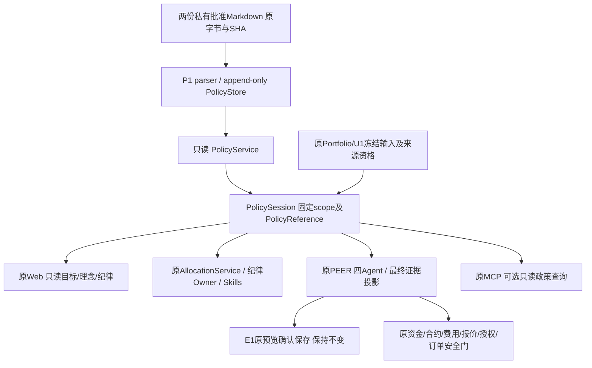

# 投资政策 P2：统一消费者接入（本地候选）

后续[P3-B正式发布者](INVESTMENT_POLICY_P3B.md)补充本地可信操作员审批/安装/发布/回滚收据及隔离副本迁移；以下“P2无真实Publisher”为阶段事实。未部署、未生产激活，不能由本地演练推定生产共库或迁移就绪。

状态：LOCAL_CANDIDATE / PRODUCTION_NOT_ACTIVE。内容批准不等于激活；本页不授权发布、真实政策激活或交易。[P1](INVESTMENT_POLICY_P1.md)保存原文与确定性派生，[统一架构](UNIFIED_INVESTMENT_DECISION_ARCHITECTURE.md)保持原PEER与数据Owner。本轮不修改两份私人批准原文，不将原文、真实配置或私人派生数据提交Git。

## 1. 范围及Owner

风险等级L2；真实迁移/激活属于后续另行授权的L3。需求为所有已迁移消费者共享一个PolicyReference和规则语义；非目标为新Agent/规则引擎/RAG、交易许可、生产配置补证、自动研究或政策自由编辑。

| Owner / 入口 | 本地实现 | 边界 |
|---|---|---|
| [runtime](../../backend/services/investment_policy/runtime.py) | 固定服务端scope、每次分析pin、ContextVar线程传递、版本冲突拒绝；按portfolio/position/risk/full/理念投影 | 不初始化、不缓存旧默认、不取资产或Provider |
| [PolicyService](../../backend/services/investment_policy/service.py) / [store](../../backend/services/investment_policy/store.py) | 原文/hash/结构化hash/批准及发布时钟复核；只读连接 | SQL重复键REPLACE与UPSERT不可改历史；旧未加固库仅只读，写入报需升级 |
| [consumers](../../backend/services/investment_policy/consumers.py) / [evaluation](../../backend/services/investment_policy/evaluation.py) | 纯预算/集中度/大类偏离诊断，来源条款 | 人工复核不改成硬持仓限额；无精确执行数量 |
| [AllocationService](../../backend/services/allocation_service.py) | 原五类展示复用中性目标聚合，原细分目标保留；条件性预算不等于计划 | 合格全分母与桶证据不足时UNKNOWN；不查单券商分母替代 |
| [原组合告警](../../app/analyzer.py) / [Portfolio Service](../../backend/services/portfolio_service.py) | 原check_deviations/get_alerts也使用同一诊断；UNKNOWN数值为空而非0 | 不沿用旧区间/杠杆档位，不以旧投资账户分母宣布安全 |
| [纪律Owner](../../backend/services/discipline_service.py) / [engine_runner](../../app/discipline/engine_runner.py) | ACTIVE不再使用旧静态/动态投资阈值，旧编辑入口拒绝 | 独立执行门继续；UNKNOWN不是纪律全部通过 |
| [graph/tools](../../backend/graph/tools.py) | 原load/check/signals/retrieve入口；旧数值及未证明版本的理念索引隔离 | 不修改内部Skill契约；不重建Chroma |
| [snapshot_chat](../../backend/services/snapshot_chat.py) | 原Web固定快照子进程从输入到后处理同pin，父进程IPC后核对mode/reference再存储/发布 | ACTIVE拒绝旧target_versions；不改变资产Owner或启动原backend lifespan |
| [decision_service_v3](../../backend/services/decision_service_v3.py) / [analysis adapter](../../pocs/chatgpt_skills/analysis.py) | 原PEER及MCP适配全程同pin；SSE/最终结果/多标的归档均复核 | 不增加模型调用；不把LLM任意价量字段当合格输出 |
| [Web边界](../../frontend/src/components/InvestmentPolicyBoundary.tsx) / [API](../../backend/api/discipline.py) | 原页面LEGACY不变；ACTIVE只读来源、目标与UNKNOWN；不可核验时不挂载旧编辑器 | 不是政策编辑、审批或激活界面 |
| [MCP server](../../pocs/chatgpt_skills/server.py) | 可选只读get_investment_policy_context，原Worker接收固定政策配置 | 无任意DB路径/scope租户参数；不刷新资产、运行PEER或写E1 |

## 2. 状态、权限与一致性

未配置`WEALTHPILOT_POLICY_DB_PATH`时LEGACY；配置但没有有效发布收据时NOT_ACTIVE/LEGACY；显式配置读取失败、scope错误或版本冲突为UNAVAILABLE，禁止静默回旧规则。`WEALTHPILOT_POLICY_SCOPE`必须匹配服务端`portfolio:<id>`。单次分析从入口到最终MCP适配保持同一个PolicySession；每个consumer及最终输出核对最新可验证PolicyReference，版本切换丢弃缓冲结果并报冲突。SSE在配置政策时缓冲，ACTIVE只发最终证据合格文本，不泄露中间LLM原文。

P2唯一发布者[publisher.publish_synthetic](../../backend/services/investment_policy/publisher.py)没有HTTP/MCP/CLI入口，只接受两份源文件都以`# SYNTHETIC ONLY`开头的本地fixture。真实批准文件即使被调用者标成synthetic也会拒绝。本轮没有真实激活命令；生产迁移仍NOT_READY。

已存在P1 schema缺少防REPLACE触发器时，读历史仍可用，写入明确拒绝；不隐式迁移任何原库。新候选库初始化包含全部不可变约束，CAS和request_id绑定完整payload。

## 3. 数据与输出资格

`PolicyAssets`为内部来源Owner资格收据，必须绑定同一portfolio和冻结snapshot_id，**不是MCP输入字段**。资格同时要求：正且有限的可投资资产分母、FX、养老金排除、跨账户去重、外部资产覆盖证明、完整性及带时区时点。旧U1的投资账户资格不会被自动升级为完整政策分母；未带合格收据的旧冻结输入仍可用于原事实研究，政策精度维持UNKNOWN。

发行人/份额/ETF穿透身份仍归原Owner；不猜别名、不按显示名称拼接。完整性不足可报告可证明的风险下限，不能宣布安全。桶权重也逐项校验时点、有限数值、范围和总和；大类偏离从原始大类权重与pin目标计算，不接收旧预计算偏离替代。

旧DataLoader输出在ACTIVE进入模型前复制并隔离：旧四数值格式槽显示`NOT_APPLICABLE_USE_POLICY_REFERENCE`，旧full_discipline_rules和未版本化原则检索不作正式政策。保留原事实证据与有界结构化政策，而非让LLM重算Markdown。

最终输出复用原Evidence/Output Policy的事实与数字绑定，只保留合格事实、验证解释、PolicyReference及未知；不靠正则黑名单过滤交易词。精确股数、金额、任意模型动作与原始文本不属于此阶段合格输出；多标的存储和Explain保留同一安全副本。条件性配置计划为空并标明未获资金/债务/执行资格，不能据此声称无业务风险或交易获批。此保守投影可能减少自由表达，真实输出体验待后续授权验收。

## 4. 用户入口与兼容性

- Web：原用户画像/纪律/资产配置页面；新增`GET /api/discipline/policy-context?view=portfolio`，view支持portfolio/position/risk/full/philosophy。固定原app.state portfolio，不接收DB路径。ACTIVE原规则/手册/理念写入口409；未配置保持原行为。旧杠杆档位只在LEGACY展示。
- MCP：仅显式配置私人政策库时注册`get_investment_policy_context(scope="portfolio"|"position"|"risk"|"full", symbol?)`。默认工具集不变；完整原18项环境合成启用后19项。查询只读、无Worker/PEER/券商/订单调用。
- PEER：沿用原四Agent，线程ContextVar传递；没有新增Agent或修改decision_engine核心。原Tool/Skill名称及内部SKILL契约不变。
- E1：不改schema/保存内容/人工确认/monitor；可传递已有PolicyReference契约，不强制回填历史。E1正式持久化PolicyReference留待明确后续切片，不能宣称本轮已落库。

## 5. 验证及后续门禁

规则/消费者测试：[P1](../../tests/test_investment_policy.py)、[P2](../../tests/test_policy_integration.py)。浏览器展示隔离：[policy-boundary](../../frontend/tests/e2e/policy-boundary.spec.ts)。独立MCP协议：[P2 protocol](../../pocs/chatgpt_skills/test_policy_protocol.py)，使用真实SDK客户端与合成服务端会话、私有临时SQLite；不是生产ChatGPT或Tunnel验收。四项现有CI保持；新增协议测试纳入原MCP Gate，文档纳入[检查器](../../scripts/check_engineering_docs.py)。每次实际运行结果见私人交付，不用历史测试数量冒充本轮。

P3前必须补齐生产私人理念、custom/official优先级、生效rules_config、缓存、索引资格；核验真实资产Owner完整分母/穿透资格；独立迁移预演、审批/版本收据、兼容备份回滚及exact HEAD四项CI；再取得个人Mac Mini访问、部署和政策激活的明确授权。P2不包含这些授权，也不提供未经批准的真实发布入口。

## P3-A集成候选

P1/P2在最新已集成main之上形成独立Draft PR候选，仍未部署或真实激活。受限Web的显式路由目录复用同一只读政策GET处理器，不加载完整Backend或开放纪律写接口，避免默认LEGACY页面查询404。客户端错误仅返回有界原因代码，文件系统异常、SQL或私人原文值不向Web/MCP传播。无真实Publisher、迁移、审批或交易权限扩张；具体PR/CI证据由本轮私人交付保存，不把代码集成视为生产迁移就绪。
