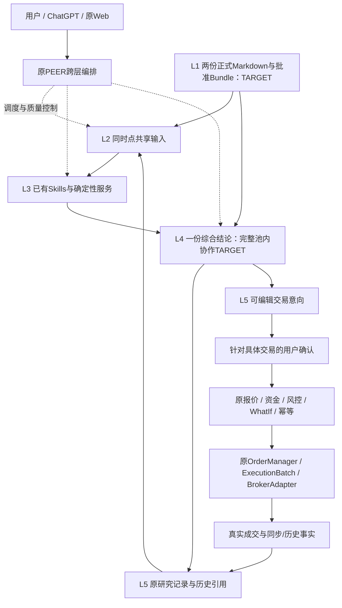

# 统一投资决策架构 v1.0

2026-10-30｜WealthPilot 4.3｜**READY_FOR_REVIEW / 文档方案，非功能上线**。

## 1. 定位与证据边界

本文件维护五层长期业务架构、复用映射和最小缺口；当前实现由[当前架构](../ARCHITECTURE_CURRENT.md)维护，能力入口由[原能力索引](../CAPABILITY_REGISTRY.md)维护，流程沿[治理](../PROJECT_GOVERNANCE.md)。不建立第二个Registry或策略Runtime。本轮仅修改文档，基线为实际fetch的main **4efcd14f3ff1dccaa69b625c4c7465bf4ca8d943**。

需求依据是用户批准的五层原则及私人交接《个人投资决策体系_统一架构与策略能力协作_增量交接_2026-10-30.md》，并复用10月29日《质量与估值_池内比较与排序_实施交接》。它们定义需求，不证明实现。目标池由用户提供，通常约十家、至多二十家公司；现有多标循环不是该目标池版本/排序接口。

本文状态用语：**CODE_VERIFIED**=本轮只读源码/加载检查；**HISTORICAL_RUNTIME_EVIDENCE**=此前验收证据，不代表今天全系统实时状态；**RESEARCH_ONLY**=外部研究工件；**TARGET/PROPOSED**=未实施。技能文件版本和研究方法版本不同；接口测试不能证明Alpha或交易许可。

本架构称L1—L5为**业务层**。原[Evidence](../../backend/services/market_data/evidence.py)/Output Policy中的L1方向、L2测算、L3精确建议、L4交易准备属于**证据资格级别**，不是本五层的层号。业务L4综合判断不授予证据资格L4，更不授权业务L5执行。

## 2. 五层定义及目标图（TARGET）

| 业务层 | 职责 | 不替代的职责 |
|---|---|---|
| L1 政策与配置约束 | 有效理念、合并投资政策、预算及人工治理，固定批准版本 | 不由策略、RAG片段或默认值自行决定正式政策 |
| L2 共享数据与证据 | 同时点目标池、持仓、价格、财报、事件、FX、来源和质量 | 不另建持仓、证券身份或价格真相源 |
| L3 可复用分析Skills | 明确问题、方法、输入输出、证据与适用边界，按需组合 | 不将每种Strategy注册成新Skill或重复算共享事实 |
| L4 综合投资决策 | 区分公司优先级与配置优先级，综合估值、质量、趋势、事件、政策与敞口，解释冲突 | 不投票，不将相关因子分数简单相加，不把未发现反证当已证实不变 |
| L5 决策、用户授权、执行与复盘 | 版本留痕、具体授权、原风控和交易服务、成交事实及复核 | 保存研究不是下单；预览、策略晋升不是具体交易授权 |

政策和质量限制贯穿全链路，不是一次进入L1就永远合格。每次分析按其真实时间重新核验，历史结论保持当时资格。

## 3. 现有五层能力与Owner映射（CODE_VERIFIED）

| 模块/源码入口 | 所在层/跨层关系 | 可复用实现与目前缺口 | 验收边界 |
|---|---|---|---|
| [Planning](../../backend/agents/planning_agent.py) / [contracts](../../backend/agents/contracts.py) | 跨L1—L4任务编排 | 意图、澄清、路由、selected_skills；无统一目标池版本和Bundle字段 | 可复用，不新增“第五Agent”；selected不证明实际调用 |
| [Executing](../../backend/agents/executing_agent.py) | L2/L3编排 | 装配、行情/研究/信号与错误隔离；部分直接Service调用 | 技能追踪需结合真实代码，不强行全改invoke |
| [Expressing](../../backend/agents/expressing_agent.py) | L4及L5输出 | 原模型推理、结构化结果，受Output Policy限制 | 多策略统一比较/冲突协议仍TARGET |
| [Reviewing](../../backend/agents/reviewing_agent.py) | 跨L3/L4质量控制 | 硬校验、模型评分、有限重试及fallback | 输出质量评分不等于投资价值评分或策略投票 |
| [decision_service](../../backend/services/decision_service.py) / [v3](../../backend/services/decision_service_v3.py) | PEER总编排及L5对话记录 | 原SSE/结果回调；position_single、portfolio、多标循环 | 多标串行单标/拼接不等于池内综合排名 |
| [SkillsLoader](../../backend/skills/loader.py) / [invoke_skill](../../backend/skills/__init__.py) / [Tool Layer](../../backend/graph/tools.py) | L3调度载体，可承载跨层复合能力 | 本地发现、类型分发、既有TOOL_EXECUTORS | 不存在需要新建的全局Skill Registry；发现表与manifest/路由表职责不同 |
| [Portfolio](../../backend/services/portfolio_service.py) / [models](../../app/models.py) / [U1](../../app/asset_views.py) | L2资产事实 | 既有账户归属、冻结snapshot_id、质量 | 存储持仓不是实时券商；不另建账户账本 |
| [AllocationService](../../backend/services/allocation_service.py) / [defaults](../../app/allocation/defaults.py) | L1消费者及L3计算，供L4使用 | 偏离、初始/增量配置、退出情景 | 旧范围目标不是获批统一政策；正式预算映射未落地 |
| [Evidence](../../backend/services/market_data/evidence.py) / [financial_research](../../backend/services/market_data/financial_research.py) / [Output Policy](../../backend/services/market_data/output_policy.py) | L2事实/资格与L3计算、L4输出限制 | 来源、财期/单位/币种、现金流及比较/有条件估值 | 不是完整质量模型、ROIC/DCF或池内排序平台；真实来源仍可能partial |
| [SEC](../../research_v2/sec_disclosures.py) / [Research Repository](../../research_v2/repository.py) / [KlineProvider](../../backend/services/execution_plan/kline_provider.py) / [technical evidence](../../backend/services/market_data/technical_evidence.py) | L2数据Owner及L3观测 | 复用公开披露、原始行情、日周线与确定性字段 | 抓取不等于当时已知；趋势观测不等于已验证动量策略 |
| [知识库](../../knowledge_base/README.md) / [理念](../../backend/services/philosophy_service.py) / [纪律](../../backend/services/discipline_service.py) / [config](../../app/discipline/config.py) | 现有L1片段及L2知识检索 | MD、JSON/默认、Chroma可重建索引，已有provenance | 两份正式业务文档及统一Bundle尚为候选；生产私人政策本轮UNKNOWN |
| [E1 contracts/store/service](../../backend/services/investment_thesis) / [bridge](../../backend/services/investment_thesis/bridge.py) | L2研究事实、L3事件分析输入、L5版本复核 | Thesis/Review双向证据、不可覆盖版本、CAS及确认保存 | 不是长期政策库；没有统一政策引用字段，历史不能回填当前规则 |
| [monitoring](../../backend/services/investment_thesis/monitoring.py) / [natural_scan](../../backend/services/investment_thesis/natural_scan.py) | L2事件发现及L5复核反馈 | opt-in、水位、task去重、人工处理 | 事件只触发复核；扫描及主动提醒分别验收，不自动运行PEER |
| [MCP server](../../pocs/chatgpt_skills/server.py) / [analysis](../../pocs/chatgpt_skills/analysis.py) / [worker](../../pocs/chatgpt_skills/worker.py) | ChatGPT适配，跨L2—L5 | 原start/get及AnalysisResult、固定scope、E1查询和确认保存 | 非第二个分析引擎；真实配置分支不注册Mock交易写工具 |
| [ActionPlanner](../../backend/services/action/action_planner.py) / [action API](../../backend/api/action.py) | L4→L5人工入口 | 对话翻译为可编辑ActionListDraft，原API落草稿 | LLM草稿数字不是已批准订单；直接服务调用不依赖发现成功 |
| [执行计划](../../backend/services/execution_plan/rule_engine.py) / [execution_plan API](../../backend/api/execution_plan.py) | L3确定性方案→L5草稿 | factors/规则产数字，LLM解释，复用原约束 | 计划生成不等于触发、风控通过或成交 |
| [RiskEngine](../../backend/services/action/risk_engine.py) / [OrderManager](../../backend/services/action/order_manager.py) / [Batch](../../backend/services/execution_batch/service.py) / [BrokerAdapter](../../backend/services/action/brokers/base.py) | L5授权执行 | 确认/版本hash/资金/WhatIf/账户/幂等及状态归并 | 业务L5确实包含执行；每笔仍须原授权和安全门，不直接从分析调用place |
| [fill_sync](../../app/fill_sync.py) / [历史域](../../backend/services/portfolio_history) / [trade_status](../../app/trade_status.py) | L5真实反馈到L2 | 原成交证据、同步覆盖、条件历史归因 | 不完整TWR，不从研究收益推导实盘表现；未知订单不自动重发 |

## 4. 真实路由与计数

本轮实际只运行SkillsLoader元数据发现，不invoke任何业务Skill。磁盘14份wp-*定义、Loader成功13项（均version=1.0.0）。action-planner frontmatter description内未转义的“trigger:”导致YAML ScannerError，Loader返回None，**不能把14份文件说成14项实际注册成功**。该问题不在本文档任务内修复。

[Tool Layer](../../backend/graph/tools.py)的TOOL_EXECUTORS静态有18项，是内部函数分派表；它与对外MCP18工具不是同一集合。额外的wp-fetch-kline、wp-fetch-fundamentals等invoked_skills标记没有对应SKILL.md，不能算独立Skill。[skill_manifest](../../backend/agents/skill_manifest.py)和[reconcile](../../backend/agents/skill_reconcile.py)是观测描述，不产生新执行Runtime或替代Planning。

当前路径：

1. 单标：Planning→Executing的load-context→并发纪律/信号/市场服务→decision_service_v3中的position_analysis.prepare→Expressing→Reviewing/输出重核。编排调用prepare后append证据Skill标记，prepare内部实际invoke该Skill；本轮同时核对两处源码，不能只据标记推断调用成功。
2. 组合：load-context→按意图宏观资料/清理research→prepare_portfolio→原review_portfolio/analyze_allocation/analyze_performance。配置计算由llm_engine的allocation context直接复用AllocationService；不是逐个执行Planning选中所有Skill。
3. 多标：decision_service_v3._handle_position_multi循环分析各标的并组合输出、重核证据；缺统一候选池冻结版本、共同决策时钟、跨公司适用性与排序契约。不是已有S3产品。
4. ChatGPT：原MCP start_position_analysis→同一job_id get_position_analysis_result；原PEER出专业结果，ChatGPT组织呈现。AnalysisResult显式status/evidence/data_quality/limitations、execution_authorized=false；失败不换ID自动重跑。E1保存另走预览与用户当次确认。

## 5. 全部内部Skills能力矩阵

下表版本**全部1.0.0**，证据为逐份读取的[skills目录](../../skills)和本轮Loader实际发现。类型F=function_call，P=prompt_inject，L=llm_dispatch，V=validation。“已接通”只表示源码路径，生产各Skill的独立验收没有因为旧整链路通过而全部升级。

| Skill（链接即定义）/类型 | 问题、输入→输出与来源 | 真实Tool/Service/Owner及PEER位置 | 重复/复用边界及成熟度 |
|---|---|---|---|
| [wp-load-context](../../skills/wp-load-context/SKILL.md) F/复合 | asset_name/portfolio/user_query→LoadDecisionContextOutput/LoadedData；画像、持仓、规则、观点/原则 | graph.tools.execute_load_decision_context→data_loader.load；Executing单标/组合入口 | 已发现/主路接通；内含持仓/研究，不要求再invoke所有原子Skill；可复用但含Provider/LLM兜底，不是纯读函数 |
| [wp-fetch-holdings](../../skills/wp-fetch-holdings/SKILL.md) F | portfolio→FetchHoldingsOutput；聚合投资持仓、市值/权重 | Tool fetch_holdings→position_aggregator；主路经load-context装配并填skill_results | 已发现/独立Tool存在；主路投影不证明独立invoke；不等于发行人ETF穿透 |
| [wp-fetch-research](../../skills/wp-fetch-research/SKILL.md) F | asset_name/portfolio→Tool实际QueryViewpointOutput；本地卡、相关在线/基金来源 | query_viewpoint_cards及related tools；data_loader集成，PortfolioReview直接search_portfolio_research | 已发现/主路复用相关服务；SKILL宣称list[str]与Tool包装不完全同型，不强行拆分；旧文字不等于已核财务 |
| [wp-check-discipline](../../skills/wp-check-discipline/SKILL.md) F | asset/action/portfolio→DisciplineCheckOutput及provenance；现有配置与持仓 | Tool check_discipline_rules→decision_engine.rule_engine；Executing明确invoke | 已发现/接通；简化单标检查不等于全部三引擎、正式政策或发行人穿透；保持旧来源未核验标志 |
| [wp-generate-signals](../../skills/wp-generate-signals/SKILL.md) F/内部复合 | asset/action/portfolio→GenerateSignalsOutput；loaded/rules/research | Tool generate_signals→data_loader+rule_engine+signal_engine；Executing invoke | 已发现/接通；内部再次装配可能重取资料，未来共享冻结输入优先；raw关键词不证明质量，fundamental为UNKNOWN；不是S1/S2动量 |
| [wp-assess-position-evidence](../../skills/wp-assess-position-evidence/SKILL.md) F | market/research/view/symbol等→records/conflicts/资格/缺失 | Tool assess_position_evidence；原编排Expressing前调用position_analysis.prepare，其内部invoke；prepare_portfolio同样invoke | 已发现/证据主路接通；不能只把append当成功证据，已核对内部invoke；资格是确定性评估，不是新增分析Agent；真实案例允许partial |
| [wp-calc-allocation-deviation](../../skills/wp-calc-allocation-deviation/SKILL.md) F | portfolio→CalcDeviationOutput；旧配置目标/投资快照 | Tool calc_allocation_deviation→AllocationService；组合模型context也直接get_deviation | 已发现/Tool可复用；Planning可选择不代表Executing逐项调用；区间中点不是新版政策目标 |
| [wp-propose-allocation](../../skills/wp-propose-allocation/SKILL.md) F | portfolio/increment_amount→IncrementPlanOutput；目标、资金与快照 | Tool propose_increment_plan→compute_increment_plan；llm_engine配置上下文另按有无持仓调用initial/increment | 已发现/Service接通；建议自动修正非自动交易；Skill入口本身不是文档声称的所有初始/无金额分支 |
| [wp-retrieve-principles](../../skills/wp-retrieve-principles/SKILL.md) F | query/types/top_k→chunks与来源；MD派生Chroma | Tool retrieve_principles→KnowledgeStore；general按关键词invoke，单标/组合data_loader内部检索 | 已发现/接通；与research按source_type分工；top5片段不是有效政策全文；生产索引资格本轮UNKNOWN |
| [wp-reasoning](../../skills/wp-reasoning/SKILL.md) L | template/query/context→LLMResult/GenericLLMResult | Expressing直接原llm_engine.reason/review_portfolio/analyze_allocation/analyze_performance；general可经invoke chat | 已发现；Loader白名单目前仅general_chat，其他直接invoke抛NotImplementedError。模型/模板旧文不得当运行配置；L4复用此处不新增推理引擎 |
| [wp-citation-rules](../../skills/wp-citation-rules/SKILL.md) P | 无业务数值输入→规则body；引用格式规范 | Loader支持取body；Expressing记录citation_rules_applied，原llm_engine/Output Policy负责实际Prompt及资格 | 已发现；记录标记不能证明完整SKILL body动态注入；旧默认硬限/用户资料优先文字需将来对齐政策，不能优先于官方事实校验 |
| [wp-output-validator](../../skills/wp-output-validator/SKILL.md) V | result/intent/violations→ValidationResult | backend.graph.decision_validator.validate_decision_output；Reviewing默认invoke，有原兼容分支 | 已发现/接通；确定性输出检查，不证明真实来源或策略盈利；最新校验以代码而非旧“六档/99%”描述为准 |
| [wp-action-planner](../../skills/wp-action-planner/SKILL.md) F声明/旁路 | conversation/context/expressing→ActionListDraft | Web action API直接plan_actions；原ActionPlanner服务，无tool_name | **文件存在但Loader未发现**；即便修YAML，通用function_call缺tool_name仍非当前直接invoke路径。人工按钮旁路，不进Selector；可复用服务，不顺带修契约 |
| [wp-generate-execution-plan](../../skills/wp-generate-execution-plan/SKILL.md) F/复合旁路 | symbol/side/目标及价格资产等→ExecutionPlanDraft | execution_plan API invoke→Tool generate_execution_plan→factors→execution_plan.rule_engine→LLM解释 | 已发现/API接通；数字由代码、解释由模型；区别ActionPlanner不可信意向翻译；非PEER每轮默认执行，缺实际交易资格不执行 |

技能定义中历史“data/handbook_official.md”、gpt-4.1、自动迭代直到通过等说明不能替代实际代码。当前手册路径由discipline_service选择knowledge_base的custom/official，规则由app.discipline.config；模型由app.llm_config；配置修正次数以原Service为准。暂不为表格整齐改Skill类型、拆复合Skill或增新Skill。

副作用范围也按真实Owner核对：底层evidence.assess是确定性评估，但assess_position_evidence Tool对US会调用official_disclosures.collect补验官方原件，不能把整个Tool称为纯离线函数。load-context及generate-signals也可能经data_loader执行研究/Provider读取。本轮只做元数据发现，未执行上述Tool。

验收索引：Loader [test_loader](../../backend/skills/test_loader.py)、[Executing](../../backend/agents/test_executing_agent.py)、[Reviewing](../../backend/agents/test_reviewing_agent.py)、[M5](../../scripts/m5_e2e_18_cases.py)、[evidence](../../tests/test_v42_evidence.py)、[execution plan](../../backend/services/execution_plan/tests/test_rule_engine.py)、[MCP协议](../../pocs/chatgpt_skills/test_protocol.py)。这些是可复用测试入口，本轮文档任务未重跑全部业务测试。

## 6. 策略融合与成熟度清单

Strategy描述机会集、方法、比较基准、时序、成本及验证，而Skill封装可复用问题。下列均不新注册策略Skill。

| 方向 | 已有研究结果/外部证据 | 计算、Skill、PEER与生产状态 | 推荐组合及当前权限 |
|---|---|---|---|
| S1 ETF相对动量 | 私人S1-C0冻结报告：RETURN_RISK_TRADEOFF_ONLY、严格LEAN未通过；PM已结项不晋升 | 外部经济TR/排名/成本研究可追溯；WP无S1 Skill/自动策略接线/生产策略资格 | 保留研究协议、方法和失败经验，不重开轮动；必要时仅引用研究局限 |
| S2 个股动量 | S2-F1：INCONCLUSIVE_DUE_TO_DATA；完整机会集缺口、终止权益/PIT/行业限制；PM结项不晋升 | 外部脚本与代理经济计算不是WP已注册Skill或可交易策略 | 不把现有technical或generate-signals改称已验证Top10动量 |
| S2 成熟动量ETF | S2-G1：WATCHLIST_READY_WITH_DISCLOSED_LEAN_LIMITATIONS，SPMO重点关注；严格会计/买入权限未齐 | 产品研究与已批准配置可以引用；不是自研策略上线，也非无条件交易许可 | 复用Portfolio/Allocation/Evidence/集中度，配置比例仍由有效政策决定 |
| S3 质量与估值 | 10月29日池内比较交接：方法/情景/排序需求；聊天中的DCF数字不是可复算工件 | 原financial_research有财务比较/有限静态估值；无完整ROIC正常化/情景回报/敏感性/版本池内排序Skill或生产闭环 | TARGET：load-context+财务证据+确定性计算+reasoning+validator；仅明确缺口才扩Owner/新增Skill |
| S4 质量与动量协作 | 10月30日交接：候选，未批准独立立项/等待条件 | 原质量证据、日周线观测可复用，但没有已验证协作策略 | TARGET：在S3前提下弱趋势先复核经营/事件；均线实验不能硬挡加仓；未来公平比较直接/等待，含现金收益、未入场及机会成本 |
| E1 事件与Thesis/Review | 原E1本地、真人保存、提醒及SEC首水位历史证据 | 私人研究域和5项可选E1 MCP已实现；不是新内部Skill；主PEER按需研究，保存人工确认 | 直接复用历史版本与事件待办；保留partial、敞口UNKNOWN；水位后自然新事件仍待观察 |
| 异常偏离/低频均值回归 | 仅候选背景，无可访问验证报告或正式Strategy | 配置偏离计算和技术观测存在，但不是价格均值回归Alpha | TARGET复查线索；不能由跌幅/均值偏离直接生成抄底建议，不单独立项 |

**六种资格不能合并**：有研究工件→有可复用计算→有注册Skill→已接入PEER→取得限定生产验收→用户批准具体使用/交易。每一步均需自己的证据；某方向可以有代码而无策略有效性，E1有生产保存也不证明投资收益。

### 外部证据记录（只读）

本轮在个人4.3研究目录读取冻结报告/RESULT，未执行Redstone/LEAN或重新取数；未检索公司项目。外部源码不在本仓，**没有核验Redstone当前分支或脚本路径**，不能编造集成接口。

| 证据工件 | 本轮读取/sha256 | 结论范围 |
|---|---|---|
| S1-C0_2026-10-23/RESULT.json | 27d7b88cf9a2eaebffdb801568973b8a0697f2f0db8d6fe2a3ac7040a5af294f | 探索性经济TR，严格会计false；无策略晋升 |
| S2-F1_2026-10-27/RESULT.json | ae33697c77bff9eccb76a2f83725a63aae786ecaa53ede79c5d54b7a98e9032e | 数据不可判定，暂停后续工程 |
| S2-G1_2026-10-28/RESULT.json | 89932511e3d9135c33741b3e56bed1db049393300948dd61cf9c918ad789381a | 成熟ETF关注池，模拟/执行限制仍在 |

只留工件标识/hash和边界；私人原始行情、持仓及研究库不进入Git。完整本地证据位置随本轮私人交付收据保存。不同研究工件早期“可继续”的建议不覆盖PM后续S1/S2结项决定。

## 7. 生产证据与现状差异

本轮没有连接生产、调用模型/市场或券商。4.1交付边界见[结项](../releases/v4.1.md)；4.2代码和真实数据质量仍分别记录。main包含实现不证明当前运行main。

本对话2026-10-29曾读取Mac Mini PR59 FINAL_ACCEPTANCE收据：Backend/MCP/Worker运行4e4fdb4ea0831eb079cf96518f91d4397e326e05；18项工具、E1 v2及已有canonical记录不变；SEC四次HTTP200，首次76 accession，独立进程0新任务，测试monitor取消。真实Scheduled task/人类提醒此前通过，但**水位后自然新accession未发生**。状态应为E1_CORE_RELEASED_N1_NOTIFICATION_PASS_NATURAL_NEW_EVENT_PENDING；不是E1_RELEASED。AUTO_SCAN当时OFF、自建NOTIFICATION=NOT_WIRED。本轮未复测今天的状态；不能据旧收据保证当前配置。

E1真人Thesis/Review保存是限定功能生产验收；B2美团/NVDA/META原报告partial、真实仓位CANNOT_QUANTIFY及个人上限UNKNOWN不因保存成功改变。实际交易模块存在/历史特定路径验收不等于新入口、任意产品或策略有实盘资格。

本轮发现的文档漂移：当前架构仍写“13份SKILL.md”，实际14份/13成功发现；E1时钟修复仍写待发布，PR59历史收据已证首水位；部分SKILL中的老模型、旧路径、manifest/selected声明和真实调用不同。仅在本轮指定文档中纠正事实，不顺带改业务或所有历史说明。

## 8. 最小公共契约（全部PROPOSED，非已有API）

复用[Agent contracts](../../backend/agents/contracts.py)、[AnalysisRequest/Result](../../pocs/chatgpt_skills/analysis.py)、[E1 contracts](../../backend/services/investment_thesis/contracts.py)、[U1](../../app/asset_views.py)及[交易models](../../backend/services/action/models.py)，只补缺失引用；不引入全局新表或统一Runtime。

| 契约片段（建议名称） | 已有基础 | 最小新增/明确项与Owner |
|---|---|---|
| AnalysisTaskRef | task_id、question、symbol、scope、history、snapshot_id | 原分析任务增加目标池版本/hash、purpose、decision_as_of、逐公司身份/失败状态；目标池上限由产品契约验证 |
| PolicyRef | rules_provenance、StageTargets引用 | 原政策Owner两份正式MD版本/hash、批准/生效、派生配置hash、完整性；未正式落地则UNKNOWN |
| EvidenceSnapshotRef | U1 ID、Evidence records、research来源/时间 | 共享池内事实冻结引用，报告期/公布/known/fetched、币种单位/股份口径/修订/质量；由原数据Owner负责，不复制金额 |
| SkillResultRef | selected/invoked/skill_results及SkillMeta.version | 输入引用、方法/参数版本、确定性产物、解释/假设、适用性、证据ID、unknown/不适用和成熟度，区分真实调用与marker |
| StrategyResearchRef | 外部协议/报告hash | 机会集/方法/时序/费用/基准/验证窗、局限及批准使用范围；跟随结果附件，不新建全局Registry |
| IntegratedAssessment | 原ExpressionOutput/AnalysisResult | 公司与配置两类优先级、调用/跳过原因、共享证据去重、分歧解释、条件与复核；排名只能使用冻结确定性规则 |
| HumanDecision/IntentRef | E1 Review、ActionDraft、TypedTradeIntent | 结论到具体意向的关联、人工确认内容/hash/scope/时间；研究保存确认与交易确认分别记录 |
| Execution/ReviewLink | Batch/Leg/OrderRecord/execution、U2、历史域 | 真实成交/费用/同步覆盖与原分析/政策/方法版本引用，变化原因；历史不静默覆盖，不把计划收益当实际绩效 |

输入时点和引用必须贯通，但不强行改所有既有对象。新增字段的兼容、存储位置和索引先沿原Owner最小实现；本轮没有定义同名真实API或改Schema。

## 9. 综合判断与冲突处理（TARGET）

原PEER负责按任务按需调用、汇集并输出一份报告。确定性代码先对齐期间、币种、股份、证据ID和适用性；模型解释经营与假设，不重算持仓/排名/现金。Reviewer检查表述与证据，不能用其质量分代替投资排序。

优先处理正式政策约束和数据资格，然后解释经营质量、价格隐含预期、趋势与事件的不同含义，最后结合真实敞口。一个财报事实被质量、事件、估值重复引用时共享同一证据ID，不叠加成三份独立支持。质量好/价格贵/走势强须逐项陈述，允许“不足以配置”、并列、全池观察和部分成功；无可靠持仓或政策只交公司比较，配置层UNKNOWN。

弱走势先检查财报、竞争与事件是否变化；查不清应UNKNOWN。“没发现变化”不能升级为“已证实不变”。未验证均线/动量不成为禁止加仓硬门槛。未来等待策略比较必须同时计入未入场、等待现金、错过上涨、成本与退出，不能只统计成功入场。

## 10. L5授权、执行与复盘

分析结果→用户需要时原ActionPlanner/Typed Intent→原Web展示具体订单/资金/风险→本次用户明确确认→原RiskEngine/OrderManager/ExecutionBatch→BrokerAdapter→订单/成交观察→U2覆盖→历史复核。原权限、价格TTL、费用、FX、账户、预算、WhatIf、预览hash及幂等均继续生效。回忆、模型概率、研究成熟度不替代这些证据。

E1预览→保存判断属于独立研究留档路径；不创建订单。未知订单不补单，源失败不写成空账户，成交状态和同步覆盖分开。复盘引用当时政策/快照/方法，不用今日规则替代过去；真实TWR需完整现金流/历史FX，原当前盈亏不冒称具备。

## 11. Gap与最小实施顺序（PROPOSED，本轮未启动）

| 顺序/缺口 | 最小复用安排 | 验收而非扩项 |
|---|---|---|
| 1 L1统一政策 | 在原理念/纪律/knowledge Owner落实两文档及用户批准、派生、Bundle context；沿原StageTargets审批模式而不把临时阶段目标当正式政策 | 单标/组合读取同hash，缺政策UNKNOWN；旧规则冲突逐项批准；不改正式阈值 |
| 2 L2池内共享输入 | 扩展原AnalysisRequest/证据Owner提供目标池引用和共同截止，不复用多标循环为假排名 | 缺源局部失败、PIT/口径可追溯、共享事实不重复取算 |
| 3 S3最小分析 | 复用financial_research的比较/现金流，补正常化、资本效率、情景回报/敏感性等明确缺口；稳定后才判断是否需新Skill | 先可复算样例与方法适用性，再一次请求比较/解释/版本；不在本轮启动 |
| 4 L4统一输出 | 扩展原PEER/Expression及Review结果，不增Agent；复用E1版本留痕思路 | 一份综合结果区分公司/配置、冲突不投票，排名与方法版本绑定 |
| 5 S1/S2与S4 | S1/S2仅归档方法/结论，成熟ETF由有效政策引用；S4后续组合S3和技术证据 | 不复活不晋升策略；未经验证等待条件不能硬阻断；异常偏离只作复查 |
| 6 L5关联 | 沿原E1及Action/Batch/成交事实增加必要引用，原授权流程接线 | 研究保存不下单、具体确认才执行；历史引用不改写、UNKNOWN不盲重试 |

E1已完成核心工程，后续外部自然事件为观察项，不为等待另开开发阶段。Skill YAML/接口文档偏差只列维护缺口；不因架构整齐重构正常复合Skill。注册并验证一个Skill不等于批准一个Strategy，实际生产使用和交易仍按既有流程分别授权。

本轮停止：**READY_FOR_REVIEW**。没有新增Skill/MCP/Agent、运行配置或业务代码，没有生产访问、交易、S3/S4开发、push/merge/deploy。
